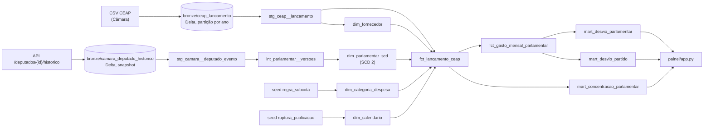

# Engenharia da Pipeline de Dados — Entrega E3 (Squad G8)

## Modelagem Dimensional, Testes de Domínio, Orquestração com Falha Controlada e Painel Analítico

> Documento técnico da Entrega E3. Os números foram medidos sobre os CSVs da CEAP baixados em 2026-09-28 e o histórico da API da Câmara extraído em 2026-11-03. A Câmara regera os CSVs, então um download em outra data traz contagens um pouco diferentes.

A E3 responde à pergunta da E1:

> *Quais parlamentares e partidos da 57ª Legislatura (2023–2026) apresentam maior desvio de
> gastos acima da média mensal da CEAP, e quais categorias e fornecedores concentram esses
> recursos?*



---

### Sumário

1. [Visão Geral da Arquitetura](#1-visão-geral-da-arquitetura)
2. [Camada Bronze e Ingestão Particionada](#2-camada-bronze-e-ingestão-particionada)
3. [Modelagem Dimensional: Fato com Grão Declarado](#3-modelagem-dimensional-fato-com-grão-declarado)
4. [Dimensão de Variação Lenta (SCD Tipo 2)](#4-dimensão-de-variação-lenta-scd-tipo-2)
5. [Testes que Verificam o que o Domínio Tem de Sujo](#5-testes-que-verificam-o-que-o-domínio-tem-de-sujo)
6. [Orquestração que Falha (Dagster)](#6-orquestração-que-falha-dagster)
7. [Painel que Responde à Pergunta (Streamlit)](#7-painel-que-responde-à-pergunta-streamlit)
8. [LGPD, Freshness e SLA](#8-lgpd-freshness-e-sla)
9. [Consulta Otimizada no PostgreSQL](#9-consulta-otimizada-no-postgresql)
10. [Erros Tratados](#10-erros-tratados)
11. [Como Executar e Reproduzir Localmente](#11-como-executar-e-reproduzir-localmente)
12. [Matriz de Conformidade com o Checklist de Aceite](#12-matriz-de-conformidade-com-o-checklist-de-aceite)

---

### 1. Visão Geral da Arquitetura

A Entrega E3 fecha o ciclo da plataforma CEAP da 57ª Legislatura: transforma o Lakehouse da E2 em um **modelo dimensional (estrela)** protegido por testes de domínio, o coloca sob **orquestração que falha de forma controlada** e o expõe em um **painel** que responde à pergunta de gestão da E1:

> *Quais parlamentares e partidos da 57ª Legislatura (2023–2026) apresentam maior desvio de gastos acima da média mensal da CEAP, e quais categorias e fornecedores concentram esses recursos?*

```
 ┌────────────────────────────────────────────────────────────────────────────────────────┐
 │                                   SISTEMAS DE ORIGEM                                   │
 │  ┌───────────────────────────────────────────┐    ┌─────────────────────────────────┐  │
 │  │   CSVs anuais da CEAP (Câmara)            │    │  API da Câmara                  │  │
 │  │   (regerados continuamente)               │    │  /deputados/{id}/historico      │  │
 │  └─────────────────────┬─────────────────────┘    └────────────────┬────────────────┘  │
 └────────────────────────┼───────────────────────────────────────────┼───────────────────┘
                          ▼                                           ▼
 ┌────────────────────────────────────────────────────────────────────────────────────────┐
 │  BRONZE (Delta Lake)                                                                   │
 │  `bronze/ceap_lancamento` (partição por ano)   `bronze/camara_deputado_historico`      │
 │                                                (snapshot)                              │
 └───────────────────────────────────────┬────────────────────────────────────────────────┘
                                         ▼
 ┌────────────────────────────────────────────────────────────────────────────────────────┐
 │  SILVER (dbt)                                                                          │
 │  `stg_ceap__lancamento`   `stg_camara__deputado_evento` ─► `int_parlamentar__versoes`  │
 └───────────────────────────────────────┬────────────────────────────────────────────────┘
                                         ▼
 ┌────────────────────────────────────────────────────────────────────────────────────────┐
 │  GOLD (dbt, DuckDB `ceap.duckdb`)                                                      │
 │  Dimensões: `dim_parlamentar_scd` (SCD 2) · `dim_fornecedor` (tipo 1)                  │
 │             `dim_categoria_despesa` · `dim_calendario`                                 │
 │  Fatos:     `fct_lancamento_ceap` ─► `fct_gasto_mensal_parlamentar`                    │
 │  Marts:     `mart_desvio_parlamentar` · `mart_desvio_partido`                          │
 │             `mart_concentracao_parlamentar` · `mart_freshness_gold`                    │
 └───────────────────────────────────────┬────────────────────────────────────────────────┘
                                         ▼
 ┌────────────────────────────────────────────────────────────────────────────────────────┐
 │  PAINEL STREAMLIT (`painel/app.py`, porta 8501, leitura somente leitura da Gold)       │
 └────────────────────────────────────────────────────────────────────────────────────────┘

 Orquestração transversal (Dagster): jobs `ingestao_ceap` (particionado por ano) e
 `transformacao`; sensor `transforma_apos_ingestao`; schedule `diario_ano_corrente` (06:00).
 Cada teste dbt é um asset check; teste reprovado pula os modelos a jusante.
```

O fluxo mantém duas propriedades ao longo de todo o desenho: **falha de dependência nunca publica dado novo** (a Gold anterior permanece intacta) e **reprocessar uma partição não altera as demais** (a Gold sai com hash idêntico).

Seeds versionados alimentam as regras de negócio: `seeds/regra_subcota.csv` (classificação das subcotas e onde valores negativos são permitidos) e `seeds/ruptura_publicacao.csv` (rupturas de publicação conhecidas, com a evidência).

---

### 2. Camada Bronze e Ingestão Particionada

#### 2.1. Tabelas Bronze

| Tabela | Fonte | Formato | Estratégia |
|---|---|---|---|
| `bronze/ceap_lancamento` | CSVs anuais da CEAP (Câmara) | Delta, **partição por ano** (2023–2026) | `replaceWhere` por partição: reprocessar um ano substitui só aquela partição |
| `bronze/camara_deputado_historico` | API `GET /deputados/{id}/historico` | Delta, **snapshot** | Substituição do snapshot só se a coleta for bem-sucedida |

A API de histórico é a fonte do SCD tipo 2, necessária porque o `sgPartido` do CSV é regravado com o partido atual do deputado (ver seção 4).

#### 2.2. Proteções da ingestão

- **Retry com espera crescente:** `RetryPolicy(max_retries=3, backoff=EXPONENTIAL)` nos dois assets Bronze.
- **Sondagem antes da coleta:** antes de abrir cerca de 860 requisições à API, o asset faz uma sondagem que falha rápido, deixando o backoff com o orquestrador.
- **Tolerância de 1%:** se mais de 1% dos deputados ficar sem histórico, o asset **não grava nada** e o snapshot anterior continua valendo.
- **Bronze como cópia fiel:** grava todas as linhas publicadas pela Câmara. A reconciliação com o fato é obrigatória (seção 5).

---

### 3. Modelagem Dimensional: Fato com Grão Declarado

#### 3.1. Grão de cada modelo

Cada modelo declara o grão na descrição e em `meta.grao`, e um teste `grao_unico` verifica essa declaração.

| Modelo | Grão (uma linha por…) | Teste de grão |
|---|---|---|
| `fct_lancamento_ceap` | lançamento publicado (documento, trecho de bilhete ou crédito) | `id_lancamento` único + reconciliação com a Bronze |
| `dim_parlamentar_scd` | versão do deputado (partido/UF constantes) | `sk_parlamentar`; `(id_cadastro_camara, numero_versao)` |
| `fct_gasto_mensal_parlamentar` | deputado × versão × competência | `(sk_parlamentar, competencia)` |
| `mart_desvio_parlamentar` | deputado | `id_deputado` |
| `mart_desvio_partido` | partido na data do gasto | `sigla_partido` |
| `mart_concentracao_parlamentar` | deputado × subcota × fornecedor | `(id_deputado, num_subcota, sk_fornecedor)` |

#### 3.2. Por que o grão não é "um documento fiscal"

`ideDocumento` vale 0 em 30.357 linhas e se repete em até 9 linhas nos bilhetes SIGEPA. A E1 usava um `BIGSERIAL` como chave, que conta linhas carregadas e não identifica o lançamento. Na E3 o grão é **lançamento publicado pela Câmara** e a chave `id_lancamento` é um hash de todos os campos de origem.

#### 3.3. Prevenção de dupla agregação

No mart mensal, as colunas que se repetem entre as versões de um mesmo mês (`gasto_deputado_mes`, `media_uf_mes`, `desvio_deputado_mes`) estão listadas como `meta.soma_proibida`. Para somar por partido existe `desvio_alocado`, e o teste `assert_desvio_alocado_reconcilia` garante que o rateio fecha. Esse teste pegou um bug real durante o desenvolvimento: um mês com gasto líquido zero não rateava o desvio.

#### 3.4. Média de referência por UF

O teto da cota varia por UF, então comparar com a média nacional distorce o desvio. A média de referência é calculada entre deputados **da mesma UF no mesmo mês**. Média e desvio usam `DECIMAL`, não ponto flutuante (ver seção 6.4).

---

### 4. Dimensão de Variação Lenta (SCD Tipo 2)

#### 4.1. O problema na própria fonte

O CSV da CEAP regrava `sgPartido` com o partido atual do deputado. Caso verificado: o ideCadastro **204494** aparece como PRD em fev/2023, mas o histórico oficial registra PATRIOTA até 07/02/2024. Na fonte, 173.413 lançamentos (22%) divergem do histórico oficial.

#### 4.2. Construção

1. O SCD é construído a partir do histórico oficial de eventos da API (`bronze/camara_deputado_historico`), via `stg_camara__deputado_evento` e `int_parlamentar__versoes`.
2. A junção do fato usa a **data do gasto** contra a janela `[valido_de, valido_ate)`. Quando `data_emissao` é nula (28.496 lançamentos), usa-se `coalesce(data_emissao, competencia)`.
3. Lideranças (linhas sem `ideCadastro`, como LID.GOV-CD) recebem versão própria e ficam fora dos rankings de parlamentares.
4. A trajetória partidária fica restrita às versões vigentes a partir de 01/02/2023, para não incluir partidos da 56ª Legislatura (PSL, DEM).

#### 4.3. Efeito medido

`mart_desvio_partido` traz, lado a lado, o resultado correto e o que se obteria com a sobrescrita (colunas `*_se_sobrescrito`). Na janela comparável, a sobrescrita enviaria **R$ 33,4 mi** ao partido errado.

#### 4.4. `dim_fornecedor` como tipo 1 (decisão justificada)

Todas as agregações são por documento (CNPJ/CPF), então sobrescrever a grafia do nome não altera nenhuma série. 7.870 documentos têm mais de um nome; a quantidade de grafias fica em `qtd_grafias_nome`.

---

### 5. Testes que Verificam o que o Domínio Tem de Sujo

Todos rodam no `dbt build`. As falhas ficam gravadas no schema `auditoria` (`store_failures`).

| Teste | O que pega | Achado real nos dados |
|---|---|---|
| `assert_fato_reconcilia_com_bronze` | fan-out de junção, linha perdida | — |
| `assert_gold_reconcilia_com_fato` | Gold que não soma exatamente o fato | — |
| `assert_negativo_somente_em_subcota_de_compensacao` | valor negativo onde não cabe | negativos só nas subcotas 40, 996, 998 e 999 (créditos de bilhete e devolução de auxílio-moradia), regra em `seeds/regra_subcota.csv` |
| `assert_subcota_sem_salto` | salto de série **por subcota** | **ago/2025: a subcota 998 (SIGEPA, mediana de R$ 3,5 mi/mês) some.** O teste do total não pegou, porque o total caiu só 21% |
| `assert_serie_mensal_sem_salto` / `_sem_lacuna` | degrau ou mês ausente no total e no nº de deputados | calibrado: razão do gasto entre 0,75 e 1,35 e do nº de deputados entre 0,98 e 1,03 nos meses fechados |
| `assert_subcota_nao_some_entre_anos` | subcota relevante que desaparece no ano seguinte | 998 some em 2026 (mesma ruptura) |
| `assert_scd_preserva_partido_da_epoca` | junção do fato com o SCD só por id (pegaria o partido atual) | — |
| `assert_scd_caso_conhecido_204494` | regressão com caso verificado na API | — |
| `assert_scd_janelas_contiguas` | janelas sobrepostas, vazias ou com buraco | pegou um vaivém falso A→B→A na primeira versão do SCD (derivada do CSV) |
| `assert_valor_inconsistente_sob_controle` | `líquido ≠ documento − glosa` acima de 0,3% | 974 lançamentos (0,12%): sinalizados em `is_valor_inconsistente`, não descartados |
| `assert_divergencia_csv_vs_historico` (warn) | tamanho da sobrescrita feita pela fonte | **173.413 lançamentos** |
| `assert_deputado_ativo_nao_some_no_meio` (warn) | gabinete sem gasto por 3+ meses no meio do mandato | 136 casos para conferência humana |
| `assert_gold_dentro_do_sla` | Gold construída sobre Bronze mais velha que o SLA | ver seção 8.2 |

**Rupturas conhecidas** ficam em `seeds/ruptura_publicacao.csv`, com a evidência. Os testes ignoram **só** o que está registrado ali, então uma ruptura nova quebra o build. Exemplos registrados: a ruptura do SIGEPA (subcota 998, a partir de ago/2025) e a queda da subcota 5 (divulgação) em jun/2026, com R$ 1,20 mi contra mediana de R$ 10,17 mi nos 6 meses anteriores. A causa provável da segunda é a vedação de gastos com divulgação nos 120 dias anteriores à eleição de 04/10/2026; a causa da primeira **não foi verificada**.

---

### 6. Orquestração que Falha (Dagster)

#### 6.1. Decisão (ADR-0006)

| Critério | Cron + scripts (opção nula) | Airflow | **Dagster + dagster-dbt (escolhida)** |
|---|---|---|---|
| Unidade do grafo | tarefa | tarefa | **asset (tabela)** |
| Testes do dbt no grafo | não | tarefa opaca | **cada teste vira asset check** |
| Backfill por ano | laço manual | por data de execução | **partição estática por ano** |
| Linhagem Bronze → Gold | inexistente | só entre tarefas | **um grafo só** |
| Peso para rodar local | mínimo | scheduler + webserver + banco | `dagster dev` num processo |

O Airflow foi descartado porque seu particionamento é por data de execução, enquanto o dado é particionado por **ano do arquivo**. O cron foi descartado porque não impede a transformação de rodar sobre uma ingestão que falhou.

#### 6.2. Desenho

- Dois jobs: `ingestao_ceap` (particionado por ano) e `transformacao`.
- O sensor `transforma_apos_ingestao` só dispara a transformação após ingestão **bem-sucedida**.
- Schedule `diario_ano_corrente`: reingere só o ano corrente, às 06:00. Anos fechados são reprocessados por backfill sob demanda.
- Modelos dbt carregados como assets e executados com `dbt build`: teste reprovado pula os modelos a jusante.
- `dagster.yaml` limita a uma execução simultânea, porque todos os jobs gravam o mesmo `ceap.duckdb`.

#### 6.3. Cenários de falha provocados (`orquestracao/demo_falhas.py`)

O "hash da Gold" é o md5 de `(id_deputado, desvio_acumulado)` em `gold.mart_desvio_parlamentar`: hash igual antes e depois significa que a falha não alterou nada publicado. As evidências ficam em `orquestracao/evidencias/*.json`.

| Cenário | O que foi feito | Resultado observado (2026-11-03) |
|---|---|---|
| `retry` | as 2 primeiras leituras de `Ano-2025.csv` falham (`CEAP_FALHA_TRANSITORIA=2`) | run **com sucesso** após 2 tentativas extras |
| `fonte_fora` | diretório dos CSVs aponta para pasta vazia | falha após 3 retries (`FonteIndisponivel`); **versão Delta da Bronze inalterada**; Gold com o mesmo hash. A transformação não roda porque o sensor só reage a ingestão bem-sucedida |
| `api_fora` | API de histórico aponta para porta fechada | falha após 3 retries (`ApiIndisponivel`); o passo `modelos_dbt` **nem inicia**; SCD e Gold iguais |
| `dado_sujo` | combustível com `vlrLiquido = -999.99` injetado numa cópia do lakehouse | `assert_negativo_somente_em_subcota_de_compensacao` **reprova**; o dbt pula os 4 modelos Gold, que mantêm o hash anterior; linhas reprovadas ficam no schema `auditoria` |
| `backfill` | reprocessa 2023 e 2024 e depois a transformação | só essas partições ganham novo `_ingerido_em`; contagens por ano não mudam; **Gold com hash idêntico** |

O `demo_falhas.py` não executa sensores. O disparo do sensor foi observado no backfill real pelo Dagster.

#### 6.4. Backfill real pelo Dagster

`orquestracao/backfill_dagster.py` (evidência em `orquestracao/evidencias/backfill_dagster.json`): o comando `dagster job backfill` submeteu as partições 2023 e 2024 ao daemon, que as executou uma de cada vez. Depois de cada ingestão bem-sucedida, o sensor disparou a transformação sozinho. Só 2023 e 2024 ganharam novo `_ingerido_em`, as contagens por ano não mudaram e a Gold saiu com hash idêntico. O schedule diário e o sensor sobem ligados por padrão.

O hash idêntico só passou depois de uma correção: na primeira versão, a média da UF era `double`, e a ordem da soma entre threads mudava a 10ª casa decimal entre execuções. Média e desvio passaram a `DECIMAL`, e três builds seguidos produziram o mesmo hash.

#### 6.5. Consequências e gatilho de revisão

- **Ganho:** falha de fonte não apaga nem corrompe a Gold (demonstrado, não só afirmado); backfill de um ano não reescreve os demais.
- **Custo:** mais uma dependência (Dagster) e dois jobs em vez de um.
- **Risco aceito:** no modo `CEAP_USAR_CACHE=1` o SCD pode ficar defasado. O modo é explícito, e a `freshness` da source avisa após 7 dias e falha após 30.
- **Revisar se:** a Câmara passar a publicar a CEAP com partição mensal, ou se o pipeline ganhar mais de uma fonte que exija execução em tempo real.

---

### 7. Painel que Responde à Pergunta (Streamlit)

#### 7.1. Estrutura

`painel/app.py` (202 linhas) tem **três blocos, um por parte da pergunta**. Cada bloco abre com a resposta em uma frase e tem um único gráfico:

1. **Parlamentares:** ranking do desvio acumulado acima da média da UF (top 15).
2. **Partidos:** desvio médio por deputado-mês, pelo partido **na data do gasto**, com a tabela do erro que a sobrescrita causaria.
3. **Categorias e fornecedores:** para o parlamentar escolhido, a categoria que gera o desvio (excesso sobre a média da UF) e os 10 maiores fornecedores com a participação de cada um.

Limitações exibidas no próprio painel: janela comparável (fev/2023 a jul/2025), ruptura do SIGEPA e meses ainda em maturação. **Desvio não é irregularidade:** indica onde olhar primeiro.

#### 7.2. Dados lidos (camada Gold, `ceap.duckdb`, 128 MB)

| Tabela Gold | Linhas |
|---|---|
| `mart_desvio_parlamentar` | 622 |
| `mart_desvio_partido` | 26 |
| `mart_concentracao_parlamentar` | 86.485 |
| `fct_gasto_mensal_parlamentar` | 23.458 |
| `mart_freshness_gold` | 4 |

#### 7.3. Escolha da ferramenta (ADR-0007)

Streamlit foi escolhido em vez de Metabase e Apache Superset (stack da disciplina), com a justificativa de que o requisito de subir do zero com um comando, versionado no git, pesa mais que a exploração livre para esta carga (3 visões fixas, leitores restritos à Squad e à monitoria).

| Critério | Consultas SQL salvas (opção nula) | Metabase | Apache Superset | **Streamlit** |
|---|---|---|---|---|
| Painel pronto após `docker compose up` | não há painel | só com script na API | só com init, admin e importação | **sim: o painel é o código** |
| Definição versionada no git | sim (SQL) | não (banco do Metabase) | parcial (ZIP/YAML) | **sim** |
| Leitura do DuckDB | — | driver da comunidade (`.jar`) | via `duckdb-engine` | **nativa** (`read_only=True`) |
| Imagem e memória | — | 1.218 MB · ~961 MB em repouso | não medido | **mesma imagem do pipeline** · 56 MB em repouso · 259 MB carregado |
| Tempo até responder | — | 40 s | não medido | 6 s |
| Exploração livre por usuário de negócio | não | sim | sim | não |
| Na stack oficial da disciplina | — | sim | sim | não |

O Superset não foi medido. As medições foram feitas em 2026-11-03 numa máquina de 7,6 GB de RAM, com a Gold real (`scripts/medir_painel_metabase.sh` e `scripts/medir_painel_streamlit.sh lakehouse`). A memória do Metabase refere-se a uma instância **vazia**.

**Perdas assumidas:** ninguém fora da Squad monta consulta nova sem programar; não há controle de acesso por usuário; fica fora da stack oficial; cada gráfico novo é código Python.

**Reversibilidade:** a Gold é uma tabela DuckDB comum, então Metabase ou Superset podem ser ligados a ela depois sem mudar o pipeline. Perdem-se apenas as ~200 linhas do painel.

**Gatilho de migração para o Metabase (qualquer um):** mais de 3 pedidos por mês de visões novas vindos de fora da Squad (hoje: zero); mais de 8 visões (hoje: 3); necessidade de acesso restrito por perfil.

O painel abre a Gold em modo somente leitura para não segurar o arquivo DuckDB enquanto o dbt a reconstrói.

---

### 8. LGPD, Freshness e SLA

#### 8.1. LGPD

| Ponto | Tratamento |
|---|---|
| CPF do parlamentar no CSV | A coluna não é gravada, nem na Bronze. Ela entra, porém, no md5 de `_hash_lancamento`: como os demais campos estão na Bronze e um CPF tem só ~10⁹ valores possíveis, o CPF pode ser recuperado por força bruta. O dado já é publicado pela Câmara. |
| Nome de passageiro (`txtPassageiro`, assessores e pessoas físicas privadas) | Mantido só na Bronze (cópia fiel do dado público); não passa para a Silver nem para a Gold. |

#### 8.2. Freshness e SLA

**SLA declarado:** as tabelas de consumo da Gold (`mart_desvio_parlamentar`, `mart_desvio_partido`, `mart_concentracao_parlamentar` e `fct_gasto_mensal_parlamentar`) são publicadas **até 26 h depois da ingestão do CSV da Câmara**. A ingestão diária roda às 06:00 (`diario_ano_corrente`), e as 2 h restantes são margem para retry e reprocesso.

| Onde | O que mede | Limite |
|---|---|---|
| `gold.mart_freshness_gold` | horas entre a ingestão mais recente e a construção da Gold (`idade_horas_no_build`), última competência publicada e última fechada | `sla_horas_gold: 26` em `dbt_project.yml` |
| teste `assert_gold_dentro_do_sla` | reprova o build se a Gold for construída sobre Bronze mais velha que o SLA | 26 h |
| `dbt source freshness` (roda no cenário `base` do `demo_falhas.py`) | idade de cada source da Bronze | CEAP: aviso 26 h, erro 48 h · histórico: aviso 7 dias, erro 30 dias |
| painel | idade no momento da leitura; alerta se passar do SLA | 26 h |

Violação provocada de propósito (`--vars '{sla_horas_gold: 0}'`):

```
2 of 3 FAIL 4 assert_gold_dentro_do_sla .......... [FAIL 4]
Done. PASS=2 WARN=0 ERROR=1 SKIP=0 NO-OP=0 TOTAL=3
```

**Freshness não é o mesmo que dado atrasado.** A Gold pode estar dentro do SLA e ainda assim os meses recentes estarem incompletos, porque as notas chegam com atraso (jun/2026 com 54% do gasto típico; set/2026 com 7%). Por isso o ranking usa só competências fechadas (`meses_maturacao: 4`). Jan/2023 pertence à 56ª Legislatura (`codLegislatura = 56` em 13.349 lançamentos) e é excluído dos rankings da 57ª.

---

### 9. Consulta Otimizada no PostgreSQL

`EXPLAIN (ANALYZE, BUFFERS)` antes e depois da consulta de desvio da pergunta de gestão (documentado em `docs/explain/`): de **~209 ms para ~33 ms** e de **21.428 para 206 páginas lidas**, com resultado idêntico, usando o gasto mensal pré-agregado da migração 004.

---

### 10. Erros Tratados

O detalhamento completo está em [E3 · Erros tratados](e3-erros-tratados.md). Resumo por categoria:

#### 10.1. Erros apontados na orientação da disciplina

| # | Erro | Tratamento |
|---|---|---|
| 1 | Fato sem grão declarado | `meta.grao` + teste `grao_unico`; `soma_proibida` nas colunas não somáveis |
| 2 | Dupla agregação despercebida | `assert_fato_reconcilia_com_bronze`, `assert_gold_reconcilia_com_fato`, `assert_desvio_alocado_reconcilia` |
| 3 | Testes que só verificam o que não quebra | Testes de domínio calibrados com dados reais (seção 5) |
| 4 | Dimensão de variação lenta tratada como sobrescrita | SCD tipo 2 a partir do histórico oficial (seção 4) |
| 5 | Orquestração que nunca falhou | Dagster com retry, quatro falhas provocadas e backfill (seção 6) |
| 6 | Painel que não responde à pergunta | Três blocos, um por parte da pergunta (seção 7) |

#### 10.2. Problemas encontrados nos dados da fonte

| # | Problema | Tratamento |
|---|---|---|
| 7 | CSV sobrescreve o partido com o atual | SCD2 da API; divergência medida em teste de aviso |
| 8 | `ideDocumento` não é chave | Grão "lançamento publicado"; hash de todos os campos |
| 9 | Ruptura de publicação do SIGEPA (subcota 998) | Teste de salto por subcota; seed de rupturas; ranking limitado a fev/2023–jul/2025 |
| 10 | Meses recentes incompletos | Só competências com 4 meses de maturação |
| 11 | Jan/2023 pertence à 56ª Legislatura | Excluído dos rankings da 57ª |
| 12 | Valores negativos (subcotas 40, 996, 998, 999) | `seeds/regra_subcota.csv`; negativo fora da regra reprova o build. A subcota 996 surgiu num download de 2026-11-03 e foi barrada pelo teste de `grupo_despesa` não nulo até ser classificada |
| 13 | Líquido ≠ documento − glosa (974 casos, 0,12%) | Linha sinalizada, não descartada; teste reprova acima de 0,3% |
| 14 | Data de emissão ausente (28.496) | `coalesce(data_emissao, competencia)` no SCD |
| 15 | Data de emissão fora do intervalo (1 caso, 2002) | Teste de relacionamento com o calendário (aviso) |
| 16 | Lideranças misturadas com deputados | Versão própria; fora dos rankings |
| 17 | Grafias diferentes de fornecedor (7.870) | `dim_fornecedor` por documento; `qtd_grafias_nome` |
| 18 | Gabinetes sem gasto por 3+ meses (136) | Teste de aviso; lista para conferência humana |
| 19 | Teto da cota varia por UF | Média de referência por UF e mês |
| 20 | Queda da subcota de divulgação em ano eleitoral | `assert_subcota_sem_salto` barrou o build; registrada no seed de rupturas |

#### 10.3. Erros do próprio pipeline pegos durante o desenvolvimento

| # | Erro | Detecção | Correção |
|---|---|---|---|
| 21 | Diferença de 175 lançamentos entre a E1 (785.754) e a Bronze da E3 (785.929) | Comparação com a Bronze | Não é perda na carga da E1: os CSVs da Câmara mudam conforme a data do download. A Bronze grava todas as linhas e a reconciliação com o fato é obrigatória |
| 22 | Vaivém falso de partido (A→B→A) | `assert_scd_janelas_contiguas` | Ordenação por continuidade, depois substituída pelo histórico oficial |
| 23 | Desvio não rateado em meses com gasto líquido zero | `assert_desvio_alocado_reconcilia` | Rateio igual entre versões quando o gasto do mês é zero |
| 24 | Linha duplicada no ranking por variação de nome | `grao_unico` do `mart_desvio_parlamentar` | Nome e UF vêm da versão mais recente |
| 25 | Gold não determinística entre execuções idênticas | Comparação de hash no backfill | `DECIMAL` no lugar de ponto flutuante |
| 26 | Partidos da 56ª (PSL, DEM) na trajetória da 57ª | Revisão manual | Trajetória restrita às versões vigentes a partir de 01/02/2023 |
| 27 | `docker compose` terminava "com sucesso" mesmo com a transformação reprovada, e a E3 não esperava o download dos CSVs | Subida do zero em cópia limpa do repositório | `demo_falhas.py base` sai com erro se algum job falhar; `e3-pipeline` espera o serviço `ingestion` concluir |

---

### 11. Como Executar e Reproduzir Localmente

#### 11.1. Execução local (Python 3.12)

```bash
python3.12 -m venv .venv && .venv/bin/pip install -r requirements-e3.txt
export LAKEHOUSE_PATH=$PWD/lakehouse
.venv/bin/python orquestracao/demo_falhas.py base     # Bronze + dbt build completo
.venv/bin/streamlit run painel/app.py                 # painel em :8501
.venv/bin/dagster dev -f orquestracao/definitions.py  # grafo, execuções, backfill em :3000
```

#### 11.2. Execução única completa via Docker Compose

```bash
docker compose up --build
```

Sobe E1/E2 e, depois da ingestão, o pipeline da E3 (container `e3-pipeline`, que espera o serviço `ingestion` concluir), o Dagster e o painel (container `e3-painel`, porta 8501).

#### 11.3. Reprodução das evidências

```bash
python orquestracao/demo_falhas.py            # cenários de falha (retry, fonte_fora, api_fora, dado_sujo, backfill)
python orquestracao/backfill_dagster.py       # backfill real de 2023 e 2024 pelo daemon do Dagster
bash scripts/medir_painel_metabase.sh         # medição do Metabase (ADR-0007)
bash scripts/medir_painel_streamlit.sh lakehouse   # medição do painel Streamlit (ADR-0007)
```

---

### 12. Matriz de Conformidade com o Checklist de Aceite

> Os itens abaixo seguem as orientações da disciplina tratadas na E3 e os requisitos complementares documentados no repositório.

| Item Oficial do Checklist | Situação | Evidência no Repositório |
|---|---|---|
| **Modelo analítico com fato e dimensão, granularidade declarada e ao menos uma dimensão de variação lenta** | Concluído | `fct_lancamento_ceap`, `fct_gasto_mensal_parlamentar`, `dim_parlamentar_scd` (SCD tipo 2), `dim_fornecedor`, `dim_categoria_despesa`, `dim_calendario`; grão em `meta.grao` com teste `grao_unico` (seção 3); ADR-0005. |
| **Transformações versionadas em ferramenta declarativa (dbt ou SQLMesh), organizadas em camadas** | Concluído | Projeto dbt em `dbt_ceap/` (modelos `stg_`, `int_`, `dim_`, `fct_`, `mart_`), camadas Bronze, Silver e Gold (seção 1). |
| **Testes de dados: esquema, volume, unicidade, integridade referencial e ao menos um de distribuição** | Concluído | Unicidade: `grao_unico`. Volume: `assert_fato_reconcilia_com_bronze`, `assert_gold_reconcilia_com_fato`, `assert_serie_mensal_sem_salto` / `assert_serie_mensal_sem_lacuna`. Integridade referencial: relacionamento com o calendário e junções do SCD. Esquema: classificação de subcota não nula (`grupo_despesa`). Distribuição: `assert_subcota_sem_salto` e limites de razão calibrados com os dados reais (seção 5). |
| **Orquestração agendada com grafo de dependência, retry e backfill demonstrado** | Concluído | Dagster: schedule `diario_ano_corrente` (06:00), sensor `transforma_apos_ingestao`, `RetryPolicy` 3x com backoff exponencial, `orquestracao/demo_falhas.py`, `backfill_dagster.py` e `orquestracao/evidencias/*.json`; ADR-0006 (seção 6). |
| **Ao menos uma consulta otimizada a partir do plano de execução, com `EXPLAIN (ANALYZE, BUFFERS)` antes e depois no repositório** | Concluído | `docs/explain/`: aproximadamente 209 ms para 33 ms e 21.428 para 206 páginas lidas, com resultado idêntico, utilizando o gasto mensal pré-agregado da migração 004 (seção 9). |
| **Métrica de freshness e SLA declarado para ao menos uma tabela de consumo** | Concluído | SLA de 26 h para as tabelas de consumo da Gold; `gold.mart_freshness_gold`, `assert_gold_dentro_do_sla`, `dbt source freshness` e alerta no painel (seção 8.2). |
| **1 ADR sobre a escolha de modelagem analítica ou de ferramenta de transformação** | Concluído | `docs/adr/0005-modelagem-dimensional-granularidade-scd-ceap.md` (modelagem dimensional e SCD). Complementares: ADR-0006 (orquestração) e ADR-0007 (painel). |
| **Painel analítico respondendo à pergunta de gestão declarada na E1** | Concluído | `painel/app.py`, com três blocos (parlamentares, partidos, categorias e fornecedores); ADR-0007 (seção 7). |
