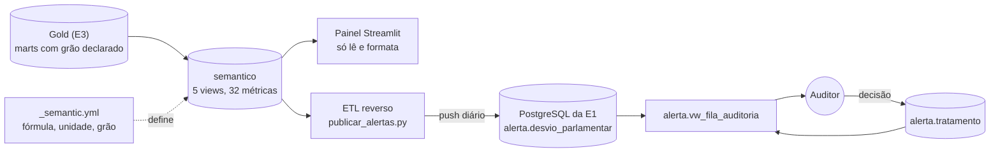

# Engenharia da Pipeline de Dados — Entrega E4 (Squad G8)

## Camada Semântica, ETL Reverso, LGPD, Controle de Acesso, Catálogo e Linhagem

> Documento técnico da Entrega E4. Os números foram medidos numa subida do zero em 2026-11-24, com 802.861 lançamentos no fato. A Câmara regera os CSVs, então um download em outra data traz contagens um pouco diferentes.

A E4 trata da **disponibilização do dado**: como as métricas que respondem à pergunta da E1 chegam a mais de um consumidor com o mesmo valor, e como o resultado volta para o sistema operacional.

> *Quais parlamentares e partidos da 57ª Legislatura (2023–2026) apresentam maior desvio de
> gastos acima da média mensal da CEAP, e quais categorias e fornecedores concentram esses
> recursos?*



---

### Sumário

1. [Visão Geral da Arquitetura](#1-visão-geral-da-arquitetura)
2. [Camada Semântica de Métricas](#2-camada-semântica-de-métricas)
3. [Consumo Duplo: Como Garantimos o Mesmo Número](#3-consumo-duplo-como-garantimos-o-mesmo-número)
4. [ETL Reverso: a Fila de Auditoria](#4-etl-reverso-a-fila-de-auditoria)
5. [Decisão de Disponibilização (ADR-0008)](#5-decisão-de-disponibilização-adr-0008)
6. [Análise de LGPD](#6-análise-de-lgpd)
7. [Controle de Acesso com Privilégio Mínimo](#7-controle-de-acesso-com-privilégio-mínimo)
8. [Catálogo e Linhagem](#8-catálogo-e-linhagem)
9. [Conferência dos ADRs Anteriores](#9-conferência-dos-adrs-anteriores)
10. [Pendências e Riscos Aceitos](#10-pendências-e-riscos-aceitos)
11. [Como Executar e Reproduzir Localmente](#11-como-executar-e-reproduzir-localmente)
12. [Matriz de Conformidade com o Checklist de Aceite](#12-matriz-de-conformidade-com-o-checklist-de-aceite)

---

### 1. Visão Geral da Arquitetura

A E4 acrescenta duas camadas ao fim do fluxo da E3: o schema `semantico`, entre a Gold e os consumidores, e o schema `alerta`, no PostgreSQL da E1, como destino do ETL reverso.

```
 ┌────────────────────────────────────────────────────────────────────────────────────────┐
 │  BRONZE → SILVER → GOLD (E3, `lakehouse/ceap.duckdb`)                                  │
 │  Gold: `mart_desvio_parlamentar` · `mart_desvio_partido` ·                             │
 │        `mart_concentracao_parlamentar` · `fct_gasto_mensal_parlamentar` ·              │
 │        `mart_freshness_gold`                                                           │
 └───────────────────────────────────────┬────────────────────────────────────────────────┘
                                         ▼
 ┌────────────────────────────────────────────────────────────────────────────────────────┐
 │  SEMÂNTICA (dbt, schema `semantico`: views com contrato de esquema)                    │
 │  `met_parlamentar` · `met_partido` · `met_categoria_parlamentar` ·                     │
 │  `met_fornecedor_parlamentar` · `met_contexto`                                         │
 └──────────────────────┬───────────────────────────────────────────┬─────────────────────┘
                        ▼                                           ▼
 ┌─────────────────────────────────────────┐   ┌──────────────────────────────────────────┐
 │  PAINEL STREAMLIT (`painel/app.py`)     │   │  ETL REVERSO (`publicar_alertas.py`)     │
 │  lê só `semantico.*`, read_only,        │   │  asset Dagster no fim da `transformacao` │
 │  cache de 5 min, porta 8501             │   │  login `ceap_etl_reverso`, retry 3x      │
 └─────────────────────────────────────────┘   └────────────────────┬─────────────────────┘
                                                                    ▼
 ┌────────────────────────────────────────────────────────────────────────────────────────┐
 │  POSTGRESQL `ceap_oltp` (E1), schema `alerta`, insert-only                             │
 │  `desvio_parlamentar` (retratos) · `tratamento` (decisões) · `execucao` (publicações)  │
 │  `vw_fila_auditoria` (a fila do dia)  ←→  Auditor (role `ceap_auditor`)               │
 └────────────────────────────────────────────────────────────────────────────────────────┘

 Orquestração (Dagster): jobs `ingestao_ceap`, `transformacao` e `etl_reverso` (novo);
 asset check `alerta_igual_a_camada_semantica`.
 Controle de acesso no PostgreSQL: migration 005 (schema `public`) e 006 (schema `alerta`).
```

O desenho mantém as duas propriedades da E3 e acrescenta uma terceira: **cada métrica tem uma definição só**, e nenhum consumidor a recalcula.

---

### 2. Camada Semântica de Métricas

#### 2.1. Problema

Na E3, o painel lia a Gold e terminava quatro contas por conta própria: somava os fornecedores de cada categoria, somava os 10 maiores fornecedores, dividia o erro da sobrescrita por dois e aplicava o corte de 5 deputados por partido. Um segundo consumidor teria de repetir essas contas, e bastaria uma diferença para duas telas mostrarem a mesma métrica com valores diferentes.

#### 2.2. Views da camada (`dbt_ceap/models/semantic/`)

| View | Grão | Responde | Quem consome |
| :--- | :--- | :--- | :--- |
| `met_parlamentar` | deputado | ranking do desvio acima da mediana da UF e regra de alerta | painel (bloco 1 e seletor do bloco 3), ETL reverso |
| `met_partido` | partido na data do gasto | ranking de partidos e erro da sobrescrita | painel (bloco 2) |
| `met_categoria_parlamentar` | deputado × subcota | a categoria que gera o desvio | painel (bloco 3) |
| `met_fornecedor_parlamentar` | deputado × fornecedor | concentração em fornecedores | painel (bloco 3) |
| `met_contexto` | uma linha | janela comparável, atualização, freshness e ruptura | painel (cabeçalho), ETL reverso |

Volume lido pelo painel a cada abertura: **91.227 linhas** (84.936 delas em `met_fornecedor_parlamentar`).

#### 2.3. Definição versionada num lugar só

- Cada métrica tem nome, descrição, fórmula e unidade no `meta` da coluna; grão, dimensões e consumidores no `meta` do modelo, em `_semantic.yml`.
- O [catálogo de métricas](e4.md#12-catálogo-de-métricas) é gerado desse arquivo por `scripts/gerar_catalogo_metricas.py`. Mudar uma métrica é um diff no `.sql` e no `.yml`.
- **Contrato de esquema** (`contract: enforced`) em todas as views.
- As regras que estavam no painel viraram métricas e variáveis do dbt:

| Regra | Onde ficava na E3 | Onde fica na E4 |
| :--- | :--- | :--- |
| Top 15 do desvio | `painel/app.py` | `met_parlamentar.em_alerta` (var `alerta_top_n = 15`) |
| Mínimo de 5 deputados por partido | `painel/app.py` | `met_partido.entra_no_ranking` (var `min_deputados_partido = 5`) |
| Erro total da sobrescrita ÷ 2 | `painel/app.py` | `met_contexto.erro_total_sobrescrita` |
| Participação acumulada dos 10 maiores fornecedores | `painel/app.py` | `met_fornecedor_parlamentar.participacao_acumulada` |

#### 2.4. Views, e não tabelas

A camada é feita de **views**: nunca fica defasada em relação à Gold, e a idade dos dados (`met_contexto.idade_horas`) é calculada no momento da leitura. O custo está medido na seção 5.

---

### 3. Consumo Duplo: Como Garantimos o Mesmo Número

| Verificação | Onde roda | O que reprova |
| :--- | :--- | :--- |
| `assert_semantico_gasto_consistente` | `dbt build` | gasto total da janela divergir em mais de R$ 0,01 entre parlamentar, partido, categoria, fornecedor e o fato |
| `assert_semantico_desvio_consistente` | `dbt build` | desvio por partido divergir do por parlamentar, ou o erro da sobrescrita do contexto divergir do dos partidos |
| `grao_unico` em cada view | `dbt build` | mais de uma linha por chave do grão |
| Contratos de esquema | `dbt build` | coluna sumir ou mudar de tipo |
| `scripts/verificar_consumo_duplo.py` | depois do build (`scripts/gerar_docs_e3.sh`) | o painel ler a Gold/Silver ou agregar dados, ou um dos **12 números exibidos** diferir da camada |
| Asset check `alerta_igual_a_camada_semantica` | Dagster, a cada publicação | a fila do auditor ter parlamentares diferentes dos `em_alerta` da camada |

Com isso, o `dbt build` passou de 42 para **48 testes** ([lista completa](testes.md)).

**Evidência da troca de fonte:** o painel novo e o painel da E3 foram abertos sobre os mesmos dados (24/11/2026). Todos os textos e as três tabelas saíram **idênticos**.

---

### 4. ETL Reverso: a Fila de Auditoria

#### 4.1. O que volta para o sistema operacional

Os parlamentares **em alerta** (o top 15 do desvio acima da mediana da UF, `semantico.met_parlamentar.em_alerta`) são publicados no PostgreSQL da E1, na tabela `alerta.desvio_parlamentar`. É a mesma regra do top 15 do painel: as duas telas mostram os mesmos 15 nomes.

#### 4.2. Objetos do destino (`migrations/006_etl_reverso.sql`)

| Objeto | O que guarda | Quem escreve |
| :--- | :--- | :--- |
| `alerta.desvio_parlamentar` | um retrato do top 15 por publicação; chave `(referencia_dados, id_deputado)` | ETL reverso |
| `alerta.tratamento` | cada decisão do auditor (`em_analise`, `sem_irregularidade`, `encaminhado`), um evento por decisão | auditor |
| `alerta.execucao` | cada publicação: linhas recebidas e linhas novas | ETL reverso |
| `alerta.vw_fila_auditoria` | a fila do dia: retrato mais recente com a última decisão de cada parlamentar | — |

- **Insert-only** (ADR-0001): um gatilho recusa `UPDATE` e `DELETE`. Corrigir uma decisão é registrar um evento novo.
- **Autoria gravada pelo banco:** `registrado_por` e `registrado_em` vêm do gatilho (`session_user` e hora do banco), inclusive para o superusuário. Ninguém registra decisão em nome de outra pessoa ou com data falsa.

#### 4.3. Push, frequência e falha

| Pergunta | Decisão |
| :--- | :--- |
| Push ou pull? | **Push.** O asset `alerta/desvio_parlamentar_postgres` roda no fim do job `transformacao` e grava no destino. |
| Frequência | **Diária**, presa à ingestão: agenda das 06:00 → ingestão → sensor → dbt → ETL reverso. Republicar os mesmos dados não cria linha nova. |
| Destino fora do ar | **3 tentativas** com espera de 2, 4 e 8 s. Se falhar, o run fica vermelho, a Gold e o painel não mudam e a fila fica com o último retrato. Uma transação só: nenhuma linha pela metade. O job `etl_reverso` republica sem refazer o dbt. |
| Credenciais | Login de serviço `ceap_etl_reverso`, membro só de `ceap_pipeline`. |

#### 4.4. Falha provocada: destino fora do ar

Cenário `destino_fora` de `orquestracao/demo_falhas.py` (evidência em `orquestracao/evidencias/destino_fora.json`, 24/11/2026):

| Etapa | Resultado |
| :--- | :--- |
| Publicar com o PostgreSQL fora do ar | falhou depois de **3 tentativas extras** (`Exceeded max_retries of 3`) |
| Gold durante a falha | **mesmo hash** antes e depois |
| Fila durante a falha | as mesmas 15 linhas, nenhuma pela metade |
| Publicar com o destino de volta | sucesso, **0 linhas novas** (idempotente); asset check aprovado |

#### 4.5. Opção nula: o CSV agendado bastaria?

Medido com `etl_reverso/comparar_opcao_nula.py` (20 repetições, evidência em `docs/evidencias/e4_etl_reverso_opcao_nula.json`):

| | Tabela no PostgreSQL (adotado) | CSV agendado (opção nula) |
| :--- | :--- | :--- |
| Publicar 15 linhas (mediana) | 38 ms | 26 ms |
| Auditor ler a fila (mediana) | 13 ms | 1 ms |
| Decisão do auditor sobrevive à publicação seguinte | **sim** | **não**: o arquivo é reescrito |
| Histórico de quem entrou no alerta | retratos consultáveis por SQL | só o arquivo do dia |
| Registro protegido contra alteração | **sim** (`UPDATE` recusado) | não |
| Acesso por perfil | `GRANT` por role | só permissão de arquivo |

O CSV bastaria se o auditor só **lesse** a lista. Como ele precisa **registrar o que decidiu**, com histórico e sem que o registro possa ser alterado, a tabela no PostgreSQL se justifica.

---

### 5. Decisão de Disponibilização (ADR-0008)

O [ADR-0008](adr/0008-disponibilizacao-camada-semantica-etl-reverso.md) fecha três escolhas, cada uma comparada com a opção nula.

#### 5.1. De onde o consumidor lê

Medido com `scripts/medir_leitura_semantica.py` (20 leituras por caminho, conexão nova a cada uma, as mesmas 5 consultas do painel; evidência em `docs/evidencias/e4_leitura_semantica.json`):

| Caminho | Leitura (mediana · p90) | Custo de manter | Espaço extra | Defasagem |
| :--- | ---: | ---: | ---: | :--- |
| Cópia em CSV (opção nula) | 148 · 162 ms | 0,17 s por exportação | 11,7 MiB | até a próxima exportação |
| Cópia em Parquet | 71 · 77 ms | 0,25 s por exportação | 6,5 MiB | até a próxima exportação |
| Warehouse, métricas como tabelas | 83 · 86 ms | 3,0 s por build | 6,3 MiB | até o próximo build |
| **Warehouse, views (adotado)** | **217 · 251 ms** | **nenhum** | **nenhum** | **nenhuma** |
| Federação (DuckDB + `ATTACH` do PostgreSQL) | 135 · 143 ms | nenhum | nenhum | nenhuma |

Todos os caminhos ficam em torno de 0,25 s ou menos, e o painel guarda o resultado em cache por 5 minutos: com o volume da CEAP, a latência não decide. As views custam ~130 ms a mais por leitura, mas não há cópia para manter nem risco de ler uma cópia velha.

#### 5.2. Por que não a federação para o auditor

A federação evitaria a cópia e foi rápida (135 ms), mas foi descartada pelo acoplamento medido:

- **Lock do DuckDB:** com o dbt escrevendo no warehouse, a leitura federada falhou (`Could not set lock on file`); o push leu as 15 linhas.
- **Acesso amplo:** o auditor precisaria abrir o arquivo inteiro (129 MiB), com `silver`, `gold`, `semantico` e `auditoria`, inclusive 6 colunas de documento de fornecedor com CPF completo. No push, ele acessa só o schema `alerta`.
- **Histórico:** a fila seria recalculada a cada leitura, e o retrato de ontem sumiria.

#### 5.3. Consequências

- **Ganho:** o mesmo número em todos os consumidores, garantido por teste; o auditor tem fila com decisões, histórico e autoria gravada pelo banco.
- **Custo:** ~130 ms a mais por leitura do painel; o PostgreSQL voltou ao fluxo de dados como destino (migration 006, roles e um asset a mais), o que torna menos absoluta a decisão do ADR-0004; a fila tem até um dia de defasagem.
- **Irreversível:** os retratos e as decisões em `alerta.*` não são apagados; o schema `semantico` passa a ser a interface pública do dado, com contrato.
- **Ponto fraco declarado:** o dbt Semantic Layer (MetricFlow) não foi prototipado. O argumento é que o desvio contra a mediana mensal da UF, o z robusto com MAD, o HHI e os `rank()` por deputado não se expressam como métrica simples, e que a API de métricas só existe no dbt Cloud. Isso é argumento, não medição.

#### 5.4. Gatilhos de revisão

| Condição | Limiar | Hoje | O que fazer |
| :--- | ---: | ---: | :--- |
| Leitura do painel pela camada (p90) | > 1 s | 251 ms | materializar as views como tabelas |
| Consumidor fora da rede do DuckDB | 1 | 0 | publicar cópia em Parquet a cada build |
| Frescor exigido pelo auditor | menor que diário | diário | publicar a cada ingestão intradiária ou avaliar federação |
| Destinos do ETL reverso | > 2 | 1 | trocar o script por uma ferramenta de ETL reverso |
| Falhas seguidas da publicação | 3 dias | 0 | rever retry, alerta e dependência do destino |
| Métricas na camada | > 50 | 32 | prototipar o dbt Semantic Layer |

---

### 6. Análise de LGPD

O detalhamento completo está em [Análise de LGPD](lgpd.md). É um documento técnico de governança, não um parecer jurídico.

#### 6.1. Titulares e decisões

| Titular | De onde vem | Por que importa | Decisão |
| :--- | :--- | :--- | :--- |
| Deputados | CEAP e API da Câmara | Agente público; o **partido é dado sensível** (art. 5º, II) | Manter nome, UF e partido, com o partido pelo art. 11, II, "c". CPF nunca nas camadas analíticas |
| Fornecedores pessoa física | CEAP (`txtCNPJCPF` com 11 dígitos) | Pessoa comum que recebeu dinheiro público | CPF mascarado, pseudônimo com chave secreta, nome mantido |
| Sócios do QSA | Receita Federal (hoje, base de demonstração) | O cruzamento com a CEAP cria dado que nenhuma base tinha | Nome e CPF mascarado só na zona restrita; consumo por pseudônimo |
| Passageiros | CEAP (`txtPassageiro`) | Pessoas privadas; nenhum modelo usa | Não ingerir; remover do OLTP e do Delta da E2 |

**Base principal:** art. 7º, IV (estudo por órgão de pesquisa, com anonimização "sempre que possível"), reforçada e limitada pelo art. 7º, §3º (reuso de dado público para fim compatível) e pelo §7º (cruzamento CEAP × QSA). A premissa de que a UnB atua como órgão de pesquisa deve ser validada com a docência e com o encarregado da UnB.

#### 6.2. Achados que corrigem a E3

1. O painel exibe `documento_fornecedor`: para pessoa física é o **CPF completo** (314 na Gold).
2. `sk_fornecedor` é `md5(CPF)` para pessoa física, reversível por força bruta.
3. O OLTP da E1 guarda `parlamentar.cpf` completo; a E3 dizia que o CPF "não é gravado", o que vale só para a Bronze.
4. `txtPassageiro` está na Bronze, no OLTP, no Delta da E2 e no WAL do CDC, e não "só na Bronze".
5. Não havia controle de acesso por papel (tratado na seção 7).

#### 6.3. Retenção, descarte e reidentificação

- **Retenção:** a fonte pública é permanente; as nossas cópias, não. Prazos por classe de dado (de "enquanto a plataforma existir" para o mandato até "zero" para CPF de deputado e passageiro).
- **Descarte:** seis tarefas (T1 a T6), com `VACUUM` do Delta (sem ele, o *time travel* mantém os arquivos antigos) e `VACUUM FULL` depois do `DROP COLUMN` no PostgreSQL. Prazo efetivo de descarte físico: substituição + 7 dias.
- **Reidentificação:** o cruzamento CEAP × QSA atribui a uma pessoa um total que estava espalhado por vários CNPJs. Sete riscos mapeados (exposição, homonímia, atribuição indevida de valor, junção espúria entre CPF e CNPJ, vazamento por log, reuso para outro fim e razão social com nome de pessoa), cada um com controle, e uma **lista fechada** de cruzamentos permitidos.

---

### 7. Controle de Acesso com Privilégio Mínimo

`migrations/005_controle_acesso.sql` (issue #10) aplica recorte de colunas e view mascarada no PostgreSQL; o schema `alerta` fica com a 006. Detalhes e roteiro de validação em [Controle de acesso](controle-de-acesso.md).

| Papel | No schema `public` | No schema `alerta` |
| :--- | :--- | :--- |
| `ceap_pipeline` | leitura e escrita necessárias à carga; sem administração nem exclusão de despesas | lê os retratos e insere só as colunas de conteúdo |
| `ceap_etl_reverso` (login) | herda só `ceap_pipeline` | idem |
| `ceap_auditor` | leitura das tabelas de negócio, inclusive dados restritos; sem escrita nem staging | lê a fila e insere decisões (sem informar autoria nem data) |
| `ceap_consulta` | só colunas públicas; fornecedores pela view `v_fornecedor_publico` | nenhum acesso |

- Para `ceap_consulta`: bloqueados `parlamentar.cpf`, `nu_carteira_parlamentar`, `despesa_ceap.passageiro`, a tabela original de fornecedores e a staging. A view mascara o CPF (`12345678901` → `***.456.789-**`) e preserva o CNPJ.
- A 005 revoga concessões excessivas de `PUBLIC` e dos grupos antes de aplicar a matriz. Colunas novas não entram automaticamente no acesso de consulta. É reaplicável e independente da ordem em relação à 006.
- **Validação** (24/11/2026, PostgreSQL 16.14, dados sintéticos): **12 asserções permitidas e 34 operações negadas**, incluindo logins reais por TCP. Também validados: instalação nova, reaplicação da 005, atualização depois da 006 e execução dos SQLs reais de carga como `ceap_pipeline`.
- **Limite:** superusuário e dono da tabela ignoram `GRANT` e `REVOKE`. O controle depende de os serviços não usarem o `postgres`; hoje, só o ETL reverso usa login de serviço.

---

### 8. Catálogo e Linhagem

#### 8.1. Catálogo ([catalogo.md](catalogo.md))

| Camada | Onde fica | Tabelas | Alimenta o painel? |
| :--- | :--- | ---: | :---: |
| Fontes públicas | Portal e API da Câmara; base societária | 3 | — |
| OLTP | PostgreSQL `ceap_oltp`, schema `public` | 10 | não |
| Lakehouse E2 | `lakehouse/delta/` | 3 | não |
| Bronze | `lakehouse/bronze/` | 2 | sim |
| Silver | `ceap.duckdb`, schema `silver` | 10 | sim |
| Gold | `ceap.duckdb`, schema `gold` | 5 | sim |
| Semântica | `ceap.duckdb`, schema `semantico` | 5 | sim |
| Destino do ETL reverso | PostgreSQL, schema `alerta` | 4 | — (é consumo) |

Cada tabela tem **dono** (a frente da Squad que escreve nela), descrição, origem, grão e colunas principais, com marcação de contrato de esquema e de dado pessoal.

#### 8.2. Linhagem ([linhagem.md](linhagem.md))

- Caminho de ponta a ponta em **12 trechos**, do download do CSV à fila do auditor, cada um com mecanismo, momento em que roda, o que muda no dado e como se confere.
- Dois exemplos seguidos até a fonte: o **desvio acumulado** do painel até o `vlrLiquido` do CSV, e o **partido** do gráfico de partidos até a API de histórico.
- O `dbt docs` cobre só o trecho Bronze → `semantico`. Download, OLTP, Delta da E2, painel e ETL reverso ficam documentados na página de linhagem.
- Lacunas registradas: o cache `base-dados/` só é baixado quando falta; duas cópias analíticas convivem (Delta da E2 e Bronze da E3); o partido do OLTP e do Delta da E2 repete a sobrescrita do CSV; seeds podem mudar a janela dos rankings sem mudança na fonte.

---

### 9. Conferência dos ADRs Anteriores

No fechamento da E4, com a plataforma subida do zero, a Squad conferiu os gatilhos de revisão dos ADRs 0001 a 0007 ([portfólio de ADRs](adr/README.md)).

| ADR | Situação |
| :--- | :--- |
| 0001 a 0003, 0005, 0006 | Nenhum gatilho disparado. O ADR-0006 ganhou um terceiro job (`etl_reverso`) sem mudar a decisão |
| 0004 | Não disparou, mas a E4 mudou o papel do PostgreSQL: ele voltou ao fluxo como **destino** do ETL reverso |
| **0007** | **Disparou** o gatilho de "acesso restrito por perfil": a análise de LGPD mostrou CPF completo de fornecedor no painel. A decisão não foi revista; a proposta é tirar o dado pessoal do que o painel lê (zona de consumo recortada), o que eliminaria a condição. **Em aberto** |
| 0008 | Novo na E4 |

---

### 10. Pendências e Riscos Aceitos

| # | Pendência | Efeito hoje | Referência |
| :---: | :--- | :--- | :--- |
| 1 | CPF completo de fornecedor PF no painel e `sk_fornecedor` reversível (L1, L2) | 314 CPFs completos na Gold lida pelo painel | [LGPD, seção 8](lgpd.md#8-lacunas-encontradas-e-plano-de-implementação) |
| 2 | Zona de consumo separada (`ceap_painel.duckdb`) | O painel monta o `./lakehouse` inteiro; ler só `semantico` é convenção conferida por script, não restrição | [LGPD, seção 6.4](lgpd.md#64-mecanismo-em-cada-armazenamento) |
| 3 | Remoção de `parlamentar.cpf` e `despesa_ceap.passageiro` (T5) | Colunas bloqueadas para `ceap_consulta`, mas ainda gravadas | [LGPD, seção 4](lgpd.md#4-retenção-e-descarte) |
| 4 | Job de descarte (`descarte_lgpd`) e pseudônimo com HMAC | Só como esboço no apêndice da análise | [LGPD, apêndice](lgpd.md#apêndice--implementação-proposta) |
| 5 | Ingestão e CDC da E1/E2 com o superusuário | O privilégio mínimo vale só para o ETL reverso | seção 7 |
| 6 | ADR-0007 com gatilho disparado | Decisão do painel em aberto | seção 9 |
| 7 | Canal para direitos dos titulares e contato do encarregado | Não definidos | [LGPD, seção 7](lgpd.md#7-direitos-dos-titulares-incidentes-e-contato) |
| 8 | `dbt docs` fora do site | Gerado só localmente | [Linhagem](linhagem.md#dbt-docs-o-que-cobre-e-o-que-não-cobre) |

---

### 11. Como Executar e Reproduzir Localmente

#### 11.1. Subida completa

```bash
docker compose up --build -d
docker compose wait e3-pipeline
```

O serviço `ingestion` aplica as migrations (incluindo a 005 e a 006). Depois, o `e3-pipeline` roda o dbt com a camada semântica e publica a fila do auditor como `ceap_etl_reverso`. Painel em `http://localhost:8501`; Dagster em `http://localhost:3000`.

#### 11.2. Reprodução das evidências

```bash
# camada semântica: build, páginas geradas, catálogo de métricas e conferência do painel
docker compose run --build --rm --no-deps -e HOST_UID="$(id -u)" -e HOST_GID="$(id -g)" \
    -v ./docs:/app/docs -v ./scripts:/app/scripts e3-pipeline bash scripts/gerar_docs_e3.sh

# leitura do warehouse e das cópias (seção 5.1)
docker compose run --rm --no-deps -v ./docs:/app/docs -v ./scripts:/app/scripts \
    e3-pipeline python scripts/medir_leitura_semantica.py 20

# fila e fluxo do auditor (seção 4)
docker compose exec -T db psql -U postgres -d ceap_oltp < etl_reverso/exemplo_auditor.sql

# destino fora do ar (seção 4.4)
docker compose run --rm --no-deps -v ./orquestracao/evidencias:/app/orquestracao/evidencias \
    e3-pipeline python orquestracao/demo_falhas.py destino_fora

# opção nula do ETL reverso (seção 4.5)
docker compose run --rm --no-deps -e DB_USER=postgres -e DB_PASSWORD=postgres \
    -v ./docs:/app/docs -v ./etl_reverso:/app/etl_reverso \
    e3-pipeline bash -c "cd etl_reverso && python comparar_opcao_nula.py 20"
```

A federação (seção 5.2) é medida pelo script `medir_federacao.py`, que fica no próprio [ADR-0008](adr/0008-disponibilizacao-camada-semantica-etl-reverso.md#3-medição). O controle de acesso (seção 7) tem roteiro próprio em [Controle de acesso](controle-de-acesso.md#demonstrar-acesso-permitido-e-negado).

---

### 12. Matriz de Conformidade com o Checklist de Aceite

> Os itens abaixo seguem as issues da E4 e os requisitos complementares documentados no repositório.

| Item | Situação | Evidência no Repositório |
|---|---|---|
| **Camada semântica de métricas com definição única e consumo duplo** (issue #6) | Concluído | `dbt_ceap/models/semantic/` (5 views, 32 métricas, contratos); catálogo gerado de `_semantic.yml`; `assert_semantico_*`; `verificar_consumo_duplo.py`; painel lendo só `semantico.*` (seções 2 e 3) |
| **ETL reverso para um sistema operacional, com consumidor declarado, frequência e tratamento de destino fora do ar** (issue #7) | Concluído | `etl_reverso/publicar_alertas.py`, `migrations/006_etl_reverso.sql`, asset `alerta/desvio_parlamentar_postgres`, asset check, `destino_fora.json` e comparação com a opção nula (seção 4) |
| **Análise de LGPD por dado: base legal, retenção, descarte e reidentificação** | Concluído (análise) · Parcial (implementação) | [`lgpd.md`](lgpd.md); controles marcados como "alvo" ainda não implementados (seção 10) |
| **Controle de acesso com privilégio mínimo e recorte de colunas** (issue #10) | Concluído no PostgreSQL · Pendente no lakehouse | `migrations/005_controle_acesso.sql`, [`controle-de-acesso.md`](controle-de-acesso.md); 12 asserções permitidas e 34 negadas (seção 7) |
| **Catálogo de dados com dono e linhagem da fonte ao consumo** | Concluído | [`catalogo.md`](catalogo.md), [`linhagem.md`](linhagem.md) (seção 8) |
| **ADR sobre a disponibilização do dado** (issue #11) | Concluído | [`adr/0008-disponibilizacao-camada-semantica-etl-reverso.md`](adr/0008-disponibilizacao-camada-semantica-etl-reverso.md), com medições e gatilhos (seção 5) |
| **Conferência dos gatilhos dos ADRs anteriores** | Concluído | [`adr/README.md`](adr/README.md); gatilho do ADR-0007 registrado em aberto (seção 9) |
