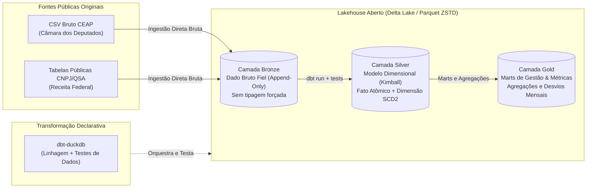

# 0004 — Avaliação da Necessidade de Staging Relacional (ETL com PostgreSQL) vs. Arquitetura Direta no Lakehouse (Direct-to-Lakehouse ELT)

- **Status:** aceito
- **Data:** 2026-10-29
- **Decisores:** Filipe Carvalho, Taynara Vitorino, Gabriel Esteves, Maria Clara Alves, Kaio Macedo, Amanda Gonçalves (Squad G8)

---

## 1. Contexto

Nas Entregas E1 e E2, a Squad G8 construiu uma arquitetura em que o **PostgreSQL 16** atuava como repositório transacional operacional (OLTP) e área de staging normalizada (3FN) para as despesas da Cota Parlamentar (CEAP da 57ª Legislatura). Os dados eram carregados via scripts imperativos de `COPY` para tabelas *unlogged*, normalizados no modelo relacional relido via *insert-only* e, subsequentemente, sincronizados para o **Delta Lake** por meio de um pipeline duplo (lote periódico com cursor streaming e streaming de mudanças via Change Data Capture - CDC no WAL do PostgreSQL).

Entretanto, durante a evolução da plataforma e a avaliação docente para a Entrega E3, a professora levantou uma questão crítica de modelagem e engenharia de dados:
> *"Qual é a real necessidade de mantermos um banco relacional intermediário (PostgreSQL) servindo como ETL/staging antes do Lakehouse, em vez de operarmos um modelo Direct-to-Lakehouse, onde os dados brutos entram diretamente nas camadas do Lakehouse?"*

Além disso, a docência orientou que as decisões desta entrega fossem **menos centradas em infraestrutura genérica de software** (como memória de contêineres e sockets de rede) e **mais concentradas no valor qualitativo para as informações e integridade dos dados**:
- Como cada abordagem lida com a fidelidade e integridade dos dados contábeis brutos da Câmara?
- Como anomalias, dados sujos e notas atípicas são preservados para auditoria pública em vez de serem rejeitados silenciosamente?
- Qual é o impacto na governança, evolução de esquema (*schema drift*) e linhagem das informações?

### Caracterização da Carga de Dados e do Domínio
- **Natureza do Dado:** O conjunto de dados da CEAP é composto por dados públicos de prestação de contas governamentais emitidos pela Câmara dos Deputados (785.754 registros de despesas entre 2023 e 2026, totalizando R$ 869.398.245,27).
- **Padrão de Consumo vs. Padrão Operacional:** A CEAP **não é um sistema transacional interno da Squad**. Não há parlamentares ou operadores humanos preenchendo formulários web concorrentes, disparando transações bancárias ou executando locks transacionais em tempo real na nossa aplicação. A plataforma é uma **plataforma analítica e de controle social**, cujo objetivo é consumir, enriquecer, modelar, auditar e responder à Pergunta de Gestão:
  > *"Quais parlamentares e partidos da 57ª Legislatura (2023–2026) apresentam maior desvio de gastos acima da média mensal da Cota Parlamentar (CEAP), e quais categorias e fornecedores concentram esses recursos?"*
- **Fontes Heterogêneas Integradas:** 
  1. Microdados de despesas da CEAP (arquivos CSV semestrais/anuais disponibilizados pela Câmara).
  2. Tabelas cadastrais da Câmara (deputados, mandatos, frentes parlamentares e lideranças).
  3. Dados Abertos do CNPJ e Quadro de Sócios e Administradores (QSA) da Receita Federal para resolução da cadeia societária e Beneficiário Final (UBO).

---

## 2. Alternativas Qualitativas Consideradas

### Alternativa A: Manutenção do Pipeline em Dois Estágios (ETL com Staging Relacional no PostgreSQL)
Manter a arquitetura atual das Entregas E1 e E2: o dado bruto em CSV é copiado para tabelas de staging no PostgreSQL, normalizado em tabelas relacionais operacionais (3FN), submetido a constraints rígidas de banco (`FOREIGN KEY`, `NOT NULL`, `CHECK`), e então replicado para o Lakehouse Delta Lake através de processos de extração em lote e CDC no WAL.

- *Por que é viável:* Já foi implementada e validada nas entregas anteriores; o PostgreSQL oferece integridade ACID clássica, índices B-Tree e dialeto SQL tradicional.
- *Por que é qualitativamente contraproducente para os dados:*
  1. **Rejeição Precoce e Perda de Fidelidade do Dado Bruto:** DDLs relacionais rígidos com constraints prévias tendem a falhar ou descartar registros atípicos na porta de entrada (ex: despesas de lideranças com CPF nulo, fornecedores estrangeiros sem CNPJ, notas retificadas com carimbos retroativos). Em auditoria de contas públicas, o dado sujo da origem **precisa ser preservado integralmente** para investigação de conformidade, e não rejeitado ou forçado a valores artificiais no ETL.
  2. **Duplo Ponto de Manutenção de Esquema (*Schema Drift Dual*):** Toda mudança de estrutura nos dados abertos da Câmara ou da Receita Federal exige alterar o esquema DDL no PostgreSQL (migrações SQL) e, em seguida, adaptar o esquema da tabela no Delta Lake.
  3. **Redundância Sem Benefício Operacional:** O banco PostgreSQL consome 178 MB apenas para manter uma réplica intermediária de tabelas cujos dados já residem no Lakehouse (64,8 MB compactados em Parquet Zstandard), gerando custos adicionais de sincronização (CDC, checkpoints, réplica de slots) para dados que são puramente analíticos.

---

### Alternativa B (Escolhida): Arquitetura Direta no Lakehouse (*Direct-to-Lakehouse ELT* com Camadas Medallion)
Abandonar a dependência do PostgreSQL como estágio intermediário obrigatório do fluxo de transformação e adotar uma **arquitetura ELT nativa direta no Lakehouse** estruturada no padrão Medallion (Bronze ➔ Silver ➔ Gold):

1. **Camada Bronze (Raw Ingestion):** Os arquivos originais da Câmara e da Receita Federal são ingeridos diretamente em tabelas Delta Lake no modo *append-only* com tipagem ampla. Nenhuma limpeza ou filtro de rejeição é aplicado aqui. O dado bruto é preservado exatamente como emitido pelo órgão público, garantindo auditabilidade jurídica estrita.
2. **Camada Silver (Conformed Dimensional Models):** As transformações, tipagens definitivas (`NUMERIC`, datas, chaves de negócio), deduplicações idempotentes e junções da cadeia societária (UBO) são executadas declarativamente via **dbt** motorizado por **DuckDB**, gerando a tabela fato de despesas e as dimensões conformadas.
3. **Camada Gold (Business Aggregations & Marts):** Tabelas agregadas especializadas para responder à Pergunta de Gestão (custos médios mensais, desvios de consumo por cota, ranking de fornecedores correlacionados por beneficiário final).

- *Por que é superior para os dados:*
  1. **Preservação Histórica Perfeita:** Qualquer auditor externo pode auditar a camada Bronze e reproduzir o cálculo contábil até a camada Gold com linhagem 100% rastreável.
  2. **Governança Declarativa com Testes de Dados:** A qualidade dos dados não depende de triggers ou erros impeditivos de inserção no banco; ela é validada por testes declarativos (unicidade, valores nulos, integridade referencial e testes de distribuição estatística) executados a cada transformação no dbt.
  3. **Isolamento de Falhas com Quarentena:** Registros com inconsistências são marcados com flags de qualidade na Silver em vez de abortar o pipeline, permitindo que a análise continue enquanto as anomalias são expostas em relatórios de auditoria.

---

### Alternativa C: Opção Nula — Manutenção Estrita de ETL Procedural em Scripts Python/Bash
Executar scripts procedurais avulsos em Python que leem arquivos CSV locais, aplicam regras de negócio em memória via Pandas e gravam arquivos finais em disco, sem um padrão formal de camadas ou repositório central.

- *Por que é viável:* Fácil de codificar inicialmente em ambiente de desenvolvimento local.
- *Por que foi rejeitada:* Ausência total de governança de dados. Não possui contratos de esquema, não versiona dados brutos, perde a rastreabilidade do que foi transformado e introduz o risco crônico de scripts "mágicos" cujo resultado não é reproduzível por outro membro da Squad.

---

## 3. Matriz Qualitativa de Avaliação de Dados e Informações

A tabela abaixo compara as abordagens sob critérios que afetam diretamente a **qualidade da informação produzida** e o **atendimento aos requisitos da CEAP**:

| Critério Qualitativo | Alternativa A: ETL com Staging PostgreSQL | Alternativa B: Direct-to-Lakehouse ELT (Escolhida) | Alternativa C: Opção Nula (Scripts Avulsos) |
| :--- | :---: | :---: | :---: |
| **Fidelidade do Dado Bruto** | Parcial (regras de DDL e normalização 3FN forçam coerção prévia na carga) | **Total (Camada Bronze preserva 100% do layout original sem perda de atributos)** | Nula (transforma em memória sem persistir histórico bruto) |
| **Auditabilidade Contábil** | Moderada (requer auditar logs do PostgreSQL e arquivos Delta separadamente) | **Alta (Linhagem ponta a ponta do CSV bruto ao Mart de Gestão via dbt DAG)** | Baixa (código procedural sem rastreamento de linhagem) |
| **Tratamento de Dados Sujos / Anomalias** | Rígido/Impeditivo (rejeição de linha em erro de constraint `NOT NULL` ou `FK`) | **Resiliente (Ingere na Bronze, sinaliza em testes de qualidade no dbt na Silver)** | Frágil (crashes imprevisíveis em tempo de execução) |
| **Flexibilidade de Esquema (*Schema Drift*)** | Baixa (necessita alterar DDL transacional, recriar índices e ajustar CDC) | **Alta (*Schema evolution* nativo do Delta Lake com contratos controlados pelo dbt)** | Moderada, porém propensa a inconsistências silenciosas |
| **Confiabilidade da Informação de Gestão** | Alta, mas suscetível a descompasso de replicação entre OLTP e Lakehouse | **Máxima (Única Fonte da Verdade — *Single Source of Truth* no Lakehouse)** | Baixa (risco de estados intermediários corrompidos) |
| **Complexidade Operacional da Stack** | Alta (Postgres + CDC + Wal2json + Ingestion + Lakehouse) | **Elegante e Enxuta (Delta Lake + DuckDB + dbt em contêiner único)** | Mínima, porém sem garantias analíticas |
| **Armazenamento Redundante** | 178 MB (Postgres) + 64,8 MB (Lakehouse) = **242,8 MB** | **64,8 MB** (armazenamento colunar único Zstandard) | ~265 MB (CSVs brutos duplicados) |

---

## 4. Decisão

A Squad G8 decidiu pela **Alternativa B: Transição da Camada Analítica para Arquitetura Direta no Lakehouse (*Direct-to-Lakehouse ELT*) estruturada no padrão Medallion (Bronze, Silver e Gold)**.

### Papel do PostgreSQL no Projeto a partir da E3
Para responder explicitamente à provocação da docência:
1. **O PostgreSQL deixa de ser o intermediário do fluxo contínuo de transformação analítica.** Ele foi fundamental nas Entregas E1 e E2 para demonstrar modelagem relacional normalizada em 3FN, índices analíticos pontuais e captura de mudanças via Change Data Capture (CDC) no WAL.
2. Na Entrega E3, **o centro de gravidade dos dados migra integralmente para o Lakehouse Delta Lake**. O pipeline de transformação analítica, versionamento de modelos e validação de qualidade passa a rodar diretamente sobre os arquivos Delta via **dbt-duckdb**.
3. Essa mudança elimina a duplicidade de esquemas, extingue o risco de descompasso de sincronização entre o banco relacional e o Lakehouse, e assegura que a camada Bronze retenha a versão exata e intocada dos microdados governamentais.

---

## 5. Consequências

### O que ganhamos qualitativamente:
1. **Preservação de Dados de Exceção para Auditoria:** Casos em que a Câmara emite despesas com notas em moedas estrangeiras, ressarcimentos sem documento fiscal atrelado ou despesas de lideranças partidárias sem CPF individual não são descartados no portal de entrada. Eles são armazenados na camada Bronze e classificados na camada Silver com regras de validação explícitas.
2. **Qualidade de Dados Auditável via dbt:** Testes de unicidade de despesa (`id_despesa`), integridade referencial com a tabela de parlamentares e regras de não-negatividade em valores monetários líquidos passam a ser executados de forma padronizada, gerando relatórios de conformidade a cada execução.
3. **Redução Drástica de Fricção Operacional:** Elimina-se a necessidade de orquestrar conexões concorrentes no PostgreSQL, slots de replicação lógica e réplicas de leitura, concentrando o poder de processamento em computação vetorizada em memória com DuckDB.

### O que perdemos:
1. **Perda de Interfaces OLTP Tradicionais:** A plataforma deixa de oferecer uma interface relacional com comandos `INSERT/UPDATE` transacionais de baixa granularidade para operadores finais, uma vez que o Lakehouse opera primariamente com operações em lote e micro-lotes analíticos.

### O que se torna irreversível:
- O contrato de dados da camada analítica passa a ser gerenciado pelos arquivos de esquema do dbt (`schema.yml`) e pelos metadados do Delta Lake (`_delta_log/`).
- **Custo de reversão:** Caso surja no futuro o requisito estrito de um sistema transacional onde parlamentares cadastrem despesas manualmente em formulário web da aplicação, o PostgreSQL precisará ser mantido paralelamente como banco de aplicação transacional, mantendo o CDC apenas para extração de eventos. Para a finalidade analítica da disciplina, o custo de reversão é desprezível.

---

## 6. Gatilho de Revisão

Esta decisão será revisada caso:
1. O projeto passe a incorporar uma aplicação transacional com interface CRUD multi-usuário simultânea exigindo garantias de concorrência pessimista por linha (*row-level locking*) em tempo real inferior a 50 milissegundos.
2. O volume de dados cresça a ponto de exigir um catálogo distribuído externo corporativo (ex: Apache Polaris ou Unity Catalog), justificando a dissociação dos metadados locais do Delta Lake.
