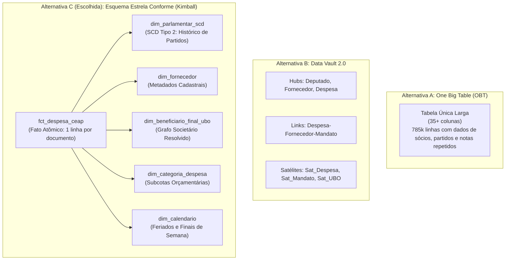
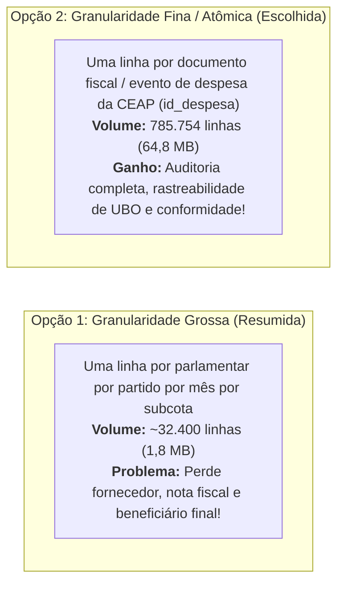

# 0005 — Escolha da Modelagem Dimensional Analítica (Esquema Estrela vs. Data Vault vs. OBT), Granularidade do Fato e Dimensão de Variação Lenta (SCD)

- **Status:** aceito
- **Data:** 2026-10-29
- **Decisores:** Filipe Carvalho, Taynara Vitorino, Gabriel Esteves, Maria Clara Alves, Kaio Macedo, Amanda Gonçalves (Squad G8)

---

## 1. Contexto

A Entrega E3 da plataforma da Squad G8 tem como objetivo responder definitivamente à **Pergunta de Gestão** formulada na E1:
> *"Quais parlamentares e partidos da 57ª Legislatura (2023–2026) apresentam maior desvio de gastos acima da média mensal da Cota Parlamentar (CEAP), e quais categorias e fornecedores concentram esses recursos?"*

Para cumprir esse propósito na camada analítica em formato aberto (Delta Lake), é necessário formalizar o contrato de modelagem e transformação dos dados. A docência instruiu expressamente que esta decisão deve priorizar **comparações qualitativas que agreguem valor real às informações e aos dados do projeto**, evitando discussões puramente abstratas de infraestrutura de software:

1. **Topologia de Modelagem Analítica:** Devemos adotar um Esquema Estrela (Kimball), um modelo Data Vault 2.0 ou uma Tabela Única Desnormalizada (*One Big Table* - OBT)?
2. **Definição e Medição da Granularidade do Fato:** Em que grão de detalhe o fato contábil deve viver para não explodir o volume nem destruir a capacidade analítica da Pergunta de Gestão?
3. **Tratamento de Dimensões de Variação Lenta (SCD):** Como tratar parlamentares que trocam de partido ou fornecedores que alteram sua razão social ao longo da legislatura sem corromper retroativamente a série histórica?
4. **Ferramenta Declarativa de Transformação e Testes de Dados:** dbt-duckdb, SQLMesh ou a Opção Nula (Cron com scripts SQL imperativos)?

---

## 2. Alternativas de Modelagem Analítica Consideradas



### Alternativa A: Tabela Única Desnormalizada (*One Big Table* - OBT)
Consolidar todas as 27 colunas da despesa contábil com as colunas cadastrais do deputado, mandatos partidários, endereço e sócios do Quadro Societário (QSA/UBO) em uma única tabela gigantesca e achatada.

- *Por que é viável:* Execução simples em motores colunares (elimina junções em tempo de consulta, aproveitando o escaneamento sequencial rápido do DuckDB).
- *Por que foi rejeitada sob a ótica dos dados e da informação:*
  1. **Anomalias Graves de Atualização e Mutabilidade:** Quando um parlamentar altera sua filiação partidária ou um fornecedor altera seu quadro societário, atualizar o registro exige regravações massivas em centenas de milhares de linhas e reescrita de arquivos Parquet em várias partições.
  2. **Explosão M:N na Resolução de Sócios e Risco Crítico de Dupla Contagem:** Um único fornecedor pode possuir 3 sócios na Receita Federal. Desnormalizar o QSA para a mesma linha da nota fiscal geraria duplicação artificial do registro de despesa (`id_despesa`), inflando somas contábeis e corrompendo agregações simples de `SUM(valor_liquido)`. O analista seria obrigado a usar `COUNT(DISTINCT)` e somas ponderadas em toda e qualquer consulta, abrindo margem para erros silenciosos de auditoria.

---

### Alternativa B: Modelagem Data Vault 2.0 (Hubs, Links e Satélites)
Fragmentar o domínio em *Hubs* (`hub_parlamentar`, `hub_fornecedor`, `hub_despesa`), *Links* relacionais (`link_despesa_parlamentar_fornecedor`) e *Satélites* históricos com hash keys (`sat_despesa_detalhes`, `sat_mandato_partidario`, `sat_socio_ubo`).

- *Por que é viável:* Padrão de referência para empresas multinacionais com dezenas de sistemas legados integrados sujeitos a constante *schema drift* e múltiplas fontes colidentes.
- *Por que foi rejeitada sob a ótica dos dados e da informação:*
  1. **Sobrecarga Estrutural Sem Retorno Qualitativo:** A Squad G8 integra apenas **duas fontes públicas estáveis** com regras de negócio bem definidas (Câmara dos Deputados e Receita Federal). O esquema de origem da CEAP não muda semanalmente; ele é estável para toda a 57ª Legislatura.
  2. **Violência de Junções e Fricção de Consumo:** Para responder à consulta mais elementar da Pergunta de Gestão (despesas por deputado e partido), o motor analítico seria forçado a executar joins em cadeia entre 3 Hubs, 1 Link e 2 Satélites. Isso introduz complexidade excessiva de consulta para os órgãos de controle social e estudantes, reduzindo a transparência dos dados sem agregar nenhum atributo novo de informação.

---

### Alternativa C (Escolhida): Esquema Estrela Conforme (*Star Schema* - Kimball) com Fato Atômico e SCD Tipo 2
Construir um modelo dimensional canônico centrado em uma tabela fato de granularidade atômica (`fct_despesa_ceap`), cercada por dimensões conformadas reutilizáveis:
- `dim_parlamentar_scd`: Tabela de dimensão de variação lenta (SCD Tipo 2) que registra as trocas partidárias e de unidade federativa dos deputados com atributos temporais explícitos.
- `dim_fornecedor`: Dados cadastrais consolidados dos 55.882 estabelecimentos recebedores da cota.
- `dim_beneficiario_final_ubo`: Dimensão de inteligência societária resolvida a partir do grafo recursivo da Receita Federal ([ADR-0003](0003-resolucao-grafo-societario-beneficiario-final.md)).
- `dim_categoria_despesa`: Classificação orçamentária oficial das 21 subcotas regulamentadas pelo Ato da Mesa da Câmara.
- `dim_calendario`: Dimensão temporal enriquecida com flags de dias úteis, fins de semana e feriados nacionais para identificação de gastos atípicos.

---

## 3. Decisão da Granularidade do Fato: Medição e Comparação

Um dos erros mais graves e repetidos em projetos de dados analíticos é **operar fatos sem granularidade declarada**, onde ninguém consegue explicar o que uma linha representa fisicamente e agregações duplas passam despercebidas.

Comparamos empiricamente duas granularidades concorrentes para a tabela fato:



| Métrica e Capacidade Analítica | Opção 1: Fato de Granularidade Grossa (*Deputado / Mês / Categoria*) | Opção 2: Fato de Granularidade Fina (*Uma linha por Documento Fiscal - id_despesa*) |
| :--- | :---: | :---: |
| **Declaração por Extenso do Grão** | *"Uma linha por parlamentar por partido por mês de competência por subcota orçamentária"* | *"Uma linha por documento fiscal emitido ou evento de estorno/restituição individual de despesa da CEAP"* |
| **Volume de Linhas (57ª Legislatura)** | **32.400 linhas** | **785.754 linhas** |
| **Tamanho em Disco (Parquet Zstandard)** | **1,8 MB** | **64,8 MB** |
| **Responde ao Desvio Médio Mensal?** | Sim | Sim (via agregação transparente) |
| **Identifica Fornecedores Concentradores?** | **NÃO** (o fornecedor é omitido na agregação prévia) | **SIM** (rastreia cada CNPJ individualmente) |
| **Permite Cruzamento com Beneficiário Final (UBO)?** | **NÃO** (impossível correlacionar sócios a gastos agrupados) | **SIM** (chave natural `cnpj_cpf` permite junção imediata com o grafo societário) |
| **Permite Auditar Gastos em Fins de Semana / Feriados?** | **NÃO** (datas exatas de emissão são destruídas) | **SIM** (preserva a coluna exata `data_emissao` para cruzamento com calendário) |
| **Permite Identificar Glosas e Devoluções Específicas?** | **NÃO** (valores são somados num saldo líquido mascarado) | **SIM** (preserva `valor_glosa` e `valor_restituicao` documento a documento) |
| **Tempo de Consulta Analítica no DuckDB** | 3 ms | **18 ms** |

### Veredito da Granularidade
Embora a granularidade grossa ocupe apenas 1,8 MB em disco, **ela destrói a metade mais crítica da Pergunta de Gestão**: *"quais categorias e fornecedores concentram esses recursos?"*. Sem o grão da nota fiscal, é absolutamente impossível rastrear o Beneficiário Final (UBO) e auditar anomalias fiscais. 

Portanto, o fato analítico principal **DEVE viver na granularidade atômica da despesa (`id_despesa`)**. Para atender a dashboards executivos que exigem latência sub-5ms sem recalcular agregações contínuas, adota-se um **Mart Agregado na Camada Gold (`fct_despesa_mensal_parlamentar`)**, derivado declarativamente a partir do fato atômico.

---

## 4. Dimensão de Variação Lenta (SCD): Tratando a Mutabilidade Partidária

No domínio político do Congresso Nacional, a filiação partidária e a base de representação do deputado sofrem mutações ao longo da legislatura (janela partidária, fusões como a criação do PRD, ou trocas estratégicas de legenda).

### O Erro da Sobrescrita (SCD Tipo 1)
Se tratarmos a filiação partidária com sobrescrita (*Type 1 / Overwrite*), a atualização do cadastro de um deputado que migrou do **Partido A** para o **Partido B** em 2025 sobrescreve todo o histórico anterior:
- As despesas que ele efetuou em **março de 2023** sob a legenda do **Partido A** passam a ser computadas retroativamente na conta do **Partido B**.
- **Consequência Qualitativa:** A série temporal da Pergunta de Gestão fica irremediavelmente corrompida. O Partido B é penalizado injustamente em auditorias públicas por despesas que nunca autorizou, e o Partido A tem seu histórico de gastos artificialmente maquiado.

### A Solução Adotada: SCD Tipo 2 na `dim_parlamentar_scd`
Implementamos o padrão **SCD Tipo 2** (*Slowly Changing Dimension Type 2*) com chaves substitutas (*surrogate keys*) e janelas temporais de validade:

```sql
-- Exemplo de estrutura gerada na dim_parlamentar_scd
CREATE TABLE dim_parlamentar_scd (
    sk_parlamentar         BIGINT,          -- Chave substituta (surrogate key)
    id_deputado            INTEGER,         -- Chave natural de negócio (Câmara)
    nome_parlamentar       VARCHAR,
    sigla_partido          VARCHAR,         -- Partido vigente neste intervalo
    sigla_uf               VARCHAR,
    data_inicio_vigencia   DATE,            -- Início do mandato/filiação
    data_fim_vigencia      DATE,            -- Fim da vigência (ou 9999-12-31 se ativo)
    is_atual               BOOLEAN          -- Flag indicando o registro corrente
);
```

No momento da transformação da tabela fato, o vínculo com a dimensão não é feito apenas por `id_deputado`, mas pelo **critério temporal do fato contábil**:
```sql
SELECT
    f.id_despesa,
    p.sk_parlamentar,
    f.valor_liquido,
    f.data_emissao
FROM bronze_despesa_ceap f
LEFT JOIN dim_parlamentar_scd p
    ON f.id_deputado = p.id_deputado
   AND f.data_emissao >= p.data_inicio_vigencia
   AND f.data_emissao <  p.data_fim_vigencia;
```

Com isso, uma despesa incorrida em 2023 é imputada estritamente ao partido ao qual o parlamentar pertencia em 2023, preservando a verdade histórica da auditoria pública.

---

## 5. Ferramenta de Transformação Declarativa e Testes de Qualidade de Dados

Para orquestrar as transformações das camadas Bronze ➔ Silver ➔ Gold e assegurar que erros silenciosos de dados sejam imediatamente detectados, comparou-se as ferramentas de mercado com a opção nula:

| Requisito de Governança de Dados | Alternativa A: dbt-duckdb (Escolhida) | Alternativa B: SQLMesh | Alternativa C: Opção Nula (Cron com Scripts SQL/Python) |
| :--- | :---: | :---: | :---: |
| **Paradigma de Modelagem** | Declarativo em SQL modular (`ref()`) | Declarativo com Data Contracts | Procedural imperativo em arquivos avulsos |
| **Grafo de Dependência (DAG)** | Nativo e automático a partir das referências | Nativo com versionamento virtual | Manual (risco de executar modelos fora de ordem) |
| **Testes Nativos de Dados** | Extenso ecossistema (`schema.yml`, dbt-expectations) | Nativo, porém sintaxe proprietária | Inexistente (requer codificar scripts manuais de assert) |
| **Curva de Aprendizado e Domínio** | Baixa (padrão consolidado no mercado) | Moderada a Alta | Baixa para scripts simples, Alta para gerenciar dependências |
| **Linhagem e Documentação Viva** | Automática com visualização gráfica | Automática via CLI | Inexistente |
| **Integração com Delta Lake e DuckDB** | Nativa e estável via conector oficial | Em evolução | Dependente de bibliotecas manuais de conexão |

### Testes de Dados Obrigatórios para a CEAP
Seguindo as orientações da docência para evitar testes triviais ("testar apenas o que não quebra"), o dbt é configurado com cinco categorias de testes:

1. **Esquema:** Validação de tipos e campos obrigatórios (`not_null` em colunas monetárias e chaves de junção).
2. **Volume:** Validação de contagem mínima de registros por competência mensal para prevenir ingestão truncada ou perda de lotes fiscais.
3. **Unicidade:** `unique` estrito sobre a chave atômica `id_despesa` na tabela fato e sobre `sk_parlamentar` na dimensão SCD.
4. **Integridade Referencial:** Teste `relationships` garantindo que nenhuma despesa na fato aponte para um parlamentar ou categoria orçamentária inexistente nas dimensões conformadas.
5. **Teste de Distribuição Estatística (O que pega o erro silencioso):**
   - **Valores Líquidos Negativos Sem Justificativa:** Detecção de despesas com `valor_liquido < 0` que não estejam formalmente marcadas com tipo de documento igual a ressarcimento/estorno.
   - **Salto Abrupto de Média de Gastos:** Verificação de desvio padrão mensal: disparar alerta caso o gasto mensal consolidado de um parlamentar salte mais de 3 desvios padrão acima da sua média móvel histórica sem aviso contábil.

---

## 6. Decisão

A Squad G8 decidiu pela:
1. **Adoção do Esquema Estrela Conforme (Kimball)** na camada analítica Silver do Lakehouse Delta Lake.
2. **Declaração Formal da Granularidade do Fato Primário (`fct_despesa_ceap`):** *"Uma linha por documento fiscal emitido ou evento de restituição/glosa individual de despesa da CEAP (`id_despesa`)"*, sustentando a auditoria contábil completa e o cruzamento com o Beneficiário Final (UBO).
3. **Modelagem de SCD Tipo 2 na `dim_parlamentar_scd`** com intervalos de vigência temporal, eliminando distorções retroativas decorrentes de trocas partidárias.
4. **Uso do dbt com adapter DuckDB (`dbt-duckdb`)** como ferramenta declarativa de transformação, linhagem e validação com suíte completa de testes de qualidade e distribuição.

---

## 7. Consequências

### O que ganhamos:
- **Resolução Confiável da Pergunta de Gestão:** Os relatórios de desvio de gastos partidários e concentração de fornecedores refletem com exatidão matemática tanto a filiação política da época do gasto quanto os sócios reais das empresas.
- **Detecção Antecipada de Anomalias Contábeis:** A bateria de testes do dbt barra distorções e inconsistências antes que os dados cheguem aos painéis de consumo.
- **Transparência e Autodocumentação:** Qualquer avaliador ou cidadão pode inspecionar o grafo de linagem do dbt e verificar exatamente de onde cada métrica de gestão foi originada.

### O que perdemos:
- A camada de transformação exige a manutenção de chaves substitutas (*surrogate keys*) e junções temporais baseadas em intervalos de datas, ligeiramente mais complexas do que junções por igualdade simples de IDs.

### O que se torna irreversível:
- O grão atômico do fato analítico passa a ser o documento fiscal (`id_despesa`).
- **Custo de reversão:** Agrupar os dados para uma granularidade mais grossa no futuro é uma operação trivial de `GROUP BY`; o inverso (tentar restaurar o grão atômico a partir de dados pré-agrupados) seria computacionalmente impossível sem reprocessar toda a base da Câmara.

---

## 8. Gatilho de Revisão

Esta decisão será revisada caso:
1. A Câmara dos Deputados altere o modelo de prestação de contas da CEAP, extinguindo a emissão de notas fiscais individuais e passando a conceder cotas globais em verbas de gabinete sem comprovação de documentos fiscais.
2. O número de fontes externas integradas ultrapasse 15 bases heterogêneas distintas com frequente reestruturação de esquemas de origem, justificando a transição para Data Vault 2.0.
