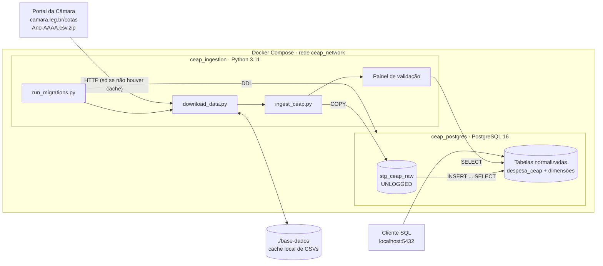

# Arquitetura

A Entrega E1 estabelece a **fonte transacional (OLTP)** da plataforma: um banco PostgreSQL normalizado e tipado, populado com os dados reais da CEAP e subido com um único comando.

## Visão geral

## Serviços (`docker-compose.yml`)

| Serviço | Container | Imagem | Papel |
| :--- | :--- | :--- | :--- |
| `db` | `ceap_postgres` | `postgres:16-alpine` | Banco OLTP `ceap_oltp`, porta `5432`, dados no volume `postgres_data` |
| `ingestion` | `ceap_ingestion` | `python:3.11-slim` (build local) | Aplica migrações, baixa os dados, carrega e valida; encerra ao terminar |

### Ordem de inicialização

O serviço `ingestion` declara `depends_on: db: condition: service_healthy`. O `db` só fica saudável quando o `healthcheck` (`pg_isready -U postgres -d ceap_oltp`, a cada 5 s, até 6 tentativas) responde. Isso evita a condição de corrida entre a subida do banco e a carga.

Como camada extra de segurança, `main.py` ainda tenta conectar até **15 vezes, a cada 2 s**, antes de desistir.

### Volumes

| Volume | Montagem | Finalidade |
| :--- | :--- | :--- |
| `postgres_data` (nomeado) | `/var/lib/postgresql/data` | Persistência do banco entre execuções |
| `./base-dados` (bind) | `/app/base-dados` | Cache dos CSVs, evita novo download |

### Variáveis de ambiente do serviço `ingestion`

| Variável | Padrão | Descrição |
| :--- | :--- | :--- |
| `DB_HOST` | `db` | Host do PostgreSQL (nome do serviço na rede do Compose) |
| `DB_PORT` | `5432` | Porta |
| `DB_NAME` | `ceap_oltp` | Banco |
| `DB_USER` / `DB_PASSWORD` | `postgres` / `postgres` | Credenciais (apenas para ambiente acadêmico local) |
| `ANOS` | `2023,2024,2025,2026` | Anos a carregar, separados por vírgula |

## Imagem de ingestão (`docker/ingestion/Dockerfile`)

- Base `python:3.11-slim`, com `PYTHONUNBUFFERED=1` para os logs aparecerem em tempo real.
- Dependências: `psycopg2-binary` e `requests`.
- Copia apenas `migrations/` e `scripts/`; o ponto de entrada é `python scripts/main.py`.

## Princípios de projeto

**Reprodutibilidade**
:   Um único `docker compose up --build` leva de uma máquina limpa a um banco populado e validado, sem serviços pagos ou passos manuais.

**Integridade contábil**
:   Valores em `NUMERIC(12, 2)`, chaves estrangeiras `ON DELETE RESTRICT` e `CHECK` nas competências. Nenhum registro real é descartado.

**Histórico imutável**
:   A tabela de fatos `despesa_ceap` segue o padrão *insert-only* (livro-razão), o que prepara o terreno para CDC na E2. Ver [ADR-0001](adr/0001-modelagem-transacional-insert-only-ceap.md).

**Carga em massa**
:   CSV → tabela `UNLOGGED` via `COPY` → normalização em SQL dentro de uma transação por ano. Ver [Pipeline de ingestão](pipeline.md).

## Limitações conhecidas

1. **A ingestão não é idempotente.** As migrações são, mas a carga em `despesa_ceap` não tem `ON CONFLICT`; rodar de novo sobre o mesmo volume duplica despesas.
2. **2026 é um ano parcial**: reflete o que a Câmara publicou até a data da carga.
3. **Credenciais fixas** e porta exposta, adequadas apenas para ambiente local acadêmico.
4. **Download sequencial**, ano a ano, sem verificação de integridade além do tamanho mínimo do cache.
5. **Fora do escopo da E1:** replicação/CDC, transformações e camada analítica (E2 a E4).

## Gatilhos de revisão da arquitetura

A decisão do ADR-0001 será reaberta se:

- o volume mensal passar de **200.000 notas fiscais/mês**, o que justificaria particionamento declarativo por ano/mês de competência; ou
- a latência p95 de agregação analítica no OLTP passar de **2,0 s**, o que justificaria uma réplica colunar dedicada.
