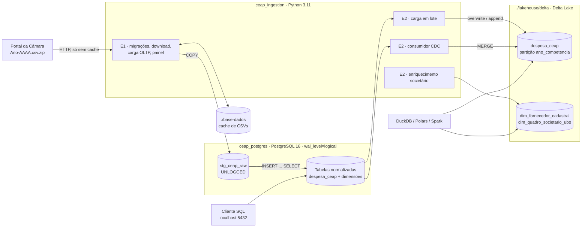

# Arquitetura

A plataforma tem duas camadas, construídas em entregas sucessivas:

| Entrega | Camada | Tecnologia |
| :--- | :--- | :--- |
| **E1** | Fonte transacional (OLTP), normalizada e *insert-only* | PostgreSQL 16 |
| **E2** | Camada analítica em formato aberto (lakehouse), alimentada por lote e por CDC, com enriquecimento societário | Delta Lake (Parquet), lido com DuckDB |

Tudo sobe com um único `docker compose up --build`.

## Visão geral

## Serviços (`docker-compose.yml`)

| Serviço | Container | Imagem | Papel |
| :--- | :--- | :--- | :--- |
| `db` | `ceap_postgres` | `postgres:16-alpine` | Banco OLTP `ceap_oltp`, porta `5432`, com `wal_level=logical`, `max_replication_slots=5` e `max_wal_senders=5` |
| `ingestion` | `ceap_ingestion` | `python:3.11-slim` (build local) | Executa `main.py`: migrações, carga OLTP, lakehouse, enriquecimento e testes; encerra ao terminar |

### Ordem de inicialização

O serviço `ingestion` declara `depends_on: db: condition: service_healthy`. O `db` só fica saudável quando o `healthcheck` (`pg_isready -U postgres -d ceap_oltp`, a cada 5 s, até 6 tentativas) responde. Isso evita a condição de corrida entre a subida do banco e a carga.

Como camada extra de segurança, `main.py` ainda tenta conectar até **15 vezes, a cada 2 s**, antes de desistir.

### Volumes

| Volume | Montagem | Finalidade |
| :--- | :--- | :--- |
| `postgres_data` (nomeado) | `/var/lib/postgresql/data` | Persistência do banco entre execuções |
| `./base-dados` | `/app/base-dados` | Cache dos CSVs, evita novo download |
| `./lakehouse` | `/app/lakehouse` | Tabelas Delta Lake, acessíveis direto do host |
| `./scripts` e `./migrations` | `/app/scripts` e `/app/migrations` | Código montado do host: alterações valem sem rebuild da imagem |

### Variáveis de ambiente do serviço `ingestion`

| Variável | Padrão | Descrição |
| :--- | :--- | :--- |
| `DB_HOST` | `db` | Host do PostgreSQL (nome do serviço na rede do Compose) |
| `DB_PORT` | `5432` | Porta |
| `DB_NAME` | `ceap_oltp` | Banco |
| `DB_USER` / `DB_PASSWORD` | `postgres` / `postgres` | Credenciais (apenas para ambiente acadêmico local) |
| `ANOS` | `2023,2024,2025,2026` | Anos a baixar e carregar no OLTP |
| `LAKEHOUSE_PATH` | `/app/lakehouse` | Raiz das tabelas Delta |

## Imagem de ingestão (`docker/ingestion/Dockerfile`)

- Base `python:3.11-slim`, com `PYTHONUNBUFFERED=1` para os logs aparecerem em tempo real.
- Dependências: `psycopg2-binary`, `requests`, `pyarrow`, `deltalake` e `duckdb`.
- O ponto de entrada é `python scripts/main.py`.

## Etapas do `main.py`

| # | Etapa | Entrega | Detalhes |
| :---: | :--- | :---: | :--- |
| 1 | Conectar ao PostgreSQL (com *retry*) | E1 | [Carga no OLTP](pipeline.md) |
| 2 | Aplicar migrações `001` a `003` | E1/E2 | [Modelo de dados](modelo-de-dados.md) |
| 3 | Garantir os CSVs (cache ou download) | E1 | [Carga no OLTP](pipeline.md) |
| 4 | Carregar e normalizar no OLTP | E1 | [Carga no OLTP](pipeline.md) |
| 5 | Painel das 6 perguntas de gestão | E1 | [Perguntas de gestão](consultas.md) |
| 6 | Carga em lote para o Delta Lake | E2 | [Lakehouse e CDC](lakehouse.md) |
| 7 | Gravar tabelas de enriquecimento societário | E2 | [Enriquecimento societário](enriquecimento.md) |
| 8 | Consultas de auditoria societária | E2 | [Enriquecimento societário](enriquecimento.md#consultas-de-auditoria) |
| 9 | 5 testes de aceite da E2 | E2 | [Lakehouse e CDC](lakehouse.md#testes-de-aceite) |

## Princípios de projeto

**Reprodutibilidade**
:   Um único `docker compose up --build` leva de uma máquina limpa a um banco populado, uma camada analítica gravada e os testes executados, sem serviços pagos ou passos manuais.

**Integridade contábil no OLTP**
:   Valores em `NUMERIC(12, 2)`, chaves estrangeiras `ON DELETE RESTRICT` e `CHECK` nas competências. Campos que vêm vazios ou incompletos nos dados abertos são anuláveis, para que essas linhas sejam aceitas em vez de rejeitadas; só ficam de fora da carga as linhas sem identificador do deputado (`nuDeputadoId`).

**Histórico imutável**
:   A tabela de fatos `despesa_ceap` segue o padrão *insert-only* (livro-razão). Ver [ADR-0001](adr/0001-modelagem-transacional-insert-only-ceap.md).

**Formato aberto, sem *lock-in***
:   A camada analítica são arquivos Parquet com log Delta, legíveis por qualquer ferramenta do ecossistema. Ver [ADR-0002](adr/0002-mecanismo-ingestao-e-formato-aberto.md).

**Leveza**
:   Sem Kafka, Spark ou JVM: a stack inteira roda em poucas centenas de MB de RAM.

## Limitações conhecidas

1. **A verificação de recarga do OLTP depende de um número fixo.** A carga é pulada se `despesa_ceap` tiver exatamente 785.754 linhas e a tabela é recriada se tiver mais. Cargas parciais ou novos dados de 2026 mudam a contagem.
2. **2026 é um ano parcial**: reflete o que a Câmara publicou até a data da carga.
3. **Credenciais fixas** e porta exposta, adequadas apenas para ambiente local acadêmico.
4. **Download sequencial**, ano a ano, sem verificação de integridade além do tamanho mínimo do cache.
5. **O consumidor CDC lê as mudanças por consulta à tabela**, não pelo slot de replicação, e não propaga exclusões. Ver [Lakehouse e CDC](lakehouse.md#como-o-consumidor-funciona).
6. **O enriquecimento societário usa uma base de demonstração** definida no código. Ver [Enriquecimento societário](enriquecimento.md#base-de-dados-usada).
7. **Fora do escopo até a E2:** transformações (E3) e o que vier na E4.

## Gatilhos de revisão da arquitetura

| Decisão | Será revista se… |
| :--- | :--- |
| [ADR-0001](adr/0001-modelagem-transacional-insert-only-ceap.md) · OLTP *insert-only* | o volume passar de **200.000 notas/mês** (particionamento declarativo) ou a latência p95 de agregação no OLTP passar de **2,0 s** (réplica colunar) |
| [ADR-0002](adr/0002-mecanismo-ingestao-e-formato-aberto.md) · Lote + CDC em Delta Lake | as mutações passarem de **5.000 eventos/s** (Redpanda/Kafka) ou for exigida integração com catálogos em nuvem (Apache Iceberg com REST Catalog) |
| [ADR-0003](adr/0003-resolucao-grafo-societario-beneficiario-final.md) · Resolução de UBO | os fornecedores monitorados passarem de **500.000** com cadeias de mais de 6 níveis (banco de grafos) ou a Receita mudar o layout dos dados do CNPJ |
