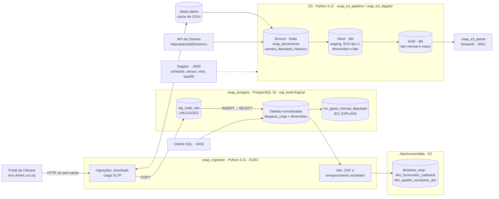

# Arquitetura

A plataforma foi construída em entregas sucessivas:

| Entrega | Camada | Tecnologia |
| :--- | :--- | :--- |
| **E1** | Fonte transacional (OLTP), normalizada e *insert-only* | PostgreSQL 16 |
| **E2** | Camada analítica em formato aberto (lakehouse), alimentada por lote e por CDC, com enriquecimento societário | Delta Lake (Parquet), lido com DuckDB |
| **E3** | Camada analítica transformada, testada e orquestrada: Bronze, Silver e Gold, com painel | Delta Lake + dbt-duckdb + Dagster + Streamlit |

Tudo sobe com um único `docker compose up --build`.

## O que mudou na E3

Na E3 a Squad decidiu, no [ADR-0004](adr/0004-avaliacao-etl-relacional-postgres-vs-lakehouse-direto.md),
que a transformação analítica **não passa mais pelo PostgreSQL**. Os CSVs da Câmara entram direto
numa camada Bronze em Delta Lake (*Direct-to-Lakehouse*), e o dbt constrói a Silver e a Gold sobre
ela. O PostgreSQL e o pipeline da E1/E2 continuam no ar, como OLTP e como base da consulta otimizada
com `EXPLAIN`, mas deixaram de ser o caminho do dado que chega ao painel.

| | Até a E2 | Na E3 |
| :--- | :--- | :--- |
| Caminho do dado analítico | CSV → PostgreSQL → lote e CDC → Delta Lake | CSV → Bronze em Delta Lake, sem passar pelo PostgreSQL |
| Camadas | `despesa_ceap` e as tabelas de sócios | Bronze → Silver → Gold |
| Transformação | scripts Python | dbt (declarativo, com 42 testes de dados) sobre DuckDB |
| Fontes | CSVs da CEAP | CSVs da CEAP e API da Câmara (histórico dos deputados, fonte do SCD tipo 2) |
| Orquestração | `main.py` em sequência | Dagster: jobs, sensor, schedule, retry e backfill |
| Consumo | consultas SQL | painel Streamlit e interface do Dagster |

## Visão geral

O fluxo da E1/E2 (acima) e o da E3 (abaixo) sobem juntos. A E3 só começa quando a ingestão da
E1/E2 termina, porque é ela que baixa os CSVs para `./base-dados`.

As camadas da E3 ficam em `./lakehouse`: a Bronze em `lakehouse/bronze/` (Delta) e a Silver e a
Gold no arquivo `lakehouse/ceap.duckdb` (schemas `silver` e `gold`, mais `auditoria` com as linhas
reprovadas pelos testes). Tabelas, colunas e tipos estão no [dicionário de dados](dicionario-de-dados.md).

## Serviços (`docker-compose.yml`)

| Serviço | Container | Imagem | Papel |
| :--- | :--- | :--- | :--- |
| `db` | `ceap_postgres` | `postgres:16-alpine` | Banco OLTP `ceap_oltp`, porta `5432`, com `wal_level=logical`, `max_replication_slots=5` e `max_wal_senders=5` |
| `ingestion` | `ceap_ingestion` | `python:3.11-slim` (build local) | Executa `main.py`: migrações, carga OLTP, lakehouse da E2, enriquecimento e testes de aceite; encerra ao terminar |
| `e3-pipeline` | `ceap_e3_pipeline` | `python:3.12-slim` (build local, `docker/e3/Dockerfile`) | Ingere a Bronze, busca o histórico na API, roda o `dbt build` com os testes e o `dbt source freshness`; encerra ao terminar e **sai com erro se algum passo falhar** |
| `e3-dagster` | `ceap_e3_dagster` | a mesma da E3 | `dagster dev` na porta `3000`: grafo, execuções, schedule diário, sensor e backfill |
| `e3-painel` | `ceap_e3_painel` | a mesma da E3 | Painel Streamlit na porta `8501`, lendo a Gold só para leitura |

### Ordem de inicialização

1. `db` sobe e só fica saudável quando o `healthcheck` (`pg_isready -U postgres -d ceap_oltp`, a cada 5 s, até 6 tentativas) responde.
2. `ingestion` espera o `db` saudável (`depends_on: condition: service_healthy`). Como segurança extra, `main.py` tenta conectar até **15 vezes, a cada 2 s**.
3. `e3-pipeline` espera a `ingestion` **terminar com sucesso** (`service_completed_successfully`), porque precisa dos CSVs já baixados.
4. `e3-dagster` e `e3-painel` esperam o `e3-pipeline` terminar com sucesso: sem Gold, eles não sobem.

### Volumes

| Volume | Montagem | Usado por | Finalidade |
| :--- | :--- | :--- | :--- |
| `postgres_data` (nomeado) | `/var/lib/postgresql/data` | `db` | Persistência do banco entre execuções |
| `./base-dados` | `/app/base-dados` | `ingestion`, `e3-pipeline`, `e3-dagster` | Cache dos CSVs, evita novo download |
| `./lakehouse` | `/app/lakehouse` | `ingestion` e os 3 serviços da E3 | Tabelas Delta da E2 e da Bronze, e o `ceap.duckdb` com Silver e Gold |
| `./scripts` e `./migrations` | `/app/scripts` e `/app/migrations` | `ingestion` | Código montado do host: alterações valem sem rebuild da imagem |
| `./orquestracao/.dagster_home` | `/app/orquestracao/.dagster_home` | `e3-pipeline`, `e3-dagster` | Histórico de execuções do Dagster, compartilhado entre o pipeline e a interface |

### Variáveis de ambiente

| Variável | Padrão | Serviço | Descrição |
| :--- | :--- | :--- | :--- |
| `DB_HOST` | `db` | `ingestion` | Host do PostgreSQL (nome do serviço na rede do Compose) |
| `DB_PORT` | `5432` | `ingestion` | Porta |
| `DB_NAME` | `ceap_oltp` | `ingestion` | Banco |
| `DB_USER` / `DB_PASSWORD` | `postgres` / `postgres` | `ingestion` | Credenciais (apenas para ambiente acadêmico local) |
| `ANOS` | `2023,2024,2025,2026` | `ingestion` e E3 | Anos a baixar e carregar (o dbt confere os mesmos anos em `anos_esperados`) |
| `LAKEHOUSE_PATH` | `/app/lakehouse` | todos | Raiz do lakehouse |
| `DAGSTER_HOME` | `/app/orquestracao/.dagster_home` | E3 | Instância do Dagster (histórico e `dagster.yaml`) |

## Imagens

**Ingestão E1/E2 (`docker/ingestion/Dockerfile`)**

- Base `python:3.11-slim`, com `PYTHONUNBUFFERED=1` para os logs aparecerem em tempo real.
- Dependências: `psycopg2-binary`, `requests`, `pyarrow`, `deltalake` e `duckdb`.
- O ponto de entrada é `python scripts/main.py`.

**E3 (`docker/e3/Dockerfile`)**

- Base `python:3.12-slim`, com as dependências de `requirements-e3.txt`: `duckdb`, `deltalake`, `dbt-core` e `dbt-duckdb`, `dagster`, `dagster-webserver` e `dagster-dbt`, `streamlit` e `plotly`.
- A extensão `delta` do DuckDB é baixada no build, para não depender de rede em tempo de execução.
- O `dbt parse` roda no build: um erro de sintaxe nos modelos quebra a imagem, não a execução.

## Etapas do `main.py` (E1/E2)

| # | Etapa | Entrega | Detalhes |
| :---: | :--- | :---: | :--- |
| 1 | Conectar ao PostgreSQL (com *retry*) | E1 | [Carga no OLTP](pipeline.md) |
| 2 | Aplicar migrações `001` a `004` | E1/E2/E3 | [Modelo de dados](modelo-de-dados.md) |
| 3 | Garantir os CSVs (cache ou download) | E1 | [Carga no OLTP](pipeline.md) |
| 4 | Carregar e normalizar no OLTP | E1 | [Carga no OLTP](pipeline.md) |
| 4.1 | Recalcular `mv_gasto_mensal_deputado` | E3 | [Consulta otimizada](explain/README.md) |
| 5 | Painel das 6 perguntas de gestão | E1 | [Perguntas de gestão](consultas.md) |
| 6 | Carga em lote para o Delta Lake | E2 | [Lakehouse e CDC](lakehouse.md) |
| 7 | Gravar tabelas de enriquecimento societário | E2 | [Enriquecimento societário](enriquecimento.md) |
| 8 | Consultas de auditoria societária | E2 | [Enriquecimento societário](enriquecimento.md#consultas-de-auditoria) |
| 9 | 5 testes de aceite da E2 | E2 | [Lakehouse e CDC](lakehouse.md#testes-de-aceite) |

## Etapas do pipeline da E3

| # | Etapa | Onde | Detalhes |
| :---: | :--- | :--- | :--- |
| 1 | Ingerir cada ano do CSV na Bronze (uma partição por ano, com retry) | `ingestao/bronze.py`, job `ingestao_ceap` | [E3, seção 4](e3.md#4-orquestração-que-falha) |
| 2 | Buscar o histórico dos deputados na API (com retry; nada é gravado se mais de 1% falhar) | `ingestao/bronze_historico.py` | [E3, seção 3](e3.md#3-dimensão-de-variação-lenta-scd-tipo-2) |
| 3 | `dbt build`: Silver e Gold com os 42 testes de dados e os contratos de esquema; teste reprovado pula a Gold | `dbt_ceap/`, job `transformacao` | [Testes de dados](testes.md) |
| 4 | `dbt source freshness` das duas fontes da Bronze | `orquestracao/demo_falhas.py` | [E3, seção 7](e3.md#7-freshness-e-sla) |

No `docker compose up`, o `e3-pipeline` roda essas etapas uma vez. Depois disso, o Dagster mantém o
ciclo: o schedule `diario_ano_corrente` reingere o ano corrente às 06:00, e o sensor
`transforma_apos_ingestao` dispara a transformação após cada ingestão bem-sucedida. O
[ADR-0006](adr/0006-orquestracao-falha-controlada-e-backfill.md) registra essa decisão.

## Princípios de projeto

**Reprodutibilidade**
:   Um único `docker compose up --build` leva de uma máquina limpa a um banco populado, às camadas analíticas gravadas, aos testes executados e ao painel no ar, sem serviços pagos ou passos manuais. A Gold sai idêntica para os mesmos dados de entrada.

**Integridade contábil no OLTP**
:   Valores em `NUMERIC(12, 2)`, chaves estrangeiras `ON DELETE RESTRICT` e `CHECK` nas competências. Campos que vêm vazios ou incompletos nos dados abertos são anuláveis, para que essas linhas sejam aceitas em vez de rejeitadas; só ficam de fora da carga as linhas sem identificador do deputado (`nuDeputadoId`).

**Histórico imutável**
:   A tabela de fatos `despesa_ceap` segue o padrão *insert-only* (livro-razão). Ver [ADR-0001](adr/0001-modelagem-transacional-insert-only-ceap.md). Na E3, o partido de cada deputado guarda o histórico (SCD tipo 2), em vez de ser sobrescrito. Ver [ADR-0005](adr/0005-modelagem-dimensional-granularidade-scd-ceap.md).

**Formato aberto, sem *lock-in***
:   A camada analítica são arquivos Parquet com log Delta, legíveis por qualquer ferramenta do ecossistema. Ver [ADR-0002](adr/0002-mecanismo-ingestao-e-formato-aberto.md).

**Falha não publica dado errado**
:   Uma fonte fora do ar ou um teste reprovado impede a publicação, e a Gold anterior permanece. Isso foi demonstrado derrubando as dependências de propósito. Ver [ADR-0006](adr/0006-orquestracao-falha-controlada-e-backfill.md).

**Leveza**
:   Sem Kafka, Spark ou JVM. A plataforma inteira (PostgreSQL, ingestão, dbt, Dagster e painel) roda numa máquina de 7 a 8 GB de RAM.

## Limitações conhecidas

1. **A verificação de recarga do OLTP depende de um número fixo.** A carga é pulada se `despesa_ceap` tiver exatamente 785.754 linhas e a tabela é recriada se tiver mais. Cargas parciais ou novos dados de 2026 mudam a contagem.
2. **2026 é um ano parcial**: reflete o que a Câmara publicou até a data da carga.
3. **Credenciais fixas** e porta exposta, adequadas apenas para ambiente local acadêmico.
4. **Download sequencial**, ano a ano, sem verificação de integridade além do tamanho mínimo do cache.
5. **O consumidor CDC lê as mudanças por consulta à tabela**, não pelo slot de replicação, e não propaga exclusões. Ver [Lakehouse e CDC](lakehouse.md#como-o-consumidor-funciona).
6. **O enriquecimento societário usa uma base de demonstração** definida no código. Ver [Enriquecimento societário](enriquecimento.md#base-de-dados-usada).
7. **A E3 depende da API da Câmara em tempo de execução**: cerca de 860 chamadas a cada transformação. Sem a API, o SCD não é montado numa máquina nova; o cache em `lakehouse/_cache/` só existe depois da primeira execução.
8. **Um único escritor no DuckDB.** O `dagster.yaml` limita o Dagster a uma execução por vez, porque todos os jobs gravam o mesmo `ceap.duckdb`.
9. **O schedule só roda com o Dagster no ar.** Fora do `docker compose up`, ninguém dispara a ingestão diária.
10. **Duas cópias analíticas convivem**: a tabela `delta/despesa_ceap` da E2 e a Bronze da E3, alimentadas de formas diferentes.
11. **A janela dos rankings termina em jul/2025**, por causa da ruptura de publicação do SIGEPA a partir de ago/2025.

## Gatilhos de revisão da arquitetura

| Decisão | Será revista se… |
| :--- | :--- |
| [ADR-0001](adr/0001-modelagem-transacional-insert-only-ceap.md) · OLTP *insert-only* | o volume passar de **200.000 notas/mês** (particionamento declarativo) ou a latência p95 de agregação no OLTP passar de **2,0 s** (réplica colunar) |
| [ADR-0002](adr/0002-mecanismo-ingestao-e-formato-aberto.md) · Lote + CDC em Delta Lake | as mutações passarem de **5.000 eventos/s** (Redpanda/Kafka) ou for exigida integração com catálogos em nuvem (Apache Iceberg com REST Catalog) |
| [ADR-0003](adr/0003-resolucao-grafo-societario-beneficiario-final.md) · Resolução de UBO | os fornecedores monitorados passarem de **500.000** com cadeias de mais de 6 níveis (banco de grafos) ou a Receita mudar o layout dos dados do CNPJ |
| [ADR-0004](adr/0004-avaliacao-etl-relacional-postgres-vs-lakehouse-direto.md) · Lakehouse direto, sem staging no PostgreSQL | surgir uma aplicação CRUD multiusuário que exija bloqueio por linha abaixo de **50 ms**, ou o volume exigir um catálogo distribuído externo (Apache Polaris, Unity Catalog) |
| [ADR-0005](adr/0005-modelagem-dimensional-granularidade-scd-ceap.md) · Esquema estrela, fato atômico e SCD tipo 2 | a Câmara deixar de exigir notas fiscais individuais, ou as fontes integradas passarem de **15 bases** com esquema instável (Data Vault 2.0) |
| [ADR-0006](adr/0006-orquestracao-falha-controlada-e-backfill.md) · Dagster com retry e backfill por ano | a Câmara passar a publicar a CEAP por mês (partições mensais), ou o pipeline ganhar mais de uma fonte com execução em tempo real |
| [ADR-0007](adr/0007-ferramenta-do-painel-analitico.md) · Painel em Streamlit | houver mais de **3 pedidos por mês** de visões novas vindos de fora da Squad, mais de **8 visões**, ou necessidade de acesso por perfil (migrar para o Metabase) |
