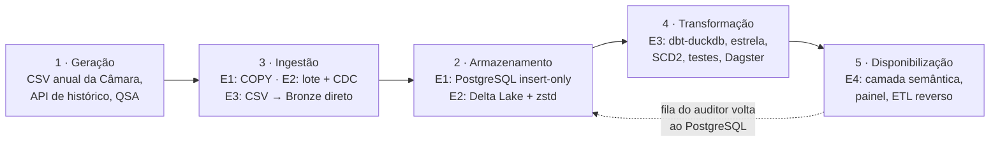

# Retrospectiva — o ciclo de vida do dado (E1 a E4)

- **Data:** 24/11/2026 (fechamento da Entrega E4)
- **Escopo:** o caminho completo do dado da CEAP na plataforma: **geração → armazenamento → ingestão → transformação → disponibilização**.
- **Fontes:** diário de bordo (semanas 01 a 10), ADRs 0001 a 0008, [portfólio de ADRs](../adr/README.md) (conferência de gatilhos de 24/11/2026), [E3](../e3.md), [Erros tratados da E3](../e3-erros-tratados.md), [E4](../e4.md), [Análise de LGPD](../lgpd.md) e [Arquitetura](../arquitetura.md#limitações-conhecidas). Todo número abaixo vem desses documentos. Nada foi medido de novo para esta página.

!!! note "Revisão"
    Rascunho feito com apoio de IA a partir dos documentos do repositório (registrar em `AI-USAGE.md`).
    A Squad precisa revisar e aprovar o texto. Isso vale principalmente para a seção
    [O que faríamos diferente](#o-que-faríamos-diferente), que é a opinião do grupo, e não um fato medido.

## Resumo

1. **O que mais funcionou foi testar o dado em vez de confiar nele.** Os testes da E3 barraram problemas reais da fonte que ninguém tinha previsto: a subcota 996 nova, a queda da divulgação em ano eleitoral e a ruptura do SIGEPA.
2. **A premissa que mais falhou foi que a fonte era estável.** O CSV da Câmara é regerado (as contagens mudam conforme a data do download) e sobrescreve o partido com o atual (22% dos lançamentos).
3. **O desenho mudou bastante ao longo do semestre.** O PostgreSQL foi o centro na E1 e na E2, saiu do fluxo analítico na E3 e voltou como destino na E4.
4. **Os gatilhos de ADR quase não ajudaram.** Só um disparou (ADR-0007), e a decisão não foi revista. As revisões que de fato aconteceram (ADR-0005 e o papel do PostgreSQL) não vieram de nenhum gatilho.
5. **A privacidade chegou tarde.** A análise de LGPD da E4 achou CPF de fornecedor no painel, CPF de deputado no OLTP e passageiros no Delta da E2. Tudo isso estava na plataforma desde a E1 ou a E2.

## O ciclo percorrido

A ordem do título da issue (armazenamento antes de ingestão) segue a ordem das entregas: a E1 desenhou o armazenamento e a carga juntos. Na prática o dado entra pela ingestão antes de ser armazenado, como mostra a figura.

---

## 1. Geração: a fonte (semanas 01 a 03 e o que a E3 descobriu)

**O que é:** a Câmara publica um CSV por ano com cada despesa da CEAP. A E3 acrescentou a API `/deputados/{id}/historico`, e a E2 acrescentou o QSA da Receita Federal.

### O que funcionou

- **A escolha da base.** A CEAP tem série contínua, granularidade fina (nota, CNPJ, valor) e volume suficiente para a disciplina: 785 mil lançamentos na legislatura ([semana 01](semana-01.md), [semana 05](semana-05.md)).
- **A pergunta de gestão escrita cedo e numa frase só** ([semana 02](semana-02.md)). Ela guiou a modelagem da E1, os marts da E3 e as métricas da E4. Os três blocos do painel correspondem às três partes da pergunta.
- **As particularidades da fonte foram previstas desde a E1** ([semana 03](semana-03.md)): lideranças sem CPF, telefonia sem data de emissão e valores negativos legítimos. O modelo aceitou essas linhas em vez de descartá-las.

### O que não funcionou

- **Tratamos o CSV como um fato fixo, e ele é uma publicação que muda.** A E1 carregou 785.754 linhas, a Bronze da E3 785.929, e cada download traz uma contagem um pouco diferente. Em 2023: 232.747, 232.745 e 232.754 ([erros tratados, nº 21](../e3-erros-tratados.md)). Na E1 a diferença pareceu perda na carga. Só a E3 mostrou que era a fonte.
- **O CSV sobrescreve o partido com o atual.** 173.413 lançamentos (22%) estão com um partido diferente do vigente na data do gasto. Pelo CSV, 92 deputados trocaram de partido. Pelo histórico oficial, foram 186. Com a sobrescrita, R$ 33,4 mi iriam para o partido errado ([ADR-0005, seção 9.2](../adr/0005-modelagem-dimensional-granularidade-scd-ceap.md)). A E1 gravava `sigla_partido_emissao` a partir desse mesmo campo, ou seja, já guardava o partido sobrescrito.
- **`ideDocumento` não é chave.** Vale 0 em 30.357 linhas e se repete em até 9 linhas nos bilhetes SIGEPA.
- **A fonte teve rupturas e dado atrasado:** a subcota 998 (SIGEPA) sem débitos desde ago/2025, meses recentes incompletos (jun/2026 com 54% do gasto típico), a subcota 996 surgindo num download de 03/11 e a queda da divulgação em jun/2026 ([erros tratados, nº 9, 10, 12 e 20](../e3-erros-tratados.md)).
- **O QSA nunca foi o dado real.** O enriquecimento societário usa uma base de demonstração escrita no código (12 empresas e 12 relações) ([enriquecimento](../enriquecimento.md)).

**Lição:** a etapa de geração não está sob nosso controle. Era preciso **perfilar a fonte antes de modelar** e registrar a data e o hash de cada download.

---

## 2. Armazenamento (E1 e E2)

**O que é:** na E1, PostgreSQL 16 normalizado e *insert-only*. Na E2, Delta Lake particionado por ano com Zstandard. Na E3, a Bronze em Delta e a Silver e a Gold num `ceap.duckdb`.

### O que funcionou

- **O padrão *insert-only* com três carimbos de tempo** ([ADR-0001](../adr/0001-modelagem-transacional-insert-only-ceap.md)). A ideia sobreviveu ao semestre todo: a fila do auditor da E4 (`alerta.*`) usa o mesmo princípio, com um gatilho que recusa `UPDATE` e `DELETE`.
- **`UNIQUE NULLS NOT DISTINCT`** resolveu as duplicatas de fornecedor sem CNPJ na carga ano a ano ([semana 05](semana-05.md)).
- **Delta Lake + zstd** reduziu o volume de 178 MB (PostgreSQL) para 64,8 MB, sem cluster nem JVM ([semana 06](semana-06.md)).
- **A partição por ano** permitiu o backfill de 2023 e 2024 sem tocar nos outros anos, com a Gold saindo com hash idêntico ([semana 10](semana-10.md)).

### O que não funcionou

- **Guardamos mais dado pessoal do que precisávamos.** O OLTP da E1 guarda `parlamentar.cpf` completo e `despesa_ceap.passageiro`, e o passageiro também foi para o Delta da E2 e para o WAL do CDC ([LGPD, seção 1](../lgpd.md)). Nenhuma consulta usa esses campos.
- **Duas cópias analíticas convivem:** `delta/despesa_ceap` da E2 e a Bronze da E3, alimentadas de formas diferentes ([arquitetura, limitação 10](../arquitetura.md#limitações-conhecidas)). A cópia da E2 não foi aposentada quando a E3 a substituiu.
- **A recarga do OLTP depende de um número fixo** (785.754 linhas), justamente o número que a fonte não mantém.
- **O DuckDB aceita um escritor só**, e o Dagster teve de ser limitado a uma execução por vez.

---

## 3. Ingestão (E1, E2 e E3)

**O que é:** na E1, `COPY` em staging `UNLOGGED`. Na E2, lote idempotente e CDC pelo WAL do PostgreSQL para o Delta. Na E3, o CSV vai direto para a Bronze (*Direct-to-Lakehouse*), orquestrado pelo Dagster.

### O que funcionou

- **Desempenho da carga:** 97,4 s para os 4 anos no PostgreSQL ([semana 05](semana-05.md)) e 34,2 s para o lote no Delta ([semana 06](semana-06.md)).
- **Idempotência e semântica de entrega:** duas execuções seguidas sem nenhuma duplicata, dado atrasado de 2023 roteado para a partição certa e reenvio duplicado absorvido (*effectively-once*) ([semana 07](semana-07.md)).
- **CDC com 380 ms ponta a ponta**, sem gatilhos no banco e sem degradar a escrita.
- **A Bronze da E3 preserva o dado bruto** sem rejeitar linhas. Isso é o que permitiu auditar as exceções da fonte depois ([ADR-0004](../adr/0004-avaliacao-etl-relacional-postgres-vs-lakehouse-direto.md)).
- **Falha controlada:** com a fonte fora, foram 3 retries e a Bronze e a Gold ficaram intactas. Com a API fora, o dbt nem começou ([erros tratados, cenários](../e3-erros-tratados.md)).

### O que não funcionou

- **O CDC foi construído para uma fonte que não é contínua.** A Câmara publica um CSV anual regerado, e a carga diária é de um ano por vez. O gatilho do ADR-0002 (5.000 eventos/s) mostra a distância: não há fluxo contínuo nenhum ([portfólio, ADR-0002](../adr/README.md)). Além disso, o consumidor lê as mudanças consultando a tabela, e não pelo slot de replicação, e não propaga exclusões. Na E3, o fluxo analítico deixou de passar pelo PostgreSQL, e o CDC ficou fora do caminho principal.
- **A E3 depende da API da Câmara a cada transformação** (~860 chamadas). Numa máquina nova, sem a API, o SCD não é montado.
- **A subida do zero escondia falhas:** o `docker compose` terminava "com sucesso" sem Gold, e a E3 não esperava o download dos CSVs. Isso só apareceu quando testamos numa cópia limpa do repositório, no fim da E3 ([semana 10](semana-10.md)).

---

## 4. Transformação (E3)

**O que é:** dbt-duckdb sobre a Bronze, com esquema estrela, fato atômico, SCD tipo 2 do partido e marts de gestão. O Dagster orquestra, com retry e backfill.

### O que funcionou

- **Grão declarado e reconciliação obrigatória.** O fato tem a mesma contagem e a mesma soma da Bronze, a Gold soma exatamente o fato e o rateio por partido fecha com o desvio do mês. Isso pega fan-out e dupla agregação.
- **O SCD2 vem do histórico oficial**, não do CSV, e tem um teste de regressão com um caso real verificado (deputado 204494).
- **Testes calibrados com dados reais funcionaram como sensor da fonte.** Eles barraram a subcota 996, a queda da divulgação e o salto de jul/2026 antes de esses problemas chegarem à Gold. O seed `ruptura_publicacao.csv` obriga a Squad a analisar cada quebra nova.
- **Falhas provocadas de propósito** (retry, fonte fora, API fora, dado sujo) e **backfill com hash idêntico** mostraram que a orquestração falha do jeito certo ([ADR-0006](../adr/0006-orquestracao-falha-controlada-e-backfill.md)).
- **Determinismo:** trocar ponto flutuante por `DECIMAL` deixou a Gold reproduzível entre execuções.

### O que não funcionou

- **Três premissas do ADR-0005 estavam erradas:** o grão (`id_despesa` era um contador da E1), a fonte do SCD e a definição de "média mensal". O ADR foi revisto em 03/11 e de novo em 19/11, quando a média foi trocada pela mediana ([ADR-0005, seção 9](../adr/0005-modelagem-dimensional-granularidade-scd-ceap.md)).
- **A janela dos rankings acaba em jul/2025** por causa da ruptura do SIGEPA. A pergunta fala de 2023–2026, e a resposta cobre fev/2023 a jul/2025 (30 meses).
- **O painel da E3 terminava contas por conta própria** (somas por categoria, corte de 5 deputados por partido, erro da sobrescrita dividido por 2). Isso só foi resolvido na E4 com a camada semântica.
- **Erros do próprio pipeline** (vaivém falso de partido, partidos da 56ª na trajetória, linha duplicada no ranking) foram pegos pelos testes ou por revisão manual, mas durante o desenvolvimento e não no desenho ([erros tratados, nº 22 a 29](../e3-erros-tratados.md)).

---

## 5. Disponibilização (E4)

**O que é:** a camada semântica no dbt (5 views com contrato), o painel Streamlit lendo só essa camada, o ETL reverso por *push* da fila de auditoria para o PostgreSQL e os controles de acesso e de LGPD.

### O que funcionou

- **Uma métrica, um lugar.** As 32 métricas são definidas em `_semantic.yml`, com contrato de esquema. O painel só ordena e formata. A troca de fonte não mudou nenhum número: os 12 números conferidos saíram idênticos ([E4, seção 1.3](../e4.md)).
- **A latência foi medida, não suposta:** views a 217 ms de mediana contra 83 ms em tabelas e 71 ms em Parquet. Com o volume da CEAP, a latência não decide, e as views evitam uma cópia defasada ([E4, seção 1.4](../e4.md)).
- **A opção nula foi testada de verdade.** O CSV agendado é mais barato (26 ms contra 38 ms para publicar), mas apaga a decisão do auditor na publicação seguinte. Foi isso que justificou a tabela no PostgreSQL ([E4, seção 2.3](../e4.md)).
- **A fila do auditor herdou o *insert-only* da E1**, com autoria gravada por gatilho (`session_user`), usuário de serviço sem superusuário (`ceap_etl_reverso`) e, com o destino fora do ar, 3 tentativas e nenhuma linha pela metade ([E4, seção 2.2](../e4.md)).

### O que não funcionou

- **O painel expõe dado pessoal.** A tabela de fornecedores mostra o **CPF completo** de pessoa física: há 314 CPFs completos na Gold que o painel lê. `sk_fornecedor` é o md5 do CPF, que se desfaz por força bruta ([LGPD, seção 1](../lgpd.md)).
- **O painel não tem controle de acesso.** Ele monta o `./lakehouse` inteiro. Ler só a Gold é uma convenção do código, e o Streamlit não tem perfil de usuário.
- **A zona de consumo recortada** (`ceap_painel.duckdb`, com CPF mascarado e pseudônimo) foi proposta e não foi implementada. As tarefas de descarte T1 a T6 da análise de LGPD também estão como "alvo".
- **A fila tem até um dia de defasagem** em relação à camada semântica. Isso é aceitável para o auditor de hoje, e está como gatilho no ADR-0008.

---

## Gatilhos de ADR: quais dispararam e o que aconteceu

Conferência feita em 24/11/2026 com a plataforma subida do zero. A fonte é o [portfólio de ADRs](../adr/README.md) (issue #11).

| ADR | Decisão | Gatilho disparou? | A decisão foi revista? |
| :--- | :--- | :--- | :--- |
| [0001](../adr/0001-modelagem-transacional-insert-only-ceap.md) | OLTP *insert-only* | não (máximo de 23.430 notas/mês contra limiar de 200.000; p95 de 378 ms contra 2,0 s) | não precisou |
| [0002](../adr/0002-mecanismo-ingestao-e-formato-aberto.md) | Lote + CDC em Delta | não (não há fluxo contínuo; não há catálogo em nuvem) | não |
| [0003](../adr/0003-resolucao-grafo-societario-beneficiario-final.md) | UBO em lote | não (55.894 fornecedores contra limiar de 500.000) | não |
| [0004](../adr/0004-avaliacao-etl-relacional-postgres-vs-lakehouse-direto.md) | Lakehouse direto | não | **o papel do PostgreSQL mudou sem gatilho:** voltou como destino na E4 (registrado no ADR-0008) |
| [0005](../adr/0005-modelagem-dimensional-granularidade-scd-ceap.md) | Estrela e SCD2 | não | **sim, duas vezes (03/11 e 19/11), por evidência da implementação, não por gatilho** |
| [0006](../adr/0006-orquestracao-falha-controlada-e-backfill.md) | Dagster e backfill | não (a Câmara continua publicando por ano) | não; a E4 acrescentou o job `etl_reverso` dentro do mesmo desenho |
| [0007](../adr/0007-ferramenta-do-painel-analitico.md) | Painel em Streamlit | **sim:** surgiu dado que exige acesso restrito por perfil (CPF de fornecedor, achado na análise de LGPD) | **não**: o ADR previa migrar para o Metabase, e nem a troca foi feita nem ela foi descartada formalmente |
| [0008](../adr/0008-disponibilizacao-camada-semantica-etl-reverso.md) | Camada semântica e ETL reverso | não (p90 de 251 ms contra limiar de 1 s; 32 métricas contra 50; 1 destino; 0 falhas seguidas) | novo na E4 |

### O que os gatilhos ensinaram

1. **O único gatilho que disparou ficou sem dono.** O ADR-0007 disparou perto do prazo final e ninguém reabriu a decisão. Um gatilho sem responsável e sem data de conferência é só um registro.
2. **As revisões reais vieram de fora dos gatilhos.** Nenhum gatilho cobria "a premissa sobre os dados está errada" (o caso do ADR-0005) ou "surgiu uma exigência de privacidade" (o caso do ADR-0007, que só disparou por acaso, porque o texto citava dados de fornecedores como exemplo).
3. **Os gatilhos de escala nunca iam disparar.** Os limiares de 200.000 notas/mês, 500.000 fornecedores e 5.000 eventos/s estão uma ou mais ordens de grandeza acima de uma base que não cresce dentro da legislatura.
4. **Vários gatilhos não tinham métrica** (catálogo em nuvem, aplicação CRUD, "publicar por mês"). O portfólio propõe versões medíveis para os ADRs 0002, 0004 e 0006.
5. **O ADR-0008 já saiu melhor:** cada gatilho tem limiar, valor atual e ação. Esse é o formato que deveríamos ter usado desde a E1.

---

## O que faríamos diferente

> Opinião da Squad a partir das evidências acima. Revisar e ajustar antes de aprovar.

1. **Perfilar a fonte antes de modelar.** Na E1, conferir a unicidade de `ideDocumento`, comparar o partido do CSV com a API de histórico e baixar a fonte duas vezes em datas diferentes. Isso teria antecipado as três premissas erradas do ADR-0005 e a "perda" de 175 linhas.
2. **Versionar cada download da fonte** (data e hash do arquivo) e trocar números fixos como 785.754 por reconciliação com o arquivo carregado.
3. **Privacidade desde a E1.** Não gravar CPF do deputado nem passageiro, mascarar o CPF de fornecedor pessoa física já na entrada, usar pseudônimo com chave secreta em vez de md5 e nunca conectar serviços como superusuário. Tudo isso foi achado só na E4 e ficou como pendência.
4. **Escrever gatilhos com limiar, responsável e data de conferência**, e conferir todos a cada entrega, não só no fim. Incluir gatilhos de premissa ("um teste de qualidade reprovou por causa de uma premissa do modelo") e de exigência regulatória.
5. **Escolher a ingestão pela natureza da fonte.** Para um CSV anual regerado, a recarga periódica idempotente (a opção nula do ADR-0002) é suficiente. O CDC deveria ter sido apresentado desde a E2 como demonstração da técnica, com essa ressalva explícita.
6. **Aposentar o que foi substituído.** Ao criar a Bronze da E3, desligar ou marcar como legado o `delta/despesa_ceap` da E2, em vez de manter duas cópias analíticas.
7. **Testar a subida do zero desde a E1**, numa cópia limpa e de preferência no CI. Os dois problemas de subida da E3 foram achados só no fechamento.
8. **Criar a camada semântica junto com a Gold.** Um painel que faz conta sozinho é um segundo lugar onde a métrica mora, e isso só foi corrigido uma entrega depois.
9. **Decidir cedo sobre dados que não vamos ter.** O QSA real nunca foi carregado. Teria sido melhor cortar esse escopo formalmente na E2, ou buscar o extrato real, do que manter uma base de demonstração até a E4.

## Pendências que ficam abertas

| Pendência | Origem | Próximo passo |
| :--- | :--- | :--- |
| Gatilho do ADR-0007 disparado e sem resposta | [Portfólio de ADRs](../adr/README.md) | Implementar a zona de consumo e registrar que o recorte resolveu a condição, ou abrir um ADR que substitua o 0007 |
| CPF completo de fornecedor pessoa física no painel e `sk_fornecedor` = md5 do CPF | [LGPD](../lgpd.md) | Mascarar na Bronze e no OLTP; pseudônimo com HMAC |
| `parlamentar.cpf` e `passageiro` no OLTP e no Delta da E2 | [LGPD](../lgpd.md) | `DROP COLUMN` e reprocessamento, conforme as tarefas T1 a T6 |
| Janela do ranking limitada a jul/2025 | [Erros tratados, nº 9](../e3-erros-tratados.md) | Acompanhar a republicação do SIGEPA pela Câmara |
| QSA de demonstração | [Enriquecimento](../enriquecimento.md) | Carregar o extrato real da Receita ou retirar o UBO do escopo |
