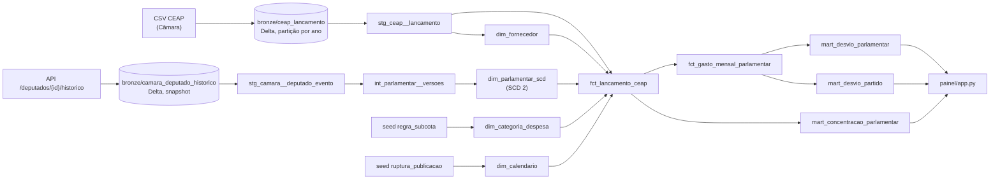

# Entrega E3 — Modelagem dimensional, testes de domínio, orquestração e painel

> Documento de entrega. Ele precisa ser revisado e aprovado por um integrante que não o redigiu.
> Os números foram medidos sobre os CSVs da Câmara baixados em 2026-09-28 e o histórico da API
> extraído em 2026-11-03.

A E3 responde à pergunta da E1:

> *Quais parlamentares e partidos da 57ª Legislatura (2023–2026) apresentam maior desvio de
> gastos acima da média mensal da CEAP, e quais categorias e fornecedores concentram esses
> recursos?*



## Como rodar

```bash
# local (Python 3.12)
python3.12 -m venv .venv && .venv/bin/pip install -r requirements-e3.txt
export LAKEHOUSE_PATH=$PWD/lakehouse
.venv/bin/python orquestracao/demo_falhas.py base     # Bronze + dbt build completo
.venv/bin/streamlit run painel/app.py                 # painel em :8501
.venv/bin/dagster dev -f orquestracao/definitions.py  # grafo, execuções, backfill em :3000

# ou via Docker
docker compose --profile e3 up --build
```

---

## 1. Fato com grão declarado

Cada modelo declara o grão na descrição e em `meta.grao`, e um teste `grao_unico` verifica
essa declaração.

| Modelo | Grão (uma linha por…) | Teste de grão |
| :--- | :--- | :--- |
| `fct_lancamento_ceap` | lançamento publicado (documento, trecho de bilhete ou crédito) | `id_lancamento` único + reconciliação com a Bronze |
| `dim_parlamentar_scd` | versão do deputado (partido/UF constantes) | `sk_parlamentar`; `(id_cadastro_camara, numero_versao)` |
| `fct_gasto_mensal_parlamentar` | deputado × versão × competência | `(sk_parlamentar, competencia)` |
| `mart_desvio_parlamentar` | deputado | `id_deputado` |
| `mart_desvio_partido` | partido na data do gasto | `sigla_partido` |
| `mart_concentracao_parlamentar` | deputado × subcota × fornecedor | `(id_deputado, num_subcota, sk_fornecedor)` |

**Por que não "um documento fiscal":** `ideDocumento` vale 0 em 30.357 linhas e se repete em
até 9 linhas nos bilhetes SIGEPA. A E1 usava um `BIGSERIAL` como chave, que conta linhas carregadas
e não identifica o lançamento.

**Dupla agregação:** no mart mensal, as colunas que se repetem entre as versões de um mesmo mês
(`gasto_deputado_mes`, `media_uf_mes`, `desvio_deputado_mes`) estão listadas como
`meta.soma_proibida`. Para somar por partido existe `desvio_alocado`, e o teste
`assert_desvio_alocado_reconcilia` garante que o rateio fecha. Esse teste pegou um bug real
durante o desenvolvimento: um mês com gasto líquido zero não rateava o desvio.

## 2. Testes que verificam o que o domínio tem de sujo

Todos rodam no `dbt build`. As falhas ficam gravadas no schema `auditoria` (`store_failures`).

| Teste | O que pega | Achado real nos dados |
| :--- | :--- | :--- |
| `assert_fato_reconcilia_com_bronze` | fan-out de junção, linha perdida | — |
| `assert_negativo_somente_em_subcota_de_compensacao` | valor negativo onde não cabe | negativos só nas subcotas 40, 996, 998 e 999 (créditos de bilhete e devolução de auxílio-moradia), regra registrada em `seeds/regra_subcota.csv` |
| `assert_subcota_sem_salto` | salto de série **por subcota** | **ago/2025: a subcota 998 (SIGEPA, mediana de R$ 3,5 mi/mês) some.** O teste do total não pegou, porque o total caiu só 21% |
| `assert_serie_mensal_sem_salto` / `_sem_lacuna` | degrau ou mês ausente no total e no nº de deputados | calibrado: razão do gasto entre 0,75 e 1,35 e do nº de deputados entre 0,98 e 1,03 nos meses fechados |
| `assert_subcota_nao_some_entre_anos` | "município que some": subcota relevante que desaparece no ano seguinte | 998 some em 2026 (mesma ruptura) |
| `assert_scd_preserva_partido_da_epoca` | junção do fato com o SCD só por id (pegaria o partido atual) | — |
| `assert_scd_caso_conhecido_204494` | regressão com caso verificado na API | — |
| `assert_scd_janelas_contiguas` | janelas sobrepostas, vazias ou com buraco | pegou um vaivém falso A→B→A na primeira versão do SCD (derivada do CSV) |
| `assert_valor_inconsistente_sob_controle` | `líquido ≠ documento − glosa` acima de 0,3% | 974 lançamentos (0,12%): sinalizados, não descartados |
| `assert_divergencia_csv_vs_historico` (warn) | tamanho da sobrescrita feita pela fonte | **173.413 lançamentos** |
| `assert_deputado_ativo_nao_some_no_meio` (warn) | gabinete sem gasto por 3+ meses no meio do mandato | 136 casos para conferência humana |

Rupturas conhecidas ficam em `seeds/ruptura_publicacao.csv`, com a evidência. Os testes ignoram
**só** o que está registrado ali, então uma ruptura nova quebra o build.

## 3. Dimensão de variação lenta (SCD tipo 2)

O erro clássico aqui vem **da própria fonte**: o CSV da CEAP regrava `sgPartido` com o partido
atual do deputado. Exemplo verificado: o ideCadastro 204494 aparece como PRD em fev/2023, mas o
histórico oficial registra PATRIOTA até 07/02/2024.

- O SCD é construído do histórico de eventos da API (`bronze/camara_deputado_historico`).
- A junção do fato usa a data do gasto contra `[valido_de, valido_ate)`.
- `mart_desvio_partido` traz, lado a lado, o resultado correto e o que se obteria com a
  sobrescrita (`*_se_sobrescrito`). Na janela comparável, a sobrescrita manda **R$ 33,4 mi**
  para o partido errado.
- `dim_fornecedor` é **tipo 1**, por decisão justificada: todas as agregações são por documento
  (CNPJ/CPF), então sobrescrever a grafia do nome não altera nenhuma série. A quantidade de
  grafias fica em `qtd_grafias_nome`.

## 4. Orquestração que falha

Ver ADR-0006 e `orquestracao/evidencias/*.json`.

`python orquestracao/demo_falhas.py` derruba cada dependência de propósito. "Hash da Gold" é
o md5 de `(id_deputado, desvio_acumulado)` em `gold.mart_desvio_parlamentar`: hash igual antes e
depois significa que a falha não alterou nada publicado.

| Cenário | O que foi feito | Resultado observado (2026-11-03) |
| :--- | :--- | :--- |
| `retry` | as 2 primeiras leituras de `Ano-2025.csv` falham (`CEAP_FALHA_TRANSITORIA=2`) | run **com sucesso** após 2 tentativas extras (`STEP_UP_FOR_RETRY` = 2) |
| `fonte_fora` | diretório dos CSVs aponta para pasta vazia | falha após 3 retries (`FonteIndisponivel`), **versão Delta da Bronze inalterada**, Gold com o mesmo hash. A transformação não roda: no Dagster, o sensor `transforma_apos_ingestao` só reage a ingestão bem-sucedida (o script não executa sensores, então isso é configuração, não algo observado) |
| `api_fora` | API de histórico aponta para porta fechada | `bronze/camara_deputado_historico` falha após 3 retries (`ApiIndisponivel`). O passo `modelos_dbt` **nem inicia**, e o snapshot do SCD e a Gold continuam iguais |
| `dado_sujo` | um combustível com `vlrLiquido = -999.99` injetado numa cópia do lakehouse | `assert_negativo_somente_em_subcota_de_compensacao` **reprova**. O dbt pula os 4 modelos Gold, que mantêm o hash anterior. A Silver da cópia é reconstruída com o dado sujo, e as linhas reprovadas ficam no schema `auditoria` para inspeção |
| `backfill` | reprocessa 2023 e 2024 e depois a transformação | só essas partições ganham novo `_ingerido_em`, as contagens por ano não mudam e a **Gold sai com hash idêntico** |

O backfill com hash idêntico só passou depois de uma correção. Na primeira versão, a média da UF
era `double`, e a ordem da soma entre threads mudava a 10ª casa decimal de uma execução para
outra. Média e desvio passaram a `DECIMAL`, e três builds seguidos produziram o mesmo hash.

## 5. Painel que responde à pergunta

`painel/app.py` tem **três blocos, um por parte da pergunta**. Cada bloco abre com a resposta em
uma frase e tem um único gráfico:

1. **Parlamentares:** ranking do desvio acumulado acima da média da UF (top 15).
2. **Partidos:** desvio médio por deputado-mês, pelo partido **na data do gasto**, com a tabela
   do erro que a sobrescrita causaria.
3. **Categorias e fornecedores:** para o parlamentar escolhido, a categoria que gera o desvio
   (excesso sobre a média da UF) e os 10 maiores fornecedores com a participação de cada um.

Limitações exibidas no próprio painel: janela comparável (fev/2023 a jul/2025), ruptura do
SIGEPA e meses ainda em maturação. **Desvio não é irregularidade**: indica onde olhar primeiro.

## 6. LGPD

A coluna `cpf` do parlamentar não é gravada nem na Bronze. Ela entra, porém, no md5 de
`_hash_lancamento`: como os demais campos estão na Bronze e um CPF tem só ~10⁹ valores
possíveis, o CPF pode ser recuperado por força bruta (o dado já é publicado pela Câmara). O nome do passageiro (`txtPassageiro`, que
identifica assessores, pessoas físicas privadas) fica na Bronze, que é cópia fiel do dado
público, mas não passa para a Silver nem para a Gold.
