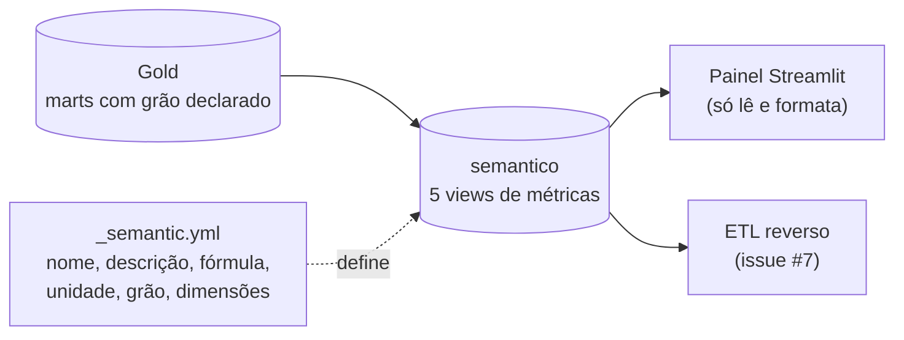
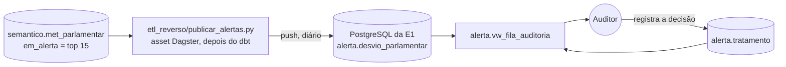

# Entrega E4 — Disponibilização do dado

> Documento da E4. Cobre a **camada semântica de métricas** (issue #6) e o **ETL reverso** (issue #7).
> A decisão sobre como o dado é disponibilizado fica no ADR-0008 (issue #11).

> **Mudança posterior à entrega (26/11/2026):** a camada semântica ganhou 3 views (série mensal,
> lançamentos com o link do documento e resultado do último build), o CPF de fornecedor pessoa física
> passou a sair mascarado, e o painel passou a mostrar quem, quando e com que prova. As seções 1.1 a
> 1.5 descrevem a entrega (tag `e4`); o catálogo de métricas (1.2) é gerado do código atual e já inclui
> as views novas. O que mudou está na [seção 1.6](#16-depois-da-entrega-o-painel-mostra-o-levantamento).

## 1. Camada semântica de métricas (consumo duplo)

**Problema:** na E3, o painel lia a Gold e terminava algumas contas por conta própria: somava os
fornecedores de cada categoria, somava os 10 maiores fornecedores, dividia o erro da sobrescrita por
dois e aplicava o corte de 5 deputados por partido. Um segundo consumidor (o ETL reverso da E4)
teria de repetir essas contas, e bastaria uma diferença para duas telas mostrarem a mesma métrica com
valores diferentes.

**Solução:** uma camada semântica no dbt, em `dbt_ceap/models/semantic/`, publicada no schema
`semantico` do `lakehouse/ceap.duckdb`. Ela é a **única fonte** das métricas da pergunta de gestão:



- **Definição versionada num lugar só:** cada métrica tem nome, descrição, fórmula e unidade no
  `meta` da coluna, e grão, dimensões e consumidores no `meta` do modelo, em
  [`_semantic.yml`](https://github.com/taybalau/sbd2-g8-ceap/blob/main/dbt_ceap/models/semantic/_semantic.yml).
  O catálogo abaixo é gerado desse arquivo.
- **Contrato de esquema** (`contract: enforced`) em todas as views: se uma coluna some ou muda de
  tipo, o `dbt build` reprova antes de o consumidor quebrar.
- **O painel não calcula nada.** `painel/app.py` lê só `semantico.*`. Ele ordena, escolhe o top 15 e
  formata; nenhuma soma, média ou agrupamento ficou nele.
- **Views, e não tabelas** (decisão da issue #6): a camada nunca fica defasada em relação à Gold, e
  a idade dos dados (`met_contexto.idade_horas`) é calculada no momento da leitura. O custo medido
  está na seção 1.4.

### 1.1 Views da camada

| View | Grão | Responde | Quem consome |
| :--- | :--- | :--- | :--- |
| `met_parlamentar` | deputado | 1ª parte da pergunta: ranking do desvio acima da mediana da UF | painel (bloco 1) e ETL reverso (seção 2) |
| `met_partido` | partido na data do gasto | 2ª parte: ranking de partidos e erro da sobrescrita | painel (bloco 2) |
| `met_categoria_parlamentar` | deputado × subcota | 3ª parte: a categoria que gera o desvio | painel (bloco 3) |
| `met_fornecedor_parlamentar` | deputado × fornecedor | 3ª parte: concentração em fornecedores | painel (bloco 3) |
| `met_contexto` | uma linha | janela comparável, atualização, freshness e ruptura | painel (cabeçalho) |

### 1.2 Catálogo de métricas

<!-- catalogo-metricas:inicio -->

> Tabela gerada por `scripts/gerar_catalogo_metricas.py` a partir de
> `dbt_ceap/models/semantic/_semantic.yml`. Para mudar uma métrica, edite o `.yml`
> (e o `.sql` da view) e rode o script de novo.

#### `semantico.met_parlamentar`

- **Grão:** deputado (id_deputado)
- **Dimensões:** deputado, UF, partido atual, trajetória partidária
- **Quem consome:** painel — bloco 1, filtros e seletor do bloco 3, ETL reverso: fila alerta.desvio_parlamentar no PostgreSQL
- **Definição:** [`met_parlamentar.sql`](https://github.com/taybalau/sbd2-g8-ceap/blob/main/dbt_ceap/models/semantic/met_parlamentar.sql)

| Métrica | Descrição | Fórmula | Unidade |
| :--- | :--- | :--- | :--- |
| `meses_com_gasto` | Competências comparáveis em que o deputado teve gasto. | `count(competências comparáveis com gasto do deputado)` | meses |
| `gasto_total` | Gasto líquido do deputado na janela comparável. | `sum(valor_liquido) nas competências comparáveis` | R$ |
| `gasto_medio_mensal` | Gasto médio do deputado por mês com gasto. | `gasto_total ÷ meses_com_gasto` | R$/mês |
| `mediana_uf_mensal` | Referência da comparação. Média, nos meses do deputado, da mediana mensal da UF. | `avg(mediana do gasto mensal dos deputados da mesma UF no mês)` | R$/mês |
| `desvio_acumulado` | Quanto o deputado gastou acima da mediana da UF, somado mês a mês. É a medida do ranking. | `Σ meses (gasto do deputado no mês − mediana da UF no mês)` | R$ |
| `desvio_relativo` | Desvio acumulado em proporção da referência (0,33 = 33% acima da mediana da UF). | `desvio_acumulado ÷ Σ meses (mediana da UF no mês)` | proporção |
| `meses_acima_mediana` | Meses em que o gasto do deputado passou da mediana da UF. | `count(meses com gasto > mediana da UF)` | meses |
| `proporcao_meses_acima` | Fração dos meses com gasto em que o deputado ficou acima da mediana da UF. Perto de 1, o desvio é constante; baixa com desvio alto, ele vem de poucos meses fora da curva. | `meses_acima_mediana ÷ meses_com_gasto` | proporção |
| `z_medio` | O quanto o deputado foge do padrão da UF, independentemente do tamanho da UF. | `avg((gasto − mediana da UF) ÷ (1,4826 × MAD da UF)) por mês` | z robusto |
| `hhi_fornecedores` | Concentração do gasto em fornecedores (0 a 1; perto de 1 = poucos fornecedores). | `Σ fornecedores (participação do fornecedor no gasto do deputado)²` | índice 0–1 |
| `posicao_ranking` | Posição pelo desvio acumulado (1 = maior desvio). | `rank() por desvio_acumulado decrescente` | posição |
| `em_alerta` | Verdadeiro para o topo do ranking (var alerta_top_n = 15). É o top 15 do painel e o que o ETL reverso publica na fila de auditoria. | `posicao_ranking ≤ 15` | regra |

#### `semantico.met_parlamentar_mes`

- **Grão:** deputado × competência (id_deputado, competencia)
- **Dimensões:** deputado, competência, UF, partido no mês
- **Quem consome:** painel — bloco 3, linha mensal do parlamentar
- **Definição:** [`met_parlamentar_mes.sql`](https://github.com/taybalau/sbd2-g8-ceap/blob/main/dbt_ceap/models/semantic/met_parlamentar_mes.sql)

| Métrica | Descrição | Fórmula | Unidade |
| :--- | :--- | :--- | :--- |
| `gasto_mes` | Gasto líquido do deputado no mês. | `sum(valor_liquido) do deputado na competência` | R$ |
| `mediana_uf_mes` | Mediana do gasto mensal dos deputados da mesma UF com gasto no mês. | `median(gasto do mês dos deputados da UF)` | R$ |
| `qtd_deputados_uf_mes` | Deputados da UF com gasto no mês (base da mediana). | `count(deputados da UF com gasto na competência)` | deputados |
| `desvio_mes` | Quanto o deputado gastou acima (ou abaixo) da mediana da UF no mês. Somado, dá desvio_acumulado. | `gasto_mes − mediana_uf_mes` | R$ |
| `z_mes` | Desvio do mês em z robusto, comparável entre UFs. | `(gasto_mes − mediana_uf_mes) ÷ (1,4826 × MAD da UF no mês)` | z robusto |
| `acima_mediana` | Verdadeiro se o gasto do mês passou da mediana da UF. | `desvio_mes > 0` | regra |
| `trocou_de_partido_no_mes` | Verdadeiro no mês em que o partido muda (dentro do mês ou em relação ao mês anterior com gasto). | `partido no início do mês ≠ partido no fim, ou ≠ partido do mês anterior` | regra |

#### `semantico.met_partido`

- **Grão:** partido na data do gasto (sigla_partido)
- **Dimensões:** partido na data do gasto
- **Quem consome:** painel — bloco 2
- **Definição:** [`met_partido.sql`](https://github.com/taybalau/sbd2-g8-ceap/blob/main/dbt_ceap/models/semantic/met_partido.sql)

| Métrica | Descrição | Fórmula | Unidade |
| :--- | :--- | :--- | :--- |
| `qtd_deputados` | Deputados com gasto pelo partido na janela. | `count(distinct deputado) com gasto pelo partido` | deputados |
| `deputado_meses` | Pares deputado × mês com gasto pelo partido. | `count(distinct (deputado, competência))` | deputado-mês |
| `gasto_total` | Gasto pelo partido na janela comparável. | `sum(gasto da versão do deputado) com o partido da data do gasto` | R$ |
| `desvio_acumulado` | Desvio acima da mediana da UF atribuído ao partido. | `Σ desvio do mês rateado entre as versões pelo gasto (desvio_alocado)` | R$ |
| `desvio_medio_por_deputado_mes` | Desvio médio por deputado-mês. É a medida do ranking de partidos. | `desvio_acumulado ÷ deputado_meses` | R$ por deputado-mês |
| `entra_no_ranking` | Verdadeiro se o partido tem deputados suficientes para o ranking (var min_deputados_partido = 5). | `qtd_deputados ≥ 5` | regra |
| `posicao_ranking` | Posição pelo desvio por deputado-mês entre os partidos que entram no ranking (nulo para os demais). | `rank() por desvio_medio_por_deputado_mes decrescente, só entra_no_ranking` | posição |
| `gasto_total_se_sobrescrito` | Gasto que o partido teria se todo o histórico do deputado fosse do partido atual (SCD tipo 1). | `sum(gasto) agrupado pelo partido atual do deputado` | R$ |
| `erro_gasto_se_sobrescrito` | Erro que o SCD tipo 2 evita no partido. | `gasto_total_se_sobrescrito − gasto_total` | R$ |

#### `semantico.met_categoria_parlamentar`

- **Grão:** deputado × subcota (id_deputado, num_subcota)
- **Dimensões:** deputado, categoria de despesa (subcota)
- **Quem consome:** painel — bloco 3, gráfico de categorias
- **Definição:** [`met_categoria_parlamentar.sql`](https://github.com/taybalau/sbd2-g8-ceap/blob/main/dbt_ceap/models/semantic/met_categoria_parlamentar.sql)

| Métrica | Descrição | Fórmula | Unidade |
| :--- | :--- | :--- | :--- |
| `gasto_categoria` | Gasto do deputado na subcota, na janela comparável. | `sum(valor_liquido) do deputado na subcota` | R$ |
| `excesso_categoria_vs_uf` | Quanto o deputado gastou na subcota acima da mediana dos deputados da UF nela. | `gasto_categoria − mediana(gasto na subcota dos deputados da UF, zero para quem não gastou)` | R$ |
| `participacao_categoria_no_deputado` | Peso da subcota no gasto total do deputado. | `gasto_categoria ÷ gasto total do deputado` | proporção |
| `posicao_excesso` | Posição da subcota pelo excesso, dentro do deputado (1 = a que mais explica o desvio). | `rank() por excesso_categoria_vs_uf decrescente, por deputado` | posição |

#### `semantico.met_fornecedor_parlamentar`

- **Grão:** deputado × fornecedor (id_deputado, sk_fornecedor)
- **Dimensões:** deputado, fornecedor
- **Quem consome:** painel — bloco 3, tabela de fornecedores
- **Definição:** [`met_fornecedor_parlamentar.sql`](https://github.com/taybalau/sbd2-g8-ceap/blob/main/dbt_ceap/models/semantic/met_fornecedor_parlamentar.sql)

| Métrica | Descrição | Fórmula | Unidade |
| :--- | :--- | :--- | :--- |
| `gasto_fornecedor` | Gasto do deputado no fornecedor, na janela comparável. | `sum(valor_liquido) do deputado no fornecedor` | R$ |
| `participacao_no_deputado` | Peso do fornecedor no gasto total do deputado. | `gasto_fornecedor ÷ gasto total do deputado` | proporção |
| `qtd_lancamentos` | Lançamentos do deputado no fornecedor. | `count(lançamentos)` | lançamentos |
| `posicao_gasto` | Posição do fornecedor pelo gasto, dentro do deputado (1 = o maior). | `row_number() por gasto_fornecedor decrescente, por deputado` | posição |
| `participacao_acumulada` | Quanto este fornecedor e os maiores que ele somam do gasto do deputado (na posição 10, os 10 maiores). | `Σ participacao_no_deputado das posições 1 até esta` | proporção |

#### `semantico.met_lancamento_parlamentar`

- **Grão:** lançamento (id_lancamento)
- **Dimensões:** deputado, categoria de despesa (subcota), competência, fornecedor
- **Quem consome:** painel — bloco 3, maiores lançamentos com link para o documento
- **Definição:** [`met_lancamento_parlamentar.sql`](https://github.com/taybalau/sbd2-g8-ceap/blob/main/dbt_ceap/models/semantic/met_lancamento_parlamentar.sql)

| Métrica | Descrição | Fórmula | Unidade |
| :--- | :--- | :--- | :--- |
| `valor_liquido` | Valor debitado da cota no lançamento (negativo em créditos). | `vlrLiquido do CSV da Câmara` | R$ |
| `tem_documento_publicado` | Verdadeiro se a Câmara publicou o link do documento (mesmo que ele não seja exibido). | `urlDocumento do CSV não vazio` | regra |
| `link_omitido_lgpd` | Verdadeiro se a Câmara publicou o documento, mas o link não é exibido porque o fornecedor é pessoa física. | `documento publicado e fornecedor com CPF (11 dígitos)` | regra |
| `posicao_valor` | Posição do lançamento pelo valor, dentro do deputado e da subcota (1 = o maior). | `row_number() por valor_liquido decrescente, por deputado × subcota` | posição |

#### `semantico.met_contexto`

- **Grão:** uma linha
- **Dimensões:** —
- **Quem consome:** painel — cabeçalho, avisos e expander do erro da sobrescrita
- **Definição:** [`met_contexto.sql`](https://github.com/taybalau/sbd2-g8-ceap/blob/main/dbt_ceap/models/semantic/met_contexto.sql)

| Métrica | Descrição | Fórmula | Unidade |
| :--- | :--- | :--- | :--- |
| `meses_janela` | Meses na janela comparável. | `count(distinct competências comparáveis)` | meses |
| `idade_horas` | Horas desde a ingestão mais recente, medidas na leitura. | `agora − ingestão mais recente (mart_freshness_gold)` | horas |
| `erro_total_sobrescrita` | Gasto que iria para o partido errado se o partido fosse sobrescrito pelo atual. | `Σ partidos \|erro_gasto_se_sobrescrito\| ÷ 2 (cada real errado sobra num partido e falta noutro)` | R$ |

#### `semantico.met_qualidade_build`

- **Grão:** uma linha (build mais recente)
- **Dimensões:** —
- **Quem consome:** painel — selo de qualidade no cabeçalho
- **Definição:** [`met_qualidade_build.sql`](https://github.com/taybalau/sbd2-g8-ceap/blob/main/dbt_ceap/models/semantic/met_qualidade_build.sql)

| Métrica | Descrição | Fórmula | Unidade |
| :--- | :--- | :--- | :--- |
| `testes_total` | Testes executados no build. | `count(testes executados)` | testes |
| `testes_aprovados` | Testes aprovados. | `count(status = pass)` | testes |
| `testes_aviso` | Testes com severidade warn que acusaram algo (não barram o build). | `count(status = warn)` | testes |
| `testes_reprovados` | Testes reprovados ou com erro. | `count(status in (fail, error))` | testes |
| `modelos_com_erro` | Modelos ou seeds que falharam no build. | `count(modelos e seeds com status error)` | modelos |
| `build_sem_falhas` | Verdadeiro se nenhum teste reprovou e nenhum modelo falhou. | `testes_reprovados = 0 e modelos_com_erro = 0` | regra |

<!-- catalogo-metricas:fim -->

### 1.3 Como garantimos o "mesmo número"

| Verificação | Onde | O que reprova |
| :--- | :--- | :--- |
| `assert_semantico_gasto_consistente` | `dbt build` | o gasto total da janela divergir em mais de R$ 0,01 entre parlamentar, partido, categoria, fornecedor e o fato |
| `assert_semantico_desvio_consistente` | `dbt build` | o desvio por partido divergir do por parlamentar, ou o erro da sobrescrita do contexto divergir do dos partidos |
| `grao_unico` em cada view | `dbt build` | uma view ter mais de uma linha por chave do grão |
| Contratos de esquema | `dbt build` | coluna sumir ou mudar de tipo |
| `scripts/verificar_consumo_duplo.py` | depois do build (`scripts/gerar_docs_e3.sh`) | o código do painel ler a Gold/Silver ou agregar dados, ou um dos 12 números exibidos (líder, partido do topo, erro da sobrescrita, categoria, fornecedores…) diferir da camada |

**Evidência da troca de fonte:** o painel novo e o painel da E3 foram abertos sobre os mesmos dados
(24/11/2026). Todos os textos e as três tabelas saíram **idênticos**: mudar a fonte para a camada
semântica não alterou nenhum número.

### 1.4 Medições: ler do warehouse ou de uma cópia

Medido com `scripts/medir_leitura_semantica.py` numa subida do zero (24/11/2026, 20 leituras por
caminho, cada uma com conexão nova), com as mesmas 5 consultas que o painel faz e o volume real: 802.861 lançamentos no
fato e 91.227 linhas nas views (84.936 delas em `met_fornecedor_parlamentar`). Evidência em
[`docs/evidencias/e4_leitura_semantica.json`](evidencias/e4_leitura_semantica.json).

| Caminho | Leitura (mediana) | Leitura (p90) | Custo de gerar a cópia | Espaço | Defasagem |
| :--- | ---: | ---: | ---: | ---: | :--- |
| Warehouse, views `semantico` (adotado) | 217 ms | 251 ms | — | — (lê o banco) | nenhuma |
| Warehouse, mesmas métricas como tabelas | 83 ms | 86 ms | 3,0 s por build | 6,3 MiB | até o próximo build |
| Cópia em Parquet | 71 ms | 77 ms | 0,25 s por exportação | 6,5 MiB | até a próxima exportação |
| Cópia em CSV (opção nula) | 148 ms | 162 ms | 0,17 s por exportação | 11,7 MiB | até a próxima exportação |

**Leitura dos números:**

- Todos os caminhos ficam em torno de 0,25 s ou menos, e o painel ainda guarda o resultado em cache por 5
  minutos. Com o volume da CEAP, a latência não decide a escolha.
- As views custam ~130 ms a mais por leitura porque refazem os agrupamentos de categoria e fornecedor.
  Em troca, não há cópia para manter nem risco de ler uma cópia velha.
- A cópia em arquivo é rápida de gerar, mas cria um segundo lugar onde a métrica mora e uma defasagem
  que precisa de agendamento e monitoramento. Esse é o **acoplamento** que a camada semântica evita.
- **Gatilho para rever:** se a leitura passar de 1 s (por exemplo, com várias legislaturas no fato)
  ou se surgir um consumidor fora da rede do DuckDB, materializar as views como tabelas ou publicar
  uma cópia em Parquet. A comparação completa vai para o ADR-0008 (issue #11).

### 1.5 Como reproduzir

Com a plataforma no ar (`docker compose up --build -d` e `docker compose wait e3-pipeline`):

```bash
# build, páginas de testes e dicionário, catálogo de métricas e a conferência do painel
docker compose run --build --rm --no-deps -e HOST_UID="$(id -u)" -e HOST_GID="$(id -g)" \
    -v ./docs:/app/docs -v ./scripts:/app/scripts e3-pipeline bash scripts/gerar_docs_e3.sh

# medições de leitura (seção 1.6; a da entrega, seção 1.4, foi feita com as 5 views da tag e4)
docker compose run --rm --no-deps -v ./docs:/app/docs -v ./scripts:/app/scripts \
    e3-pipeline python scripts/medir_leitura_semantica.py 20
```

### 1.6 Depois da entrega: o painel mostra o levantamento

**Problema:** o painel da entrega respondia à pergunta, mas escondia boa parte do que a Gold já
calculava (z robusto, concentração em fornecedores, meses acima da mediana, troca de partido) e não
mostrava nem a série mensal nem o caminho até o documento. O CPF de fornecedor pessoa física aparecia
completo (achado L1 da [análise de LGPD](lgpd.md#8-lacunas-encontradas-e-plano-de-implementação)).

**Views novas** (mesmas regras das outras: views, contrato de esquema, `meta` por métrica):

| View | Grão | Responde | Quem consome |
| :--- | :--- | :--- | :--- |
| `met_parlamentar_mes` | deputado × competência | **quando**: o desvio é constante ou vem de poucos meses; troca de partido no mês | painel (bloco 3, linha mês a mês) |
| `met_lancamento_parlamentar` | lançamento | **com que prova**: os maiores lançamentos, com o link do documento na Câmara | painel (bloco 3), sempre filtrada por deputado e subcota |
| `met_qualidade_build` | uma linha | o resultado dos testes do build que produziu os dados | painel (selo no cabeçalho) |

`met_parlamentar` ganhou `proporcao_meses_acima`, usada no gráfico "constante ou pontual". A camada
passou de 5 views e 32 métricas para **8 views e 50 métricas**, exatamente no limite do gatilho do
ADR-0008 (mais de 50 métricas: prototipar o dbt Semantic Layer). A próxima métrica dispara o gatilho.

**Selo de qualidade:** o próprio dbt grava o resultado de cada `dbt build` em
`auditoria.resultado_build` (hooks `on-run-start` e `on-run-end`, em `dbt_ceap/macros/registra_build.sql`).
Como a linha é gravada depois dos testes, o selo mostra o build que gerou os dados em tela, inclusive
quando algum teste reprova (aí o selo fica vermelho).

**CPF mascarado (LGPD, L1 e L10):** as macros `mascara_cpf` e `mascara_cpf_no_texto` entregam
`***.456.789-**` no documento e dentro do nome do fornecedor (MEI). O teste
`assert_semantico_sem_cpf_completo` barra o build se algum CPF completo aparecer na camada. Pelo mesmo
motivo, o link do documento **não é exibido quando o fornecedor é pessoa física**: o recibo digitalizado
traz o CPF completo, e o link desfaria a máscara com um clique (`link_omitido_lgpd` marca esses
lançamentos: 4.676 na janela, cerca de 1%). O CPF continua completo na Gold e no arquivo do lakehouse:
a zona de consumo separada segue pendente.

**O que mudou na tela:**

| Bloco | Antes | Agora |
| :--- | :--- | :--- |
| Cabeçalho | freshness | selo com os testes do último build e link para a [página de testes](testes.md) |
| 1. Parlamentares | barras do top 15 | barras, tabela dos 15 com meses acima da mediana, z robusto, parte dos 3 maiores fornecedores, concentração (HHI) e troca de partido 🔀, e a dispersão "constante ou pontual" |
| 2. Partidos | barras; erro da sobrescrita num expander | barras e o erro da sobrescrita em destaque, com os 10 partidos mais afetados |
| 3. Onde está o dinheiro | categorias e fornecedores | linha mês a mês contra a mediana da UF, posição entre os colegas da UF, categorias, fornecedores e os maiores lançamentos com o link "abrir na Câmara" |
| Geral | — | filtros por UF e partido (a posição e o alerta continuam nacionais) e download em CSV |

**Como garantimos o "mesmo número" com as views novas:**

- `assert_semantico_gasto_consistente` passou a somar também a série mensal e os lançamentos;
- `assert_semantico_desvio_consistente` confere, deputado a deputado, que a série mensal soma o desvio
  acumulado do ranking (R$ 0,01) e que os dois têm os mesmos deputados;
- `scripts/verificar_consumo_duplo.py` passou de 12 para **21 conferências**: as 12 de antes, mais o
  selo, a tabela dos 15 em alerta, a série mensal do líder, o maior lançamento com o mesmo link,
  nenhum CPF completo em nenhuma tabela da tela, nenhum link de documento de pessoa física e o filtro
  por UF (líder da UF com a posição nacional);
- o painel continua sem `groupby`, `sum`, `mean` ou leitura da Gold e da Silver (mesma conferência).

**Leitura** (`scripts/medir_leitura_semantica.py`, subida do zero de 26/11/2026, 20 leituras; evidência
em [`docs/evidencias/painel_leitura_semantica.json`](evidencias/painel_leitura_semantica.json)): as 7
views que o painel lê inteiras ao abrir levam **246 ms de mediana e 254 ms de p90**, contra 251 ms de
p90 na entrega, com o limiar do ADR-0008 em 1 s. Os lançamentos são lidos só para o parlamentar e a
categoria escolhidos: 34 ms de mediana e 38 ms de p90 a cada seleção.

**Cobertura do link do documento** (CSVs baixados em 26/11/2026): a Câmara publicou o documento de 94%
dos lançamentos da janela; 100% das notas eletrônicas e dos recibos e 87% das notas em papel. Sem o
link, o painel deixa a célula vazia e o lançamento continua identificado por fornecedor, data e valor.

**A fonte mudou no mesmo dia:** os CSVs regerados pela Câmara em 26/11/2026 têm 647.072 lançamentos,
contra 802.861 na subida de 24/11 (seção 1.4), e o líder do ranking passou a ser Zé Trovão (PL-SC). Os
testes de volume e de reconciliação passaram: a diferença está na fonte, não na pipeline.

## 2. ETL reverso: a fila de auditoria

**O que volta para o sistema operacional:** os parlamentares **em alerta**, ou seja, o top 15 do
desvio acima da mediana da UF (`semantico.met_parlamentar.em_alerta`, regra na var `alerta_top_n`).
Eles são publicados no **PostgreSQL da E1**, na tabela `alerta.desvio_parlamentar`, que forma a fila
de trabalho do auditor. É a mesma regra do top 15 do painel: as duas telas mostram os mesmos 15 nomes.



### 2.1 Quem consome e o que faz com o dado

O **auditor** (role `ceap_auditor` da migration 005, quando existir) abre a fila do dia em
`alerta.vw_fila_auditoria`, escolhe quem investigar, abre as notas daquele parlamentar no portal da
Câmara e registra a decisão em `alerta.tratamento`: `em_analise`, `sem_irregularidade` ou
`encaminhado`. A decisão continua valendo nas publicações seguintes, então o mesmo caso não volta para
a fila como pendente a cada dia. As consultas do auditor estão em
[`etl_reverso/exemplo_auditor.sql`](https://github.com/taybalau/sbd2-g8-ceap/blob/main/etl_reverso/exemplo_auditor.sql).

| Objeto (migration `006_etl_reverso.sql`) | O que guarda | Quem escreve |
| :--- | :--- | :--- |
| `alerta.desvio_parlamentar` | um retrato do top 15 por publicação; chave `(referencia_dados, id_deputado)` | ETL reverso |
| `alerta.tratamento` | cada decisão do auditor, um evento por decisão | auditor |
| `alerta.vw_fila_auditoria` | a fila do dia: o retrato mais recente com a última decisão de cada um | — |
| `alerta.execucao` | cada publicação: quantas linhas vieram e quantas eram novas | ETL reverso |

As três tabelas são **insert-only**, como o resto do banco da E1 (ADR-0001): um gatilho recusa
`UPDATE` e `DELETE`. Corrigir uma decisão é registrar um evento novo.

**Autoria à prova de falsificação:** quem registrou a decisão (`registrado_por`) e quando
(`registrado_em`) não vêm de quem insere. Um gatilho grava sempre o usuário da conexão
(`session_user`) e a hora do banco, inclusive para o superusuário, e o mesmo vale para a hora de
publicação dos retratos e das cargas. Como a fila mostra a decisão mais recente, isso impede que
alguém registre uma decisão em nome de outra pessoa ou com data falsa para passar na frente de outra.

**Privilégio mínimo** (nomes combinados na issue #10 e na análise de LGPD). O ETL reverso **não**
conecta como superusuário: o pipeline e o Dagster usam o usuário de serviço `ceap_etl_reverso`
(`docker-compose.yml`), que só pertence a `ceap_pipeline`. A `006` cria as roles de grupo se a
migration 005 ainda não as criou, então as permissões valem em qualquer ordem.

| Role | No schema `alerta` |
| :--- | :--- |
| `ceap_etl_reverso` (login) | herda só `ceap_pipeline`; é o usuário com que o ETL reverso conecta |
| `ceap_pipeline` | lê os retratos e insere só as colunas de conteúdo (sem `publicado_em`/`executado_em`) |
| `ceap_auditor` | lê a fila e insere só `id_deputado`, `referencia_dados`, `situacao` e `observacao` em `alerta.tratamento` |
| `ceap_consulta` | nenhum acesso |

Testado com usuários de login dentro de cada role: as tentativas de informar autoria ou data são
recusadas (`permission denied`) e o superusuário tem os valores substituídos pelo gatilho. Numa subida
do zero, o fluxo automático (Dagster) publica a fila conectado como `ceap_etl_reverso`.

### 2.2 Push ou pull, frequência e destino fora do ar

| Pergunta | Decisão |
| :--- | :--- |
| Push ou pull? | **Push.** O asset `alerta/desvio_parlamentar_postgres` roda no fim do job `transformacao`, logo depois do dbt, e grava no destino. O auditor não precisa saber quando os dados mudaram. |
| Frequência | **Diária**, presa à ingestão: agenda das 06:00 → ingestão → sensor → dbt → ETL reverso. Um retrato novo por ingestão nova; republicar os mesmos dados não cria linha nova (idempotente). |
| Destino fora do ar | **3 tentativas com espera crescente** (2 s, 4 s, 8 s). Se ainda falhar, o run fica vermelho no Dagster, a Gold e o painel não mudam e a fila continua com o último retrato. Tudo é gravado numa transação só, então não fica linha pela metade. Quando o destino volta, o job `etl_reverso` republica sem refazer o dbt. |
| Conferência | O asset check `alerta_igual_a_camada_semantica` compara os parlamentares publicados com os da camada semântica a cada publicação. |

**Evidência** ([`orquestracao/evidencias/destino_fora.json`](https://github.com/taybalau/sbd2-g8-ceap/blob/main/orquestracao/evidencias/destino_fora.json),
cenário `destino_fora` de `orquestracao/demo_falhas.py`, 24/11/2026):

| Etapa | Resultado |
| :--- | :--- |
| Publicar com o PostgreSQL fora do ar (porta sem banco) | falhou depois de **3 tentativas extras** ("Exceeded max_retries of 3") |
| Gold durante a falha | **mesmo hash** antes e depois |
| Fila durante a falha | inalterada: as mesmas 15 linhas, nenhuma pela metade |
| Publicar de novo com o destino de volta | sucesso, **0 linhas novas** (idempotente); asset check aprovado |
| Fila × camada semântica | **iguais** (mesmos 15 parlamentares, na mesma ordem) |

Na mesma subida, a corrente automática rodou sozinha: o Dagster executou a ingestão agendada que
estava pendente, o sensor disparou a transformação e o ETL reverso publicou um retrato novo, com a
nova data dos dados. O registro em `alerta.execucao` mostra cada publicação com 15 linhas novas
quando os dados mudaram e 0 quando não mudaram.

### 2.3 Opção nula: um CSV agendado bastaria?

Medido com [`etl_reverso/comparar_opcao_nula.py`](https://github.com/taybalau/sbd2-g8-ceap/blob/main/etl_reverso/comparar_opcao_nula.py)
(24/11/2026, 20 repetições), publicando os mesmos 15 parlamentares pelos dois caminhos. As necessidades
do auditor foram **testadas**, não só afirmadas. Evidência em
[`docs/evidencias/e4_etl_reverso_opcao_nula.json`](evidencias/e4_etl_reverso_opcao_nula.json).

| | Tabela no PostgreSQL (adotado) | CSV agendado (opção nula) |
| :--- | :--- | :--- |
| Publicar 15 linhas (mediana) | 38 ms | 26 ms |
| Auditor ler a fila (mediana) | 13 ms | 1 ms |
| A decisão do auditor sobrevive à publicação do dia seguinte? | **sim**: continua `em_analise` | **não**: a exportação reescreve o arquivo e a anotação se perde |
| Histórico de quando cada parlamentar entrou no alerta | retratos guardados, consultáveis por SQL | só o arquivo do dia, ou um arquivo por dia sem consulta |
| Registro protegido contra alteração | **sim**: o `UPDATE` é recusado pelo banco | não: quem abre o arquivo reescreve os valores |
| Acesso por perfil | `GRANT` por role (`ceap_auditor` lê e decide; `ceap_pipeline` só publica) | só permissão de arquivo: quem lê também edita e repassa |

**Conclusão:** em custo, o CSV ganha, mas a diferença é de milissegundos e não decide nada. Ele
bastaria se o auditor só **lesse** a lista. Como o auditor precisa **registrar o que decidiu** e
manter esse registro protegido e com histórico, o CSV não atende, e a tabela no PostgreSQL se
justifica.

### 2.4 Como reproduzir

Com a plataforma no ar (`docker compose up --build -d` e `docker compose wait e3-pipeline`), a fila já
foi publicada pela pipeline:

```bash
# a fila e o fluxo do auditor
docker compose exec -T db psql -U postgres -d ceap_oltp < etl_reverso/exemplo_auditor.sql

# destino fora do ar (seção 2.2)
docker compose run --rm --no-deps -v ./orquestracao/evidencias:/app/orquestracao/evidencias \
    e3-pipeline python orquestracao/demo_falhas.py destino_fora

# opção nula (seção 2.3)
# (como administrador, para o script fazer o papel do auditor com SET ROLE ceap_auditor)
docker compose run --rm --no-deps -e DB_USER=postgres -e DB_PASSWORD=postgres \
    -v ./docs:/app/docs -v ./etl_reverso:/app/etl_reverso \
    e3-pipeline bash -c "cd etl_reverso && python comparar_opcao_nula.py 20"
```

