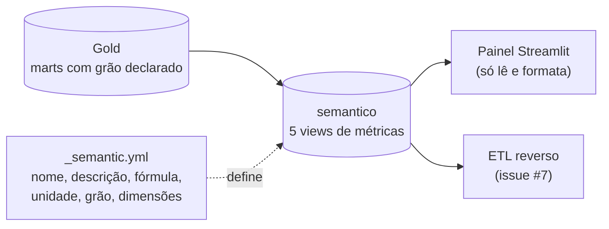

# Entrega E4 — Disponibilização do dado

> Documento da E4. Esta versão cobre a **camada semântica de métricas** (issue #6). O ETL reverso
> (issue #7) e o ADR-0008 (issue #11) entram nas próximas seções.

## 1. Camada semântica de métricas (consumo duplo)

**Problema:** na E3, o painel lia a Gold e terminava algumas contas por conta própria: somava os
fornecedores de cada categoria, somava os 10 maiores fornecedores, dividia o erro da sobrescrita por
dois e aplicava o corte de 5 deputados por partido. Um segundo consumidor (o ETL reverso da E4)
teria de repetir essas contas, e bastaria uma diferença para duas telas mostrarem a mesma métrica com
valores diferentes.

**Solução:** uma camada semântica no dbt, em `dbt_ceap/models/semantic/`, publicada no schema
`semantico` do `lakehouse/ceap.duckdb`. Ela é a **única fonte** das métricas da pergunta de gestão:



- **Definição versionada num lugar só:** cada métrica tem nome, descrição, fórmula e unidade no
  `meta` da coluna, e grão, dimensões e consumidores no `meta` do modelo, em
  [`_semantic.yml`](https://github.com/taybalau/sbd2-g8-ceap/blob/main/dbt_ceap/models/semantic/_semantic.yml).
  O catálogo abaixo é gerado desse arquivo.
- **Contrato de esquema** (`contract: enforced`) em todas as views: se uma coluna some ou muda de
  tipo, o `dbt build` reprova antes de o consumidor quebrar.
- **O painel não calcula nada.** `painel/app.py` lê só `semantico.*`. Ele ordena, escolhe o top 15 e
  formata; nenhuma soma, média ou agrupamento ficou nele.
- **Views, e não tabelas** (decisão da issue #6): a camada nunca fica defasada em relação à Gold, e
  a idade dos dados (`met_contexto.idade_horas`) é calculada no momento da leitura. O custo medido
  está na seção 1.4.

### 1.1 Views da camada

| View | Grão | Responde | Quem consome |
| :--- | :--- | :--- | :--- |
| `met_parlamentar` | deputado | 1ª parte da pergunta: ranking do desvio acima da mediana da UF | painel (bloco 1) |
| `met_partido` | partido na data do gasto | 2ª parte: ranking de partidos e erro da sobrescrita | painel (bloco 2) |
| `met_categoria_parlamentar` | deputado × subcota | 3ª parte: a categoria que gera o desvio | painel (bloco 3) |
| `met_fornecedor_parlamentar` | deputado × fornecedor | 3ª parte: concentração em fornecedores | painel (bloco 3) |
| `met_contexto` | uma linha | janela comparável, atualização, freshness e ruptura | painel (cabeçalho) |

### 1.2 Catálogo de métricas

<!-- catalogo-metricas:inicio -->

> Tabela gerada por `scripts/gerar_catalogo_metricas.py` a partir de
> `dbt_ceap/models/semantic/_semantic.yml`. Para mudar uma métrica, edite o `.yml`
> (e o `.sql` da view) e rode o script de novo.

#### `semantico.met_parlamentar`

- **Grão:** deputado (id_deputado)
- **Dimensões:** deputado, UF, partido atual, trajetória partidária
- **Quem consome:** painel — bloco 1 e seletor do bloco 3, ETL reverso
- **Definição:** [`met_parlamentar.sql`](https://github.com/taybalau/sbd2-g8-ceap/blob/main/dbt_ceap/models/semantic/met_parlamentar.sql)

| Métrica | Descrição | Fórmula | Unidade |
| :--- | :--- | :--- | :--- |
| `meses_com_gasto` | Competências comparáveis em que o deputado teve gasto. | `count(competências comparáveis com gasto do deputado)` | meses |
| `gasto_total` | Gasto líquido do deputado na janela comparável. | `sum(valor_liquido) nas competências comparáveis` | R$ |
| `gasto_medio_mensal` | Gasto médio do deputado por mês com gasto. | `gasto_total ÷ meses_com_gasto` | R$/mês |
| `mediana_uf_mensal` | Referência da comparação. Média, nos meses do deputado, da mediana mensal da UF. | `avg(mediana do gasto mensal dos deputados da mesma UF no mês)` | R$/mês |
| `desvio_acumulado` | Quanto o deputado gastou acima da mediana da UF, somado mês a mês. É a medida do ranking. | `Σ meses (gasto do deputado no mês − mediana da UF no mês)` | R$ |
| `desvio_relativo` | Desvio acumulado em proporção da referência (0,33 = 33% acima da mediana da UF). | `desvio_acumulado ÷ Σ meses (mediana da UF no mês)` | proporção |
| `meses_acima_mediana` | Meses em que o gasto do deputado passou da mediana da UF. | `count(meses com gasto > mediana da UF)` | meses |
| `z_medio` | O quanto o deputado foge do padrão da UF, independentemente do tamanho da UF. | `avg((gasto − mediana da UF) ÷ (1,4826 × MAD da UF)) por mês` | z robusto |
| `hhi_fornecedores` | Concentração do gasto em fornecedores (0 a 1; perto de 1 = poucos fornecedores). | `Σ fornecedores (participação do fornecedor no gasto do deputado)²` | índice 0–1 |
| `posicao_ranking` | Posição pelo desvio acumulado (1 = maior desvio). | `rank() por desvio_acumulado decrescente` | posição |

#### `semantico.met_partido`

- **Grão:** partido na data do gasto (sigla_partido)
- **Dimensões:** partido na data do gasto
- **Quem consome:** painel — bloco 2
- **Definição:** [`met_partido.sql`](https://github.com/taybalau/sbd2-g8-ceap/blob/main/dbt_ceap/models/semantic/met_partido.sql)

| Métrica | Descrição | Fórmula | Unidade |
| :--- | :--- | :--- | :--- |
| `qtd_deputados` | Deputados com gasto pelo partido na janela. | `count(distinct deputado) com gasto pelo partido` | deputados |
| `deputado_meses` | Pares deputado × mês com gasto pelo partido. | `count(distinct (deputado, competência))` | deputado-mês |
| `gasto_total` | Gasto pelo partido na janela comparável. | `sum(gasto da versão do deputado) com o partido da data do gasto` | R$ |
| `desvio_acumulado` | Desvio acima da mediana da UF atribuído ao partido. | `Σ desvio do mês rateado entre as versões pelo gasto (desvio_alocado)` | R$ |
| `desvio_medio_por_deputado_mes` | Desvio médio por deputado-mês. É a medida do ranking de partidos. | `desvio_acumulado ÷ deputado_meses` | R$ por deputado-mês |
| `entra_no_ranking` | Verdadeiro se o partido tem deputados suficientes para o ranking (var min_deputados_partido = 5). | `qtd_deputados ≥ 5` | regra |
| `posicao_ranking` | Posição pelo desvio por deputado-mês entre os partidos que entram no ranking (nulo para os demais). | `rank() por desvio_medio_por_deputado_mes decrescente, só entra_no_ranking` | posição |
| `gasto_total_se_sobrescrito` | Gasto que o partido teria se todo o histórico do deputado fosse do partido atual (SCD tipo 1). | `sum(gasto) agrupado pelo partido atual do deputado` | R$ |
| `erro_gasto_se_sobrescrito` | Erro que o SCD tipo 2 evita no partido. | `gasto_total_se_sobrescrito − gasto_total` | R$ |

#### `semantico.met_categoria_parlamentar`

- **Grão:** deputado × subcota (id_deputado, num_subcota)
- **Dimensões:** deputado, categoria de despesa (subcota)
- **Quem consome:** painel — bloco 3, gráfico de categorias
- **Definição:** [`met_categoria_parlamentar.sql`](https://github.com/taybalau/sbd2-g8-ceap/blob/main/dbt_ceap/models/semantic/met_categoria_parlamentar.sql)

| Métrica | Descrição | Fórmula | Unidade |
| :--- | :--- | :--- | :--- |
| `gasto_categoria` | Gasto do deputado na subcota, na janela comparável. | `sum(valor_liquido) do deputado na subcota` | R$ |
| `excesso_categoria_vs_uf` | Quanto o deputado gastou na subcota acima da mediana dos deputados da UF nela. | `gasto_categoria − mediana(gasto na subcota dos deputados da UF, zero para quem não gastou)` | R$ |
| `participacao_categoria_no_deputado` | Peso da subcota no gasto total do deputado. | `gasto_categoria ÷ gasto total do deputado` | proporção |
| `posicao_excesso` | Posição da subcota pelo excesso, dentro do deputado (1 = a que mais explica o desvio). | `rank() por excesso_categoria_vs_uf decrescente, por deputado` | posição |

#### `semantico.met_fornecedor_parlamentar`

- **Grão:** deputado × fornecedor (id_deputado, sk_fornecedor)
- **Dimensões:** deputado, fornecedor
- **Quem consome:** painel — bloco 3, tabela de fornecedores
- **Definição:** [`met_fornecedor_parlamentar.sql`](https://github.com/taybalau/sbd2-g8-ceap/blob/main/dbt_ceap/models/semantic/met_fornecedor_parlamentar.sql)

| Métrica | Descrição | Fórmula | Unidade |
| :--- | :--- | :--- | :--- |
| `gasto_fornecedor` | Gasto do deputado no fornecedor, na janela comparável. | `sum(valor_liquido) do deputado no fornecedor` | R$ |
| `participacao_no_deputado` | Peso do fornecedor no gasto total do deputado. | `gasto_fornecedor ÷ gasto total do deputado` | proporção |
| `qtd_lancamentos` | Lançamentos do deputado no fornecedor. | `count(lançamentos)` | lançamentos |
| `posicao_gasto` | Posição do fornecedor pelo gasto, dentro do deputado (1 = o maior). | `row_number() por gasto_fornecedor decrescente, por deputado` | posição |
| `participacao_acumulada` | Quanto este fornecedor e os maiores que ele somam do gasto do deputado (na posição 10, os 10 maiores). | `Σ participacao_no_deputado das posições 1 até esta` | proporção |

#### `semantico.met_contexto`

- **Grão:** uma linha
- **Dimensões:** —
- **Quem consome:** painel — cabeçalho, avisos e expander do erro da sobrescrita
- **Definição:** [`met_contexto.sql`](https://github.com/taybalau/sbd2-g8-ceap/blob/main/dbt_ceap/models/semantic/met_contexto.sql)

| Métrica | Descrição | Fórmula | Unidade |
| :--- | :--- | :--- | :--- |
| `meses_janela` | Meses na janela comparável. | `count(distinct competências comparáveis)` | meses |
| `idade_horas` | Horas desde a ingestão mais recente, medidas na leitura. | `agora − ingestão mais recente (mart_freshness_gold)` | horas |
| `erro_total_sobrescrita` | Gasto que iria para o partido errado se o partido fosse sobrescrito pelo atual. | `Σ partidos \|erro_gasto_se_sobrescrito\| ÷ 2 (cada real errado sobra num partido e falta noutro)` | R$ |

<!-- catalogo-metricas:fim -->

### 1.3 Como garantimos o "mesmo número"

| Verificação | Onde | O que reprova |
| :--- | :--- | :--- |
| `assert_semantico_gasto_consistente` | `dbt build` | o gasto total da janela divergir em mais de R$ 0,01 entre parlamentar, partido, categoria, fornecedor e o fato |
| `assert_semantico_desvio_consistente` | `dbt build` | o desvio por partido divergir do por parlamentar, ou o erro da sobrescrita do contexto divergir do dos partidos |
| `grao_unico` em cada view | `dbt build` | uma view ter mais de uma linha por chave do grão |
| Contratos de esquema | `dbt build` | coluna sumir ou mudar de tipo |
| `scripts/verificar_consumo_duplo.py` | depois do build (`scripts/gerar_docs_e3.sh`) | o código do painel ler a Gold/Silver ou agregar dados, ou um dos 12 números exibidos (líder, partido do topo, erro da sobrescrita, categoria, fornecedores…) diferir da camada |

**Evidência da troca de fonte:** o painel novo e o painel da E3 foram abertos sobre os mesmos dados
(24/11/2026). Todos os textos e as três tabelas saíram **idênticos**: mudar a fonte para a camada
semântica não alterou nenhum número.

### 1.4 Medições: ler do warehouse ou de uma cópia

Medido com `scripts/medir_leitura_semantica.py` (24/11/2026, 20 leituras por caminho, cada uma com
conexão nova), com as mesmas 5 consultas que o painel faz e o volume real: 801.743 lançamentos no
fato e 91.227 linhas nas views (84.936 delas em `met_fornecedor_parlamentar`). Evidência em
[`docs/evidencias/e4_leitura_semantica.json`](evidencias/e4_leitura_semantica.json).

| Caminho | Leitura (mediana) | Leitura (p90) | Custo de gerar a cópia | Espaço | Defasagem |
| :--- | ---: | ---: | ---: | ---: | :--- |
| Warehouse, views `semantico` (adotado) | 198 ms | 213 ms | — | — (lê o banco) | nenhuma |
| Warehouse, mesmas métricas como tabelas | 80 ms | 86 ms | 2,9 s por build | 6,3 MiB | até o próximo build |
| Cópia em Parquet | 72 ms | 78 ms | 0,2 s por exportação | 6,5 MiB | até a próxima exportação |
| Cópia em CSV (opção nula) | 146 ms | 156 ms | 0,2 s por exportação | 11,7 MiB | até a próxima exportação |

**Leitura dos números:**

- Todos os caminhos ficam abaixo de 0,25 s, e o painel ainda guarda o resultado em cache por 5
  minutos. Com o volume da CEAP, a latência não decide a escolha.
- As views custam ~120 ms a mais por leitura porque refazem os agrupamentos de categoria e fornecedor.
  Em troca, não há cópia para manter nem risco de ler uma cópia velha.
- A cópia em arquivo é rápida de gerar, mas cria um segundo lugar onde a métrica mora e uma defasagem
  que precisa de agendamento e monitoramento. Esse é o **acoplamento** que a camada semântica evita.
- **Gatilho para rever:** se a leitura passar de 1 s (por exemplo, com várias legislaturas no fato)
  ou se surgir um consumidor fora da rede do DuckDB, materializar as views como tabelas ou publicar
  uma cópia em Parquet. A comparação completa vai para o ADR-0008 (issue #11).

### 1.5 Como reproduzir

Com a plataforma no ar (`docker compose up --build -d` e `docker compose wait e3-pipeline`):

```bash
# build, páginas de testes e dicionário, catálogo de métricas e a conferência do painel
docker compose run --build --rm --no-deps -e HOST_UID="$(id -u)" -e HOST_GID="$(id -g)" \
    -v ./docs:/app/docs -v ./scripts:/app/scripts e3-pipeline bash scripts/gerar_docs_e3.sh

# medições de leitura (seção 1.4)
docker compose run --rm --no-deps -v ./docs:/app/docs -v ./scripts:/app/scripts \
    e3-pipeline python scripts/medir_leitura_semantica.py 20
```
