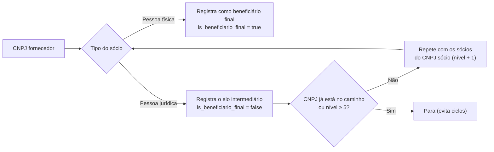

# E2 · Enriquecimento societário

## A pergunta ampliada

Por sugestão da professora, a E2 acrescenta uma dimensão de auditoria à pergunta de gestão:

!!! question ""
    **Quais despesas da CEAP pagas a múltiplos CNPJs aparentemente concorrentes concentram recursos no mesmo Beneficiário Final (mesmo CPF ou grupo econômico controlador)?**

A ideia é cruzar os fornecedores da CEAP com o **Quadro de Sócios e Administradores (QSA)** da Receita Federal e seguir a cadeia de sócios até a **pessoa física que controla** a empresa: o Beneficiário Final, ou UBO (*Ultimate Beneficial Owner*). Assim, vários CNPJs que parecem independentes podem ser agrupados sob o mesmo controlador.

A decisão de modelagem está no [ADR-0003](adr/0003-resolucao-grafo-societario-beneficiario-final.md).

## Base de dados usada

!!! note "Base de demonstração"
    O script [`enrich_receita_socios.py`](https://github.com/taybalau/sbd2-g8-ceap/blob/main/scripts/enrich_receita_socios.py) usa um conjunto de dados **definido no próprio código** (12 empresas e 12 relações societárias, organizadas em 5 grupos), e não um extrato dos Dados Abertos do CNPJ da Receita Federal. Os CPFs seguem o padrão de mascaramento da Receita (`***.123.456-**`).

O ADR-0003 justifica não baixar a base nacional completa (mais de 80 GB) nem consultar APIs públicas em tempo real (limites de requisição e dependência de rede).

## Algoritmo de resolução do beneficiário final

Para cada empresa da base, `resolver_grafo_beneficiario_final` percorre os sócios recursivamente:



- `grau_profundidade` indica em que nível da cadeia o sócio está (1 = sócio direto).
- `caminho_societario` registra o trajeto, por exemplo `CNPJ -> HOLDING -> PESSOA`.
- A verificação do caminho protege contra participações cruzadas (A sócia de B e B sócia de A), e a profundidade é limitada a 5 níveis.

## Tabelas geradas no lakehouse

Ambas são gravadas em Delta Lake com `mode="overwrite"` (reexecutar não duplica).

### `dim_fornecedor_cadastral`

Dados cadastrais de cada empresa.

| Coluna | Conteúdo |
| :--- | :--- |
| `cnpj`, `cnpj_basico` | CNPJ completo e raiz de 8 dígitos |
| `razao_social`, `nome_fantasia` | Identificação |
| `cnae_principal`, `cnae_descricao` | Atividade econômica |
| `capital_social`, `data_abertura` | Porte e idade |
| `uf`, `municipio` | Localização |

### `dim_quadro_societario_ubo`

Uma linha por elo da cadeia societária resolvida.

| Coluna | Conteúdo |
| :--- | :--- |
| `cnpj_fornecedor_ceap`, `razao_social_fornecedor` | Empresa de origem |
| `grau_profundidade` | Nível na cadeia |
| `caminho_societario` | Trajeto completo |
| `tipo_socio` | `PESSOA_FISICA` ou `PESSOA_JURIDICA` |
| `doc_socio`, `nome_socio` | CPF mascarado ou CNPJ, e nome |
| `qualificacao`, `percentual_capital` | Papel e participação |
| `is_beneficiario_final` | `true` quando o sócio é a pessoa física no topo |

## Consultas de auditoria

Executadas por [`consulta_caminho_societario.py`](https://github.com/taybalau/sbd2-g8-ceap/blob/main/scripts/consulta_caminho_societario.py) ao final do `docker compose up`, com DuckDB sobre as tabelas Delta.

**1. Cadeia societária completa:** lista cada elo de `dim_quadro_societario_ubo`, ordenado por empresa e nível.

**2. Vários CNPJs sob o mesmo beneficiário final:**

```sql
SELECT nome_socio, doc_socio,
       COUNT(DISTINCT cnpj_fornecedor_ceap)            AS qtd_cnpjs,
       STRING_AGG(DISTINCT razao_social_fornecedor, ' | ') AS empresas
FROM delta_scan('lakehouse/delta/dim_quadro_societario_ubo')
WHERE is_beneficiario_final = true
GROUP BY nome_socio, doc_socio
HAVING COUNT(DISTINCT cnpj_fornecedor_ceap) > 1
ORDER BY qtd_cnpjs DESC;
```

**3. Gastos da CEAP somados por beneficiário final:** cruza a tabela de despesas com a cadeia societária pela **raiz do CNPJ** (8 primeiros dígitos):

```sql
SELECT c.nome_socio, c.doc_socio,
       COUNT(DISTINCT d.id_despesa)  AS notas,
       ROUND(SUM(d.valor_liquido), 2) AS total_pago
FROM delta_scan('lakehouse/delta/despesa_ceap') d
JOIN delta_scan('lakehouse/delta/dim_quadro_societario_ubo') c
  ON SUBSTR(regexp_replace(d.cnpj_cpf, '[^0-9]', '', 'g'), 1, 8)
   = SUBSTR(regexp_replace(c.cnpj_fornecedor_ceap, '[^0-9]', '', 'g'), 1, 8)
WHERE c.is_beneficiario_final = true
GROUP BY c.nome_socio, c.doc_socio
ORDER BY total_pago DESC;
```

Como a junção usa a raiz do CNPJ, matriz e filiais de uma mesma empresa são somadas juntas.
