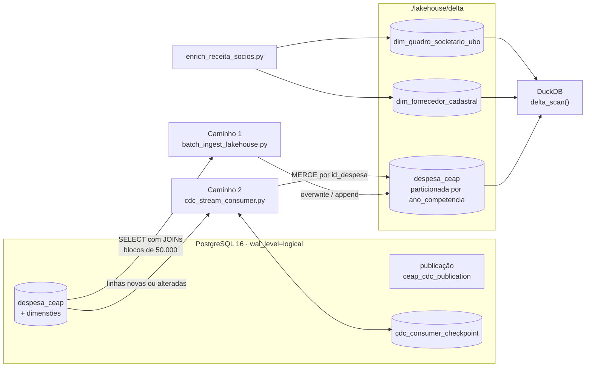

# E2 · Lakehouse e CDC

A Entrega E2 leva os dados do banco transacional (OLTP) para uma **camada analítica em formato aberto**: uma tabela **Delta Lake** (arquivos Parquet + log de transações `_delta_log/`), que pode ser lida por DuckDB, Polars, Spark ou Trino sem nenhum servidor proprietário.

Os dados chegam por **dois caminhos**:

| | Caminho 1 · Lote | Caminho 2 · Mudanças (CDC) |
| :--- | :--- | :--- |
| Script | [`batch_ingest_lakehouse.py`](https://github.com/taybalau/sbd2-g8-ceap/blob/main/scripts/batch_ingest_lakehouse.py) | [`cdc_stream_consumer.py`](https://github.com/taybalau/sbd2-g8-ceap/blob/main/scripts/cdc_stream_consumer.py) |
| O que faz | Recria a tabela Delta inteira a partir do OLTP | Propaga inserções e alterações pontuais para a tabela Delta |
| Escrita | `overwrite` + `append` por blocos | `MERGE` pela chave `id_despesa` |
| Garantia | Idempotente (rodar duas vezes não duplica) | *At-least-once* com deduplicação no destino |

A decisão por essa arquitetura, com as alternativas comparadas (recarga periódica como opção nula e Kafka + Debezium + Spark), está no [ADR-0002](adr/0002-mecanismo-ingestao-e-formato-aberto.md).

## Fluxo



## A tabela analítica `despesa_ceap` (Delta)

Diferente do OLTP normalizado, a tabela analítica é **desnormalizada**: cada linha já traz o nome do parlamentar, o CNPJ e a razão social do fornecedor e a descrição da subcota, para que as consultas não precisem de junções.

| Grupo | Colunas |
| :--- | :--- |
| Identificação | `id_despesa`, `ide_documento` |
| Parlamentar | `id_deputado`, `nome_parlamentar`, `sigla_partido_emissao`, `sigla_uf_emissao`, `codigo_legislatura` |
| Fornecedor | `cnpj_cpf`, `razao_social` |
| Categoria | `num_subcota`, `subcota_descricao` |
| Documento | `numero_documento`, `tipo_documento`, `data_emissao` |
| Valores | `valor_documento`, `valor_glosa`, `valor_liquido`, `valor_restituicao` |
| Competência | `mes_competencia`, `ano_competencia` (**coluna de partição**), `parcela` |
| Detalhes | `passageiro`, `trecho`, `numero_lote`, `numero_ressarcimento`, `data_pagamento_restituicao` |
| Auditoria | `data_ingestao` |

São 27 colunas. Os valores monetários são convertidos de `NUMERIC(12, 2)` para `DOUBLE PRECISION` na extração.

### Formato, compressão e particionamento

- **Parquet (colunar):** as consultas de gestão leem poucas colunas (`valor_liquido`, partido, UF, ano), e o formato colunar evita ler o resto.
- **Particionamento por `ano_competencia`:** 4 partições (2023 a 2026). Particionar por dia geraria mais de mil arquivos pequenos (*small files problem*).
- **Compressão:** o ADR-0002 escolhe **Zstandard** e registra uma camada analítica de **64,8 MB**, contra 178 MB no PostgreSQL e ~265 MB em CSV.

!!! note "Compressão no código atual"
    O `write_deltalake` é chamado sem opção de compressão, então os arquivos são gravados com o padrão da biblioteca `deltalake`, que é **Snappy**. Para usar Zstandard, como decidido no ADR-0002, é preciso passar as propriedades de escrita explicitamente, por exemplo `writer_properties=WriterProperties(compression="ZSTD")`.

## Caminho 1 · Ingestão em lote

1. Apaga a pasta `lakehouse/delta/despesa_ceap` se ela existir.
2. Para cada ano de 2023 a 2026, executa um `SELECT` em `despesa_ceap` com `JOIN` em `parlamentar`, `fornecedor` e `categoria_despesa`.
3. Lê o resultado em **blocos de 50.000 linhas**, converte cada bloco em tabela Arrow (`pyarrow`) e grava com `write_deltalake`: o primeiro bloco em modo `overwrite`, os seguintes em `append`, sempre com `partition_by=["ano_competencia"]`.
4. Imprime total de linhas, versão do Delta log, número de arquivos e tempo.

**Por que é idempotente:** cada execução começa apagando a tabela e o primeiro bloco usa `overwrite`. Rodar duas vezes produz exatamente as mesmas 785.754 linhas.

## Caminho 2 · Captura de mudanças (CDC)

### Preparação no banco

O PostgreSQL sobe com `wal_level=logical`, `max_replication_slots=5` e `max_wal_senders=5` (ver `command` em `docker-compose.yml`). A migração [`003_setup_cdc_replication.sql`](https://github.com/taybalau/sbd2-g8-ceap/blob/main/migrations/003_setup_cdc_replication.sql):

- cria a publicação `ceap_cdc_publication` para `despesa_ceap` (só se ainda não existir);
- define `REPLICA IDENTITY FULL` na tabela, para que alterações carreguem o estado anterior e o novo;
- cria a tabela `cdc_consumer_checkpoint`, que guarda até onde o consumidor já processou.

### Como o consumidor funciona

A classe `CDCDeltaConsumer` executa ciclos de sincronização (`process_cycle`):

1. Garante que o slot de replicação lógica `ceap_cdc_slot` (plugin `test_decoding`) exista.
2. Busca as mudanças pendentes em `despesa_ceap`, com os mesmos `JOIN`s do lote:
    - **com `target_id`:** relê a despesa com aquele `id_despesa` (usado nos testes, após `INSERT` ou `UPDATE`);
    - **sem `target_id`:** busca até `limit` despesas com `id_despesa` acima do último checkpoint.
3. Aplica as linhas na tabela Delta com `MERGE` pela chave `id_despesa`: atualiza se já existe, insere se não existe.
4. No modo sem `target_id`, grava o maior `id_despesa` processado em `cdc_consumer_checkpoint`.

!!! note "Como a captura está implementada hoje"
    O consumidor cria o slot `ceap_cdc_slot`, mas não lê os eventos dele: as mudanças são obtidas por consulta à tabela `despesa_ceap`. Exclusões no OLTP não são propagadas para a tabela Delta.

!!! warning "Slot de replicação e espaço em disco"
    Um slot de replicação lógica que não é consumido faz o PostgreSQL **reter os arquivos de WAL** indefinidamente. Se o volume do banco crescer, verifique com `SELECT slot_name, active FROM pg_replication_slots;` e, se necessário, remova o slot com `SELECT pg_drop_replication_slot('ceap_cdc_slot');`.

### Semântica de entrega

Declarada como **at-least-once com deduplicação idempotente no destino** (efeito *effectively-once*): um evento pode ser aplicado mais de uma vez, mas o `MERGE` por `id_despesa` impede duplicatas.

### Dado atrasado (*late-arriving data*)

O dado é posicionado pela **competência contábil** (`ano_competencia`), não pela data em que chegou (`data_ingestao`). Uma nota de fevereiro de 2023 processada em 2026 vai para a partição `ano_competencia=2023`, sem afetar os totais de 2026.

## Testes de aceite

[`test_e2_pipeline.py`](https://github.com/taybalau/sbd2-g8-ceap/blob/main/scripts/test_e2_pipeline.py) roda automaticamente ao final do `docker compose up` e pode ser executado sozinho:

```bash
docker exec -it ceap_ingestion python scripts/test_e2_pipeline.py
```

| Teste | O que faz | O que verifica |
| :--- | :--- | :--- |
| `test_1_idempotencia_batch` | Roda a carga em lote duas vezes | Contagem na tabela Delta igual à de uma única carga |
| `test_2_cdc_mutacao_atravessando_fluxo` | Insere a despesa `99999901` (R$ 4.550,00) no OLTP, propaga, depois altera para R$ 7.800,50 e propaga de novo | A linha aparece no Delta e o `UPDATE` é refletido sem duplicar |
| `test_3_dado_atrasado_roteamento_de_janela` | Insere a despesa `99999902` com competência 02/2023 e propaga | A linha cai na partição `ano_competencia=2023` |
| `test_4_reprocessamento_semantica_entrega` | Reaplica até 50 eventos pendentes via `MERGE` | A contagem no Delta não muda |
| `test_5_auditoria_societaria_beneficiario_final` | Regrava as tabelas societárias e consulta grupos econômicos | Lista beneficiários finais com mais de um CNPJ e cadeias com holding |

Os testes 2 e 3 apagam as despesas de teste do OLTP ao final. Como exclusões não são propagadas, essas linhas continuam na tabela Delta até a próxima carga em lote.

## Consultar o lakehouse

Com o DuckDB, direto sobre os arquivos:

```bash
docker exec -it ceap_ingestion python -c "
import duckdb
con = duckdb.connect()
print(con.execute('''
    SELECT ano_competencia,
           COUNT(*)                     AS total_notas,
           ROUND(SUM(valor_liquido), 2) AS total_gasto
    FROM delta_scan('lakehouse/delta/despesa_ceap')
    GROUP BY ano_competencia
    ORDER BY ano_competencia;
''').fetchdf())
"
```

A pasta `./lakehouse` é montada no host, então também é possível ler as tabelas com um DuckDB instalado localmente.

## Números da E2 (segundo o ADR-0002 e os diários)

| Métrica | Valor |
| :--- | ---: |
| Carga em lote dos 785.754 registros para o Delta | 34,2 s |
| Tamanho da camada analítica | 64,8 MB |
| Agregação analítica no DuckDB | 18 ms (contra 112 ms no OLTP) |
| Latência ponta a ponta do CDC no teste | 380 ms |
| Memória da stack | ~380 MB |
