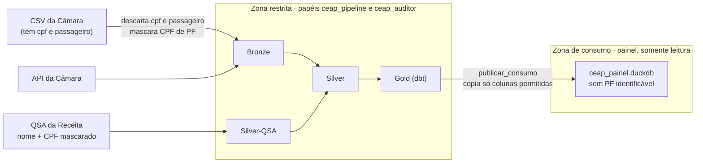

# E4 · Análise de LGPD

Para cada dado pessoal que a plataforma trata, esta seção diz **qual é o dado** (coluna, tabela e camada Bronze/Silver/Gold), a **base legal** (LGPD, art. 7º e, quando preciso, art. 11), a **retenção** e o **descarte**. 

Documento técnico de governança, não é parecer jurídico. As bases legais e a premissa de "órgão de pesquisa" ([seção 2.1](#21-papéis)) devem ser validadas com a docência e com o encarregado da UnB.

### Os dados do QSA são de demonstração

Hoje o QSA vem de um conjunto escrito no código (`scripts/enrich_receita_socios.py`: 12 empresas e 12 relações societárias), e não de um extrato do CNPJ da Receita Federal (ver [Enriquecimento societário](enriquecimento.md)). A análise trata o QSA como ele será em produção, porque o desenho (colunas, cruzamento, acesso) é o mesmo e porque nomes e CPFs parciais já têm o formato real. Antes de qualquer carga real, a [seção 5](#5-reidentificação-por-cruzamento-entre-ceap-e-qsa) precisa ser consultada.

## 1. Resumo

| Titular | De onde vem | Por que importa | Decisão da E4 |
| :--- | :--- | :--- | :--- |
| **Deputados** | CEAP e API da Câmara | Agente público, dado ligado ao mandato. O **partido é dado sensível** (art. 5º, II) | Manter nome, UF e partido; tratar o partido pelo art. 11, II, "c". CPF nunca nas camadas analíticas |
| **Fornecedores pessoa física** | CEAP (`txtCNPJCPF` com 11 dígitos) | Pessoa comum que recebeu dinheiro público. Hoje o CPF completo aparece no painel e `sk_fornecedor` é o md5 do CPF | CPF mascarado, pseudônimo com chave secreta, nome mantido |
| **Sócios do QSA** | Receita Federal | Pessoas comuns. O cruzamento com a CEAP cria um dado que nenhuma base tinha | Nome e CPF mascarado só na zona restrita; consumo só por pseudônimo; só grupos com 2 ou mais CNPJs |
| **Passageiros** | CEAP (`txtPassageiro`) | Assessores e outras pessoas privadas; nenhum modelo usa | Não ingerir (como já é feito com o `cpf`); remover do OLTP e do Delta da E2 |

Achados que mudam o que a E3 afirmava (detalhes na [seção 8](#8-lacunas-encontradas-e-plano-de-implementação)):

1. O painel exibe `documento_fornecedor` na tabela dos 10 maiores fornecedores. Se o fornecedor for pessoa física, é o **CPF completo**.
2. `sk_fornecedor` é `md5(chave_fornecedor)`, e para pessoa física a chave é o CPF. Um md5 de CPF se desfaz por força bruta, então o campo é o CPF disfarçado e está na Gold.
3. A E3 diz que o CPF do parlamentar "não é gravado". Isso vale para a Bronze. O **OLTP da E1 guarda `parlamentar.cpf` completo**, e o CSV baixado também.
4. `txtPassageiro` "fica só na Bronze" na E3, mas também está em `despesa_ceap.passageiro` (OLTP), no Delta `despesa_ceap` da E2 e no WAL do CDC.
5. **Não existe controle de acesso por papel.** Os serviços que acessam o PostgreSQL usam o superusuário `postgres`, e o painel monta o `./lakehouse` inteiro. Ler só a Gold é convenção do `painel/app.py`, não restrição.

### Tabela consolidada de dados pessoais

Uma linha por dado. O detalhe por camada e coluna está na [seção 3](#3-inventário-por-titular); `T1` a `T6` são as tarefas de descarte da [seção 4](#4-retenção-e-descarte). Retenção e descarte marcados como "alvo" são propostas da E4 ainda não implementadas.

| Dado (coluna · tabela · camada) | Base legal | Retenção | Descarte |
| :--- | :--- | :--- | :--- |
| **Nome do sócio PF do QSA**: `nome_socio` e `caminho_societario` · `dim_quadro_societario_ubo` · Silver-QSA (restrita) | Art. 7º, IV (pesquisa por órgão de pesquisa), com §3º e §7º; alternativa IX com balanceamento ([3.3.1](#331-por-que-guardamos)) | Snapshot corrente, no máximo 12 meses | Sobrescrita + `VACUUM` em até 7 dias (T2); T1 apaga o vencido; T6 no encerramento |
| **CPF mascarado do sócio PF**: `doc_socio` · `dim_quadro_societario_ubo` · Silver-QSA (restrita) | Igual ao nome do sócio | Igual | Igual. Decisão: manter mascarado **só na zona restrita**; no consumo, só `id_beneficiario_pseudo` (HMAC com chave secreta). Hash sem chave rejeitado ([3.3.2](#332-dá-para-mascarar-o-cpf-ou-guardar-só-um-hash)) |
| **Pseudônimo do beneficiário**: `id_beneficiario_pseudo` · Silver-QSA e Gold `mart_grupo_economico` (alvo) | Art. 7º, IV (anonimização "sempre que possível"). Continua sendo dado pessoal (art. 13, §4º) | Enquanto a chave existir | Chave destruída no encerramento (T6) |
| **Nome do deputado**: `txNomeParlamentar`, `nome`, `nomeEleitoral` · Bronze; `nome_parlamentar` · Silver e Gold | Art. 7º, §3º e §4º, e IV; origem: art. 7º, II e 23 | Enquanto a plataforma existir; revisão a cada 12 meses | `VACUUM` semanal (T2); T6 |
| **Partido do deputado** (sensível, art. 5º, II): `sgPartido`, `siglaPartido` · Bronze; `sigla_partido` · Silver; `partido_atual`, `trajetoria_partidaria` · Gold | **Art. 11, II, "c"**; legítimo interesse não se aplica | Igual ao nome | Igual ao nome |
| **Identificadores do deputado e UF**: `ideCadastro`, `nuDeputadoId`, `sgUF` · Bronze; `id_deputado`, `sigla_uf` · Silver e Gold | Art. 7º, §3º e IV | Igual ao nome | Igual ao nome |
| **CPF do deputado**: `cpf` · CSV e OLTP `parlamentar.cpf` (**não** está na Bronze, Silver nem Gold) | Público na origem, mas sem necessidade (art. 6º, III) | Alvo: zero | Migração 005 (`DROP COLUMN`), `cpf` fora do hash, CSV substituído por ano (T4) |
| **CPF do fornecedor PF**: `txtCNPJCPF` · Bronze; `documento_fornecedor`, `sk_fornecedor` · Silver; `documento_fornecedor` · Gold; `stg_ceap_raw.txtCNPJCPF`, `fornecedor.cnpj_cpf` · OLTP; `cnpj_cpf` · Delta da E2 | Art. 7º, §3º e IV; alternativa IX | Alvo: mascarado e pseudonimizado em **todos** os caminhos. Staging: só durante a carga de cada ano | Mascarar nas **duas** entradas: Bronze (`bronze.py`) e OLTP (`ingest_ceap.py`), mais o Delta da E2. Staging: `TRUNCATE` ao fim de cada ano, com teste de que fica vazio ([3.2](#32-fornecedores-pessoa-física)); resíduo no CSV (T4) |
| **Nome do fornecedor PF**: `txtFornecedor` · Bronze; `nome_fornecedor` · Silver e Gold | Igual ao CPF do fornecedor; mantido porque é o objeto do controle | Enquanto a plataforma existir | T6; sequências de 11 dígitos (MEI) mascaradas |
| **Passageiro**: `txtPassageiro` · Bronze; `passageiro` · OLTP `despesa_ceap` e Delta da E2 | Art. 7º, §3º; sem necessidade (art. 6º, III) | Alvo: zero | Não ingerir na Bronze; `DROP COLUMN` no OLTP; evitar `UPDATE` (o WAL guarda a linha antiga) |
| **Resultado do cruzamento CEAP × QSA** (total pago por pessoa) · consulta 3 de `consulta_caminho_societario.py` | Art. 7º, IV, §3º e §7º; é dado novo ([seção 5](#5-reidentificação-por-cruzamento-entre-ceap-e-qsa)) | Não é persistido; no consumo, só o grupo pseudonimizado | Saída padrão com pseudônimo; identificação só no papel `ceap_auditor` |


## 2. Premissas e bases legais

### 2.1 Papéis

- **Câmara dos Deputados e Receita Federal** são as controladoras dos dados na origem. A Câmara publica a CEAP e os dados de deputados por obrigação legal e transparência ativa (art. 7º, II e art. 23 da LGPD, como já registrado na planilha da E1; Lei de Acesso à Informação).
- **Squad G8 / UnB (disciplina SBD2)** faz um **tratamento secundário**: reutiliza dado público para análise. A premissa é que a UnB é **órgão de pesquisa** (art. 5º, XVIII: entidade pública que inclui a pesquisa em sua missão institucional) e que o projeto é um **estudo**. É o que sustenta o art. 7º, IV. 

### 2.2 Bases usadas

| Base | O que diz (resumido) | Como usamos |
| :--- | :--- | :--- |
| Art. 7º, IV | Estudo por órgão de pesquisa, com anonimização "sempre que possível" | Base principal. O "sempre que possível" é o que **obriga** a pseudonimizar e recortar colunas nas camadas de consumo |
| Art. 7º, §3º | Dado de acesso público: considerar a finalidade, a boa-fé e o interesse público que justificaram a publicação | Reforça e **limita**: só reutilizamos para fim compatível (controle do gasto público) |
| Art. 7º, §4º | Dispensa de consentimento para dado manifestamente público **pelo titular** | Só para deputados, com ressalva. **Não vale** para sócios nem fornecedores, que não publicaram o próprio dado |
| Art. 7º, §7º | Novas finalidades permitidas se legítimas, específicas e com os direitos preservados | Cobre o cruzamento CEAP × QSA, desde que fique no fim declarado |
| Art. 7º, IX | Legítimo interesse, com teste de balanceamento | Alternativa para sócios e fornecedores PF. **Não vale para dado sensível** |
| Art. 11, II, "c" | Dado sensível: estudo por órgão de pesquisa, anonimizando sempre que possível | Partido do deputado |
| Art. 6º, I, III, V, VII | Finalidade, necessidade, qualidade, segurança | Critério de cada decisão de minimização |

Consentimento (art. 7º, I) não é usado: não há como colher de milhares de titulares e a fonte é pública.

### 2.3 Camadas e zonas

| Termo | O que é |
| :--- | :--- |
| Bronze | `lakehouse/bronze/` (`ceap_lancamento`, `camara_deputado_historico`) |
| Silver / Gold | Schemas `silver` e `gold` do `ceap.duckdb`, construídos pelo dbt |
| OLTP (E1) | PostgreSQL `ceap_oltp` (`parlamentar`, `fornecedor`, `despesa_ceap`) |
| Delta da E2 | `lakehouse/delta/` (`despesa_ceap`, `dim_fornecedor_cadastral`, `dim_quadro_societario_ubo`). Fora das camadas do dbt; neste documento, `dim_quadro_societario_ubo` é tratada como **Silver-QSA** |
| Zona restrita (alvo) | Bronze, Silver, QSA e chave de pseudonimização. Só serviços e o papel auditor |
| Zona de consumo (alvo) | `ceap_painel.duckdb`, com a Gold já recortada. É o que o painel abre |



## 3. Inventário por titular

Cada tabela segue a ordem pedida: **dado e local**, **base legal**, **retenção**, **descarte**. As tarefas `T1` a `T6` do descarte estão na [seção 4](#4-retenção-e-descarte).

### 3.1 Deputados

| Dado | Onde está (camada · tabela · coluna) | Base legal | Retenção | Descarte |
| :--- | :--- | :--- | :--- | :--- |
| **Nome** (civil e parlamentar) | Bronze · `ceap_lancamento.txNomeParlamentar`; `camara_deputado_historico.nome`, `.nomeEleitoral`<br>Silver · `stg_ceap__lancamento.nome_parlamentar`, `stg_camara__deputado_evento.nome_parlamentar`, `int_parlamentar__versoes.nome_parlamentar`, `dim_parlamentar_scd.nome_parlamentar`<br>Gold · `fct_gasto_mensal_parlamentar.nome_parlamentar`, `mart_desvio_parlamentar.nome_parlamentar`<br>OLTP · `parlamentar.nome_parlamentar` | Art. 7º, §3º e §4º (nome e mandato tornados públicos pelo titular ao exercer o mandato, com ressalva), e IV. Na origem, a Câmara publica por obrigação legal (art. 7º, II e 23) | Enquanto a plataforma existir, com revisão a cada 12 meses (art. 15, I) | A Bronze é regravada por partição e os arquivos antigos saem no `VACUUM` semanal (T2). Encerramento do projeto: T6 |
| **Identificadores e UF** | Bronze · `ceap_lancamento.ideCadastro`, `.nuDeputadoId`, `.sgUF`; `camara_deputado_historico.id`, `.siglaUf`<br>Silver · `id_deputado`, `id_cadastro_camara`, `sigla_uf`, `sigla_uf_publicada`<br>Gold · `id_deputado`, `sigla_uf` | Art. 7º, §3º e IV. Identificadores administrativos públicos, não sensíveis | Igual ao nome | Igual ao nome |
| **Partido e trajetória** (filiação a organização política: **sensível**, art. 5º, II) | Bronze · `ceap_lancamento.sgPartido`; `camara_deputado_historico.siglaPartido`<br>Silver · `sigla_partido_publicada`, `stg_camara__deputado_evento.sigla_partido`, `int_parlamentar__versoes.sigla_partido`, `dim_parlamentar_scd.sigla_partido`<br>Gold · `fct_gasto_mensal_parlamentar.sigla_partido`, `mart_desvio_parlamentar.partido_atual`, `.trajetoria_partidaria`, `.trocou_de_partido`, `mart_desvio_partido.sigla_partido` | **Art. 11, II, "c"** (estudo por órgão de pesquisa); na origem, alínea "a" (obrigação legal). Legítimo interesse não se aplica. É **indispensável** à pergunta de gestão (ranking por partido), o que cumpre a necessidade | Igual ao nome | Igual ao nome. `trajetoria_partidaria` é derivada e some quando o mart é reconstruído |
| **Eventos do mandato** (`situacao`, `condicaoEleitoral`, `descricaoStatus`, `dataHora`) | Bronze · `camara_deputado_historico` (mesmas colunas)<br>Silver · `stg_camara__deputado_evento.situacao`, `.descricao_status`, `.data_hora_evento`; `dim_parlamentar_scd.evento_de_abertura`<br>Gold · não vão | Art. 7º, §3º e IV. **A verificar:** se `descricao_status` indicar motivo de saúde (licença médica), é dado sensível e a base passa a ser art. 11, II, "c" | Igual ao nome | Igual ao nome. Verificar com `select distinct descricao_status` |
| **CPF do deputado** | **Bronze, Silver e Gold: não existe.** O `cpf` é descartado em `ingestao/bronze.py`<br>Mas existe em: CSV `base-dados/Ano-*.csv` (coluna `cpf`); OLTP `parlamentar.cpf` (completo); staging `stg_ceap_raw.cpf`; e dentro do md5 de `_hash_lancamento` | Dado público na origem (art. 7º, §3º), mas **sem necessidade** para a pergunta de gestão (art. 6º, III). Não há finalidade que justifique guardá-lo | **Hoje:** OLTP e CSV sem prazo. **Alvo:** zero | **Alvo:** migração 005 (`DROP COLUMN parlamentar.cpf`), `cpf` fora do insumo do hash (L5) e CSV substituído a cada ano (T4) |
| **Carteira parlamentar** | Bronze · `ceap_lancamento.nuCarteiraParlamentar`<br>OLTP · `parlamentar.nu_carteira_parlamentar`<br>Silver e Gold não usam | Art. 7º, §3º e IV. Identificador administrativo; nenhum modelo o usa, então fica só como cópia fiel na Bronze | Igual à Bronze | T2 e T6. Não é concedido ao papel `ceap_consulta` |
| **Cache da API de histórico** | `lakehouse/_cache/historico/<ideCadastro>.json`, gravado em `bronze_historico._buscar` com a **resposta inteira** da API, não só os 10 campos de `CAMPOS`. Pode ter campos que a Bronze não guarda (por exemplo e-mail do gabinete e URL da foto): conferir um arquivo | Art. 7º, §3º e IV | Sobrescrito a cada sucesso; no máximo 90 dias | T3 |

### 3.2 Fornecedores pessoa física

Na CEAP, o fornecedor pode ser CPF no lugar de CNPJ (`dim_fornecedor.tipo_documento_fornecedor = 'CPF'`, 11 dígitos). Para a Bronze, a E3 só garante "CNPJ ou CPF, com ou sem máscara".

| Dado | Onde está (camada · tabela · coluna) | Base legal | Retenção | Descarte |
| :--- | :--- | :--- | :--- | :--- |
| **CPF do fornecedor** | Bronze · `ceap_lancamento.txtCNPJCPF`<br>Silver · `stg_ceap__lancamento.documento_fornecedor`, `dim_fornecedor.documento_fornecedor`, `.chave_fornecedor`, `.sk_fornecedor` (md5 do documento)<br>Gold · `mart_concentracao_parlamentar.documento_fornecedor`, `.sk_fornecedor`<br>Painel · coluna "CNPJ/CPF" dos 10 maiores fornecedores<br>OLTP · `fornecedor.cnpj_cpf` e a **staging** `stg_ceap_raw.txtCNPJCPF` (CSV bruto, `UNLOGGED`); Delta E2 · `despesa_ceap.cnpj_cpf` | Art. 7º, §3º (a Câmara publica o documento ao prestar contas do gasto público; reutilizar para controle social é fim compatível) e IV. Alternativa: IX. **Necessidade:** identificar o recebedor, sim; guardar o número completo, não. CPF mascarado e pseudônimo bastam (art. 6º, III) | **Hoje:** CPF completo em todas as camadas, sem prazo; na staging, só entre o `COPY` e o `TRUNCATE` de cada ano. **Alvo:** Silver e Gold só com CPF mascarado e pseudônimo. A Bronze já recebe o valor mascarado | **Alvo:** mascarar **na entrada da Bronze** (`txtCNPJCPF` com 11 dígitos vira `***.XXX.XXX-**`, mesmo padrão da Receita) e gravar o pseudônimo em `_doc_pf_pseudo`. Mesma exceção deliberada que já vale para `cpf`. **Isso não alcança o OLTP nem o Delta da E2**: `ingest_ceap.py` copia o CSV direto para a staging (`COPY`) e dali para `fornecedor`, e `batch_ingest_lakehouse.py` e o CDC leem `cnpj_cpf` do OLTP. A máscara precisa ser repetida nesses caminhos (L15). Residual no CSV: T4 |
| **Nome do fornecedor PF** | Bronze · `txtFornecedor`<br>Silver · `nome_fornecedor_publicado`, `dim_fornecedor.nome_fornecedor`<br>Gold · `mart_concentracao_parlamentar.nome_fornecedor`<br>OLTP · `fornecedor.razao_social` | Igual ao CPF. É **mantido**: quem recebe dinheiro público é o objeto do controle. **Ressalva:** em MEI e empresário individual, o nome empresarial costuma ser o nome da pessoa seguido do CPF. Sequências de 11 dígitos no nome são mascaradas na Silver | Enquanto a plataforma existir | T6. Verificação contínua pelo teste `assert_gold_sem_cpf_completo` (apêndice A.5) |
| **Pseudônimo do fornecedor PF** (alvo) | Bronze · `_doc_pf_pseudo`<br>Silver e Gold · `sk_fornecedor` para PF, calculado com HMAC e não mais com md5 | Art. 7º, IV (anonimização "sempre que possível") | Enquanto a chave secreta existir | No encerramento, a chave é destruída (T6) e o pseudônimo deixa de poder ser refeito |

### Staging do OLTP (`stg_ceap_raw`)

A tabela guarda o CSV **bruto** de um ano (`txtCNPJCPF` com o CPF completo do fornecedor, além de `cpf` do deputado e `txtPassageiro`). No `ingest_ceap.py` ela recebe `TRUNCATE` no início e no fim de cada ano, e o `COMMIT` vem depois do segundo, então **depois de uma carga concluída ela fica vazia**. A exposição é transitória, mas existe durante a carga, e a máscara aplicada na Bronze não a alcança. Controles: (a) mascarar na própria carga, aplicando o mesmo tratamento do OLTP antes de gravar em `fornecedor` e `despesa_ceap`; (b) teste que reprova se `select count(*) from stg_ceap_raw` for maior que zero depois da ingestão; (c) nenhum papel, além de `ceap_pipeline`, tem acesso à tabela (o `REVOKE` do apêndice A.1 já cobre). Um `COPY` interrompido desfaz a transação, mas só um `VACUUM` remove fisicamente as linhas mortas.

### Quantos fornecedores são pessoa física?
Não há número medido no repositório (os CSVs não são versionados), então este documento não afirma nenhum. Para medir, na Silver:

    ```sql
    select tipo_documento_fornecedor, count(*) as fornecedores
    from silver.dim_fornecedor group by 1;

    -- nomes com CPF embutido (MEI)
    select count(*) from silver.dim_fornecedor
    where regexp_matches(nome_fornecedor, '\d{11}');
    ```

### 3.3 Sócios do QSA da Receita

Aqui estão **pessoas comuns**, não políticos. Elas não aparecem na CEAP; aparecem porque são donas de uma empresa que recebeu dinheiro da cota.

| Dado | Onde está (camada · tabela · coluna) | Base legal | Retenção | Descarte |
| :--- | :--- | :--- | :--- | :--- |
| **Nome do sócio** (PF) | Silver-QSA · `dim_quadro_societario_ubo.nome_socio`<br>e dentro de `.caminho_societario` (o nome do sócio é a última etapa do texto)<br>Gold · não existe hoje; **o alvo também não leva o nome** | Ver [3.3.1](#331-por-que-guardamos). Art. 7º, IV com §3º e §7º; alternativa IX com balanceamento | Só o **snapshot corrente**, substituído a cada carga e com validade máxima de 12 meses (art. 6º, V). Fim: encerramento da avaliação da disciplina ou desativação da plataforma, o que vier primeiro | A tabela é sobrescrita (`mode="overwrite"`), mas o Delta mantém os arquivos antigos: `VACUUM` em até 7 dias (T2). T1 apaga snapshot vencido. T6 no encerramento |
| **CPF mascarado do sócio** (PF) | Silver-QSA · `dim_quadro_societario_ubo.doc_socio` quando `tipo_socio = 'PESSOA_FISICA'` (em PJ, é CNPJ e não é dado pessoal)<br>Gold · não vai | Igual ao nome | Igual ao nome | Igual ao nome |
| **Qualificação e % do capital** | Silver-QSA · `qualificacao`, `percentual_capital` | Igual ao nome. Só é dado pessoal enquanto ligado a uma pessoa identificada | Igual ao nome | Igual ao nome |
| **Razão social de empresa individual** | `dim_fornecedor_cadastral.razao_social`, `.nome_fantasia`; `dim_quadro_societario_ubo.razao_social_fornecedor` | Em EI e MEI a razão social é o nome da pessoa. Nos demais casos é dado de PJ, fora da LGPD | Igual ao nome | Igual ao nome |
| **Pseudônimo do beneficiário** (alvo) | Silver-QSA e Gold · `id_beneficiario_pseudo` (e a Gold nova `mart_grupo_economico`) | Art. 7º, IV (anonimização "sempre que possível"); é o que alimenta o consumo | Enquanto a chave existir | Chave destruída em T6 |

#### 3.3.1 Por que guardamos

- **Finalidade (art. 6º, I):** a pergunta ampliada da E2 (*quais despesas pagas a múltiplos CNPJs concentram recursos no mesmo beneficiário final?*) não tem resposta sem o QSA. A alternativa de ficar só com o CNPJ da nota foi avaliada e rejeitada no [ADR-0003](adr/0003-resolucao-grafo-societario-beneficiario-final.md).
- **Adequação e boa-fé (art. 7º, §3º):** o QSA é publicado justamente para que terceiros saibam quem está por trás de uma empresa. Usá-lo para saber quem está por trás de empresas pagas com a cota é um fim compatível com o da publicação.
- **Necessidade (art. 6º, III):** guardamos só nome e CPF mascarado, o suficiente para distinguir sócios. Não guardamos endereço, data de nascimento nem CPF completo (a fonte nem o fornece).
- **Balanceamento (se for preciso recorrer ao art. 7º, IX):** o interesse é o controle social do gasto público; o titular, ao ser sócio de empresa contratada pela Câmara, pode esperar escrutínio sobre essa relação específica; e as salvaguardas são pseudonimização, acesso restrito, retenção curta e publicação só dos grupos com 2 ou mais CNPJs.
- **O que não justificamos:** guardar pessoas que controlam um único CNPJ para fim que não seja o cruzamento, e exibir o nome de sócio ao público geral.

#### 3.3.2 Dá para mascarar o CPF ou guardar só um hash?

A Receita **já publica o CPF mascarado** (`***.382.911-**`: esconde os 3 primeiros e os 2 últimos dígitos). Nós nunca temos o CPF completo do sócio. A pergunta é o que fazer com o valor mascarado e o nome.

Um detalhe que pesa na avaliação: os 2 dígitos verificadores do CPF são calculados a partir dos 9 primeiros. Com 6 dos 9 visíveis, restam **no máximo 1.000 CPFs válidos** compatíveis com a máscara. Ela impede o uso direto como CPF, mas não impede que alguém com outra lista de CPFs completos reconstrua o número. Por outro lado, a máscara tem só 10⁶ valores para centenas de milhões de CPFs, então o par (nome, máscara) é muito seletivo, mas **não é um identificador único**.

| Opção | Protege contra | Custo para a análise | Veredito |
| :--- | :--- | :--- | :--- |
| **0. Manter como a Receita publica** (nome + CPF mascarado) em todas as camadas | Uso direto do CPF | Nenhum | **Só na zona restrita.** No consumo expõe pessoa comum sem necessidade |
| **1. Mascarar mais** (por exemplo mostrar só 3 dígitos) | Reconstrução do CPF | Perde a desambiguação de homônimos | Rejeitada |
| **2. Hash sem chave** (`md5` ou `sha256` do CPF mascarado) | Nada. São 10⁶ possibilidades, e o nome é adivinhável por dicionário | Nenhum | **Rejeitada.** É o mesmo dado com outra roupa |
| **3. Pseudônimo com chave** (HMAC-SHA-256 de nome normalizado + CPF mascarado, chave guardada fora do lakehouse) | Reidentificação por quem só tem o consumo | Nenhum para agrupar e contar; o nome só aparece para o auditor | **Adotada no consumo** |
| **4. Descartar o CPF mascarado e usar só o nome** | Reconstrução do CPF | Funde homônimos, o que atribui gasto a quem não tem relação | Rejeitada |

**Decisão (E4-D1):** a zona restrita mantém nome e CPF mascarado, porque o auditor precisa desambiguar e conferir na Receita. Todas as camadas de consumo usam `id_beneficiario_pseudo = HMAC(chave, nome_normalizado | doc_mascarado)`. A chave vem de variável de ambiente (`CEAP_PSEUDO_KEY`), fora do repositório e fora do volume do painel. Código no [apêndice A.2](#a2-pseudônimo-hmac).

Duas ressalvas que o documento não pode omitir:

- **Pseudonimizado continua sendo dado pessoal** (art. 13, §4º: só perde a associação "senão pelo uso de informação adicional mantida separadamente"). Por isso os controles de acesso e de retenção continuam valendo para a Gold com pseudônimo.
- **A chave é o ponto único de falha.** Quem a tem refaz o pseudônimo de qualquer nome e máscara conhecidos. Destruí-la no encerramento (T6) aproxima a Gold de dado anonimizado (art. 12), desde que nenhum outro meio de reidentificar reste.

### 3.4 Passageiros e demais campos

| Dado | Onde está (camada · tabela · coluna) | Base legal | Retenção | Descarte |
| :--- | :--- | :--- | :--- | :--- |
| **Nome do passageiro** (`txtPassageiro`; assessores e pessoas privadas) | Bronze · `ceap_lancamento.txtPassageiro` (só aqui nas camadas da E3; Silver e Gold não o selecionam)<br>OLTP · `despesa_ceap.passageiro` e `stg_ceap_raw.txtPassageiro`<br>Delta E2 · `despesa_ceap.passageiro`<br>WAL do CDC: `REPLICA IDENTITY FULL` envia a linha inteira | Art. 7º, §3º (publicado pela Câmara). **Sem necessidade:** nenhum modelo, teste ou painel o usa (art. 6º, III) | **Hoje:** sem prazo, em 4 lugares. **Alvo:** zero | **Alvo:** não ingerir na Bronze (como o `cpf`); migração 005 (`DROP COLUMN despesa_ceap.passageiro`) e remoção de `passageiro` do Delta da E2. **Não usar `UPDATE ... SET passageiro = NULL`**: com `REPLICA IDENTITY FULL` a linha antiga vai para o WAL e para o CDC |
| **Trecho e link do documento** | Bronze · `txtTrecho`, `urlDocumento`; Silver · `trecho`, `url_documento` | `trecho` sem o nome do passageiro deixa de identificar alguém. `urlDocumento` é só o link: a imagem fica no portal da Câmara e pode conter dado de terceiros que não controlamos | Igual à Bronze | T2 e T6 |

## 4. Retenção e descarte

### 4.1 Política de retenção (proposta)

A fonte pública é permanente; **nossas cópias, não**. O critério é o art. 15, I e o art. 16: o dado sai quando a finalidade (auditar a CEAP da 57ª Legislatura) é cumprida ou deixa de ser necessária. Os prazos abaixo são **propostas da E4, a ratificar pela Squad**.

| Classe | Onde | Prazo | Gatilho de descarte |
| :--- | :--- | :--- | :--- |
| Dado público de mandato (nome, UF, partido, ids) | Bronze, Silver, Gold | Enquanto a plataforma existir; revisão a cada 12 meses | Desativação da plataforma |
| CPF de fornecedor PF | Mascarado desde a Bronze; pseudônimo enquanto a chave existir | Igual à classe acima | Destruição da chave |
| Sócios do QSA (nome, CPF mascarado) | Silver-QSA, zona restrita | Snapshot corrente; no máximo 12 meses desde a carga | Nova carga (substitui), vencimento de 12 meses, ou o fim da avaliação da disciplina (o que vier primeiro) |
| Pseudônimo de beneficiário | Silver-QSA e Gold | Enquanto a chave existir | Destruição da chave |
| Cache da API de histórico | `lakehouse/_cache/historico/` | 90 dias | T3 |
| CSVs baixados | `base-dados/` | Só a última versão de cada ano | T4 |
| `cpf` de deputado e `txtPassageiro` | Qualquer camada | **Zero** | Não ingerir; migração 005 |

### 4.2 Como o descarte acontece

Um asset do Dagster, `descarte_lgpd` (grupo `lgpd`), roda **semanalmente, domingo às 03:00** (`America/Sao_Paulo`), antes da ingestão diária das 06:00 e sem colidir com ela (a fila do Dagster tem `max_concurrent_runs: 1`). Esboço no [apêndice A.6](#a6-job-de-descarte-no-dagster). Ele só registra **contagens** nos metadados do run, nunca valores de dados pessoais.

| Tarefa | O que faz | Frequência |
| :--- | :--- | :--- |
| **T1** | Apaga `dim_quadro_societario_ubo` se `_carregado_em` tiver mais de 12 meses (coluna nova) | Semanal |
| **T2** | `DeltaTable.vacuum` na Bronze e nas tabelas do QSA, com retenção de 168 h | Semanal |
| **T3** | Remove do cache de histórico o que tiver mais de 90 dias | Semanal |
| **T4** | Mantém só o CSV mais recente de cada ano em `base-dados/` | Semanal |
| **T5** | Migração `005_lgpd_minimizacao_e_papeis.sql`: remove `parlamentar.cpf` e `despesa_ceap.passageiro` e cria os papéis ([seção 6](#6-controle-de-acesso-e-recorte-de-colunas)) | Uma vez, via `scripts/run_migrations.py` |
| **T6** | Encerramento (`--encerramento`): apaga a zona restrita, o cache e os CSVs, e **destrói a chave** `CEAP_PSEUDO_KEY`. Mantém só `consumo/` | Uma vez, na desativação |

Por que `VACUUM` e por que o prazo de 7 dias:

- A Bronze é regravada por partição (`replaceWhere`) e as tabelas do QSA por `overwrite`. **O Delta não apaga os arquivos antigos**: eles ficam acessíveis por *time travel* até o `VACUUM`. Sem T2, o descarte seria só lógico.
- O Delta recusa `VACUUM` com retenção abaixo de 168 h por padrão. Então o descarte físico efetivo é **a data da substituição + 7 dias**, e é esse o prazo que declaramos.
- No PostgreSQL, `DROP COLUMN` não reescreve as linhas; é preciso `VACUUM FULL` depois (fora de transação, por isso o `run_migrations.py` precisa executá-lo separado).
- O DuckDB (`ceap.duckdb`) é reconstruído a cada `dbt build`, então a Silver e a Gold não acumulam versões antigas.

## 5. Reidentificação por cruzamento entre CEAP e QSA

A CEAP, sozinha, identifica **empresas** e pagamentos. O QSA, sozinho, identifica **quem são os sócios** de cada empresa. Nenhuma das duas diz "esta pessoa recebeu R$ X de dinheiro público, por estas empresas, vindo destes deputados". O cruzamento (consulta 3 de `consulta_caminho_societario.py` e a consulta 3 de [Enriquecimento societário](enriquecimento.md)) produz exatamente isso.

### O cruzamento cria dado pessoal novo

O cruzamento CEAP × QSA pode identificar pessoas, e atribuir a elas valores, que nenhuma das duas bases identificava sozinha. O resultado (nome, CPF mascarado, total pago pela Câmara aos CNPJs que a pessoa controla) é informação relacionada a pessoa natural identificada (art. 5º, I) e se aproxima de perfil (art. 12, §2º). Ele deve ser tratado com mais cuidado que cada fonte isolada, mesmo que as duas fontes sejam públicas. A publicidade da origem não se transfere automaticamente ao resultado (art. 7º, §3º e §7º).

### 5.1 Riscos e como os limitamos

| # | Risco | Evidência no código | Controle | Situação |
| :--- | :--- | :--- | :--- | :--- |
| R1 | **Reidentificação e exposição:** a pessoa passa a ser o alvo de um total acumulado, antes espalhado por vários CNPJs | A consulta 3 devolve "Controlador Final (UBO)", CPF mascarado e "Total Acumulado Pago" | Consumo só com `id_beneficiario_pseudo`; nome e CPF mascarado só na zona restrita; **nenhum ranking público de pessoas**; só grupos com **2 ou mais CNPJs** (o objeto da pergunta da E2), então quem controla um CNPJ só não sai da zona restrita | Alvo E4 |
| R2 | **Falso positivo por homonímia:** agrupar por `nome_socio, doc_socio` funde pessoas diferentes com o mesmo nome e a mesma máscara | `GROUP BY c.nome_socio, c.doc_socio` | Chave de agrupamento é o pseudônimo (HMAC de nome normalizado + máscara); resultado rotulado como **indício, não prova**; antes de qualquer divulgação externa, conferir na fonte oficial | Alvo E4 |
| R3 | **Atribuição indevida de valor:** quem tem 10% de uma empresa aparece com 100% do que ela recebeu | `is_beneficiario_final = True` para qualquer PF, sem limiar; a consulta 3 soma `valor_liquido` inteiro e ignora `percentual_capital`. Exemplo do próprio código: BEATRIZ SILVEIRA MENEZES tem 10% da BRASILIA MIDIA e é agrupada com o total | Limiar de participação configurável (proposta: 25%, a confirmar contra a norma de beneficiário final) e **valor atribuído** = total × participação efetiva, multiplicando os percentuais ao longo da cadeia (HORIZON 99% × RICARDO 85% = 84,15% da AEROJET) | Alvo E4 |
| R4 | **Junção espúria entre CPF e CNPJ:** pagamento a uma pessoa física atribuído a um sócio sem relação | `SUBSTR(regexp_replace(d.cnpj_cpf, ...), 1, 8)` não filtra o tamanho: os 8 primeiros dígitos de um CPF (11) podem coincidir com a raiz de um CNPJ | Junção só com `length(documento) = 14` | Alvo E4 |
| R5 | **Vazamento pela saída e pelos logs:** nome e CPF mascarado impressos em tela | `consulta_caminho_societario.py` imprime as duas colunas, e o `docker compose up` grava no log do container | Saída padrão com pseudônimo; `--identificar` só no papel `ceap_auditor` | Alvo E4 |
| R6 | **Reuso para outro fim:** somar novas bases de pessoas ao cruzamento amplia o perfil | Nenhuma trava hoje | **Lista fechada** de cruzamentos permitidos (abaixo); qualquer outro exige revisar esta seção (art. 7º, §7º) | Alvo E4 |
| R7 | **Razão social que é nome de pessoa** (EI e MEI) revela o sócio mesmo sem o nome dele | `razao_social_fornecedor` e `nome_fornecedor` vão ao painel | No consumo, razão social terminada em 11 dígitos é omitida e só o CNPJ é exibido | Alvo E4 |

**Cruzamentos permitidos (lista fechada):**

- CEAP × QSA, **somente pela raiz do CNPJ** (8 dígitos de um documento de 14).
- CEAP × histórico da Câmara, pelo `ideCadastro`.

**Proibido sem nova análise:** juntar por nome ou por CPF mascarado com qualquer fonte externa, e cruzar com outras bases de pessoas (doações eleitorais, folha de pagamento, benefícios sociais).

### 5.2 Quando revisar

Esta seção funciona como um relatório de impacto simplificado (art. 38). Ela deve ser revisada quando (a) o QSA de demonstração for trocado por dados reais da Receita, (b) entrar uma nova fonte que identifique pessoas, ou (c) o painel passar a ser aberto a público externo à disciplina.

## 6. Controle de acesso e recorte de colunas

### 6.1 Situação hoje

- O `docker-compose.yml` sobe o PostgreSQL com o superusuário `postgres`, e a ingestão se conecta com ele. Não há papéis nem `GRANT`.
- O `e3-painel` monta o `./lakehouse` inteiro: Bronze (com `txtPassageiro`) e as tabelas do QSA ficam acessíveis ao processo do painel. O `read_only=True` da conexão DuckDB evita travar o dbt, mas **não é segurança**: é só uma opção de conexão.
- O [ADR-0007](adr/0007-ferramenta-do-painel-analitico.md) lista "acesso restrito por perfil" como gatilho para migrar ao Metabase. A E4 atende o requisito **sem trocar de ferramenta**, separando arquivos; o ADR deve ganhar uma nota apontando para cá.

### 6.2 Papéis

| Papel | Quem usa | O que enxerga | Mecanismo |
| :--- | :--- | :--- | :--- |
| `ceap_pipeline` | Serviços: ingestão, CDC, dbt, Dagster. Conta de serviço, sem uso humano | Tudo | PostgreSQL: papel com todos os privilégios. Lakehouse: volume `restrito` em leitura e escrita |
| `ceap_auditor` | Pessoa autorizada (Squad ou docência) que precisa identificar sócios | Zona restrita, **somente leitura**: Silver-QSA com nome e CPF mascarado | Volume `restrito` montado `:ro` no container do auditor |
| `ceap_consulta` | Consulta SQL ao OLTP e ferramentas de BI | OLTP **sem** `cpf`, `passageiro` e `nu_carteira_parlamentar`; fornecedor só pela view mascarada | `GRANT SELECT (colunas)` e view |
| Painel | Cidadão, jornalista, pesquisador | `ceap_painel.duckdb`: Gold já recortada | Só o volume `consumo`, `:ro` |

### 6.3 Recorte de coluna por papel

| Coluna | `ceap_pipeline` | `ceap_auditor` | `ceap_consulta` e painel |
| :--- | :---: | :---: | :---: |
| `parlamentar.cpf`, `despesa_ceap.passageiro`, `ceap_lancamento.txtPassageiro` | removidas (alvo) | – | – |
| `parlamentar.nu_carteira_parlamentar` | sim | – | **não** |
| `fornecedor.cnpj_cpf` (OLTP) | completo | – | mascarado, pela view `v_fornecedor_publico` |
| `mart_concentracao_parlamentar.documento_fornecedor` (Gold) | mascarado | – | mascarado |
| `dim_quadro_societario_ubo.nome_socio`, `.doc_socio`, `.caminho_societario` | sim | sim (só leitura) | **não existem no consumo** |
| `id_beneficiario_pseudo` (via `mart_grupo_economico`) | sim | sim | sim |
| `CEAP_PSEUDO_KEY` (chave) | sim | **não** | **não** |

### 6.4 Mecanismo em cada armazenamento

- **PostgreSQL:** o privilégio por coluna é nativo (`GRANT SELECT (col1, col2) ON tabela`). Os papéis do apêndice A.1 revogam tudo de `PUBLIC`, liberam só as colunas permitidas ao `ceap_consulta` e oferecem o fornecedor por uma view que mascara o CPF. Os serviços do compose passam a usar logins que herdam de `ceap_pipeline`, e o `postgres` fica para administração.
- **DuckDB e lakehouse:** o DuckDB não tem `GRANT` nem `REVOKE`; um arquivo `.duckdb` ou uma pasta Delta é tudo ou nada. Por isso **uma view sem a coluna, dentro do mesmo arquivo, não protege nada**: quem abre o arquivo lê a tabela-base. A barreira tem de ser o **arquivo**. O dbt grava em `lakehouse/restrito/ceap.duckdb`; a função `publicar_consumo` (apêndice A.3) copia só as colunas permitidas para `lakehouse/consumo/ceap_painel.duckdb`; o painel monta só essa pasta, em `:ro` (apêndice A.4).
- **Painel:** passa a abrir o arquivo de consumo. As duas leituras que hoje faz na Silver (`max(competencia)` e `max(ingerido_em)` de `silver.fct_lancamento_ceap`, e `silver.ruptura_publicacao`) viram tabelas de metadados no próprio arquivo de consumo.
- **Segredo:** `CEAP_PSEUDO_KEY` é variável de ambiente apenas dos serviços da zona restrita. O `.env` já está no `.gitignore`; a chave não entra no repositório, no lakehouse nem no container do painel.

### 6.5 Isso conta como "recorte de coluna com privilégio mínimo"?

**Conta, nos dois armazenamentos, com uma condição em cada um:**

- **No PostgreSQL**, porque o privilégio é concedido por coluna a um papel que só tem o necessário, e a única porta para o CPF do fornecedor é uma view.
- **No lakehouse**, porque o painel **não consegue** abrir a coluna: ela não está no arquivo que ele monta. A view, sozinha, não bastaria (ver 6.4).

A condição comum é a **verificação**: um controle que ninguém testa não conta como evidência.

### 6.6 Verificação

O script `scripts/test_lgpd_acesso.py` (a criar, no padrão das evidências em `orquestracao/evidencias/`) deve registrar:

1. Como `ceap_consulta`: `SELECT passageiro FROM despesa_ceap` e `SELECT cpf FROM parlamentar` falham com `permission denied`.
2. Como `ceap_consulta`: `SELECT cnpj_cpf FROM v_fornecedor_publico` não devolve nenhuma sequência de 11 dígitos.
3. No `ceap_painel.duckdb`: nenhuma coluna chamada `nome_socio`, `doc_socio`, `caminho_societario`, `cpf` ou `passageiro` em `information_schema.columns`.
4. Dentro do container do painel: abrir `lakehouse/restrito/` falha (pasta não montada).
5. No `dbt build`: o teste `assert_gold_sem_cpf_completo` (apêndice A.5) passa.

## 7. Direitos dos titulares, incidentes e contato

- **Direitos (art. 18):** o titular pode pedir confirmação, acesso, correção, anonimização, bloqueio ou eliminação do que for desnecessário, e pode se opor ao tratamento. O que podemos fazer é **bloquear ou eliminar da nossa base**; correção do dado em si só ocorre na origem (Câmara ou Receita), e o pedido deve ser encaminhado a ela.
- **Canal:** a definir pela Squad (e-mail ou issue no repositório), com prazo de resposta declarado no `README`. **Pendência.**
- **Incidente (art. 48):** vazamento da zona restrita ou da chave dispara (1) isolar o volume `restrito`, (2) rotacionar `CEAP_PSEUDO_KEY` e recalcular os pseudônimos, (3) avisar a docência e o encarregado da UnB, que avaliam a comunicação à ANPD e aos titulares.
- **Encarregado (art. 41):** o da UnB. Contato a confirmar.

## 8. Lacunas encontradas e plano de implementação

Cada linha vem de uma leitura do código. A prioridade considera o dano ao titular (pessoa comum) e a facilidade da correção.

| # | Achado | Onde | Ação | Prioridade |
| :--- | :--- | :--- | :--- | :--- |
| L1 | O painel exibe o documento do fornecedor; para PF é o **CPF completo** | `painel/app.py` (coluna "CNPJ/CPF" dos 10 maiores fornecedores); `mart_concentracao_parlamentar.documento_fornecedor` | Macro `mascara_cpf` no dbt (A.5); o painel mostra a coluna mascarada | Alta |
| L2 | `sk_fornecedor` de PF é `md5(CPF)`, reversível por força bruta, e está na Gold | `dim_fornecedor.sql` | Pseudônimo com HMAC para PF (A.2), calculado na Bronze | Alta |
| L3 | Sem papéis: superusuário `postgres` nos serviços que usam o banco; painel monta o lakehouse inteiro | `docker-compose.yml` | Seção 6 e apêndices A.1, A.3, A.4 | Alta |
| L4 | Cruzamento: beneficiário final sem limiar, soma sem ponderação, junção sem filtro de 14 dígitos | `enrich_receita_socios.py`; `consulta_caminho_societario.py`; `enriquecimento.md` | Controles R2, R3 e R4 da seção 5 | Alta |
| L5 | Nomes de sócios ligados a CNPJs que o código chama de "Fornecedores Reais da CEAP" (`00692418`, `08532429`) | `enrich_receita_socios.py` (grupos D e E) | Comprovar a origem dos nomes ou declará-los sintéticos; não atribuir pessoa inventada a empresa real | Alta |
| L6 | CPF completo do deputado no OLTP e no CSV, ao contrário do que a E3 sugere | `001_create_tables.sql` (`parlamentar.cpf`); `ingest_ceap.py` (`SQL_POPULATE_PARLAMENTAR`) | Migração 005, ajuste do `ingest_ceap.py` e de `modelo-de-dados.md` | Média |
| L7 | `passageiro` em 4 lugares (Bronze, OLTP, Delta da E2, WAL), e a E3 diz "só na Bronze" | `bronze.py`; `001_create_tables.sql`; `batch_ingest_lakehouse.py`; `cdc_stream_consumer.py` | Não ingerir na Bronze; `DROP COLUMN`; tirar `passageiro` de `COLUNAS_DESPESA_CEAP` e dos `SELECT` do CDC; corrigir `e3.md`, `E3_MODEL.md` e `e3-erros-tratados.md` | Média |
| L8 | `consulta_caminho_societario.py` imprime nome e CPF mascarado no log do container | `scripts/consulta_caminho_societario.py` | Controle R5 | Média |
| L9 | Descarte só lógico: Delta guarda arquivos antigos até o `VACUUM` | `bronze.py`; `enrich_receita_socios.py` | Tarefa T2 | Média |
| L15 | CPF de fornecedor PF entra completo pela staging do OLTP, por `fornecedor.cnpj_cpf` e pelo Delta da E2; a máscara na Bronze não os alcança | `001_create_tables.sql` (`stg_ceap_raw`, `fornecedor`); `ingest_ceap.py` (`COPY`, `SQL_POPULATE_FORNECEDOR`); `batch_ingest_lakehouse.py` e `cdc_stream_consumer.py` (`cnpj_cpf`) | Aplicar a mesma máscara ou pseudônimo nas duas junções do `ingest_ceap.py` (a chave única `(cnpj_cpf, razao_social)` e o `JOIN` com a despesa usam a mesma expressão) e nos `SELECT` do Delta; teste de staging vazia | Alta |
| L10 | Nome do fornecedor pode trazer CPF (MEI e empresário individual) | `dim_fornecedor.nome_fornecedor` | Medir (consulta em 3.2) e mascarar sequências de 11 dígitos | Média |
| L11 | Planilha da E1 diz que a fonte CNPJ/Receita não contém dado pessoal | Aba "1 Fontes", linha 3 | Seção 9 | Média |
| L12 | `_hash_lancamento` inclui o `cpf` e o CPF é recuperável por força bruta | `ingestao/bronze.py` (`hash_expr`) | Tirar `cpf` do insumo (o `nuDeputadoId` já distingue o deputado), reprocessar os anos pelo backfill e conferir o teste `unique` | Baixa |
| L13 | Cache da API e CSVs sem prazo | `bronze_historico.py`; `base-dados/` | Tarefas T3 e T4 | Baixa |
| L14 | `descricao_status` pode trazer motivo de saúde | `stg_camara__deputado_evento.descricao_status` | `select distinct descricao_status`; se houver, restringir à zona restrita | Baixa |

## 9. Alinhamento com a planilha da E1

A aba "1 Fontes" da planilha de acompanhamento já registra base e retenção. Esta seção **mantém** o que estava certo e **corrige** dois pontos:

| Fonte | Planilha da E1 | E4 |
| :--- | :--- | :--- |
| CEAP | Dado pessoal: sim. Art. 7º, II c/c art. 23. Retenção: permanente | Mantém "sim". Esse enquadramento é o da **Câmara ao publicar**; para o **nosso reuso**, valem art. 7º, §3º e §4º, e IV. "Permanente" vale para a fonte; as nossas cópias seguem a [seção 4](#4-retenção-e-descarte) |
| API de deputados | Dado pessoal: sim. Art. 7º, II c/c art. 23. Retenção: permanente | Mantém "sim" e **acrescenta art. 11, II, "c"** para o partido (dado sensível) |
| CNPJ / Receita Federal | Dado pessoal: **não**. Art. 7º, IX. Retenção: 5 anos | **Corrige para "sim"**: o QSA traz nome e CPF mascarado de sócios. Base: art. 7º, IV com §3º e §7º, e IX como alternativa. Retenção: snapshot de no máximo 12 meses, porque a necessidade acaba com a avaliação e o dado envelhece (art. 6º, V) |

A aba "3 Modelos" lista `cpf` na entidade `parlamentar`; com a migração 005, a coluna sai do modelo.

---

## Apêndice · Implementação proposta

Os trechos abaixo são **esboços** para a Squad implementar e testar; nenhum deles está no repositório hoje.

### A.1 Papéis e minimização no PostgreSQL

```sql
-- migrations/005_lgpd_minimizacao_e_papeis.sql
-- 1) Minimização: dados que nenhuma consulta usa.
--    (Ajustar antes ingest_ceap.py, batch_ingest_lakehouse.py e cdc_stream_consumer.py,
--     que ainda referenciam parlamentar.cpf e despesa_ceap.passageiro.)
ALTER TABLE parlamentar  DROP COLUMN IF EXISTS cpf;
ALTER TABLE despesa_ceap DROP COLUMN IF EXISTS passageiro;
-- VACUUM FULL parlamentar, despesa_ceap;  -- rodar fora de transação (ver 4.2)

-- 2) Papéis (sem login; os logins dos serviços herdam deles)
CREATE ROLE ceap_pipeline NOLOGIN;
CREATE ROLE ceap_consulta NOLOGIN;

REVOKE ALL ON ALL TABLES IN SCHEMA public FROM PUBLIC;
GRANT ALL ON ALL TABLES    IN SCHEMA public TO ceap_pipeline;
GRANT ALL ON ALL SEQUENCES IN SCHEMA public TO ceap_pipeline;

-- 3) Consulta: só as colunas que não identificam pessoa
GRANT SELECT (id_deputado, nome_parlamentar, ide_cadastro) ON parlamentar TO ceap_consulta;
GRANT SELECT (id_despesa, ide_documento, id_deputado, id_fornecedor, num_subcota,
              id_especificacao, sigla_partido_emissao, sigla_uf_emissao, codigo_legislatura,
              numero_documento, tipo_documento, data_emissao, valor_documento, valor_glosa,
              valor_liquido, mes_competencia, ano_competencia, parcela, trecho, numero_lote,
              numero_ressarcimento, data_pagamento_restituicao, valor_restituicao,
              url_documento, data_ingestao)
      ON despesa_ceap TO ceap_consulta;
GRANT SELECT ON categoria_despesa, especificacao_despesa, mandato_parlamentar TO ceap_consulta;

-- 4) Fornecedor: CPF mascarado e sem CPF embutido no nome (MEI)
CREATE VIEW v_fornecedor_publico AS
SELECT id_fornecedor,
       regexp_replace(razao_social, '\d{11}', '***', 'g') AS razao_social,
       CASE WHEN regexp_replace(cnpj_cpf, '\D', '', 'g') ~ '^\d{11}$'
            THEN '***.' || substr(regexp_replace(cnpj_cpf, '\D', '', 'g'), 4, 3)
                 || '.'  || substr(regexp_replace(cnpj_cpf, '\D', '', 'g'), 7, 3) || '-**'
            ELSE cnpj_cpf
       END AS cnpj_cpf_exibicao
FROM fornecedor;
GRANT SELECT ON v_fornecedor_publico TO ceap_consulta;
```

### A.2 Pseudônimo (HMAC)

O DuckDB não tem HMAC, então o cálculo fica em Python: `enrich_receita_socios.py` para o QSA e `ingestao/bronze.py` para o CPF de fornecedor PF (mapa dos valores distintos de 11 dígitos, aplicado na consulta).

```python
import hashlib, hmac, os, re, unicodedata

def _chave() -> bytes:
    return os.environ["CEAP_PSEUDO_KEY"].encode()   # fora do repositório e do lakehouse

def _norm(nome: str) -> str:
    s = unicodedata.normalize("NFKD", nome).encode("ascii", "ignore").decode()
    return re.sub(r"\s+", " ", s).strip().upper()

def pseudonimo_socio(nome: str, doc_mascarado: str) -> str:
    msg = f"socio|{_norm(nome)}|{doc_mascarado}".encode()
    return hmac.new(_chave(), msg, hashlib.sha256).hexdigest()[:32]

def pseudonimo_cpf(cpf_digitos: str) -> str:
    msg = f"cpf|{cpf_digitos}".encode()             # prefixo separa os dois domínios
    return hmac.new(_chave(), msg, hashlib.sha256).hexdigest()[:32]
```

### A.3 Publicação do arquivo de consumo

```python
# ingestao/consumo.py (chamado pelo Dagster depois do dbt build)
from pathlib import Path
import duckdb

TABELAS_GOLD = ["fct_gasto_mensal_parlamentar", "mart_desvio_parlamentar", "mart_desvio_partido",
                "mart_concentracao_parlamentar", "mart_freshness_gold", "mart_grupo_economico"]

def publicar_consumo(lakehouse: Path) -> None:
    origem  = lakehouse / "restrito" / "ceap.duckdb"
    destino = lakehouse / "consumo" / "ceap_painel.duckdb"
    destino.parent.mkdir(parents=True, exist_ok=True)
    tmp = destino.with_suffix(".tmp")
    tmp.unlink(missing_ok=True)

    con = duckdb.connect(str(tmp))
    con.execute(f"ATTACH '{origem}' AS r (READ_ONLY)")
    con.execute("CREATE SCHEMA gold")
    for t in TABELAS_GOLD:
        con.execute(f"CREATE TABLE gold.{t} AS SELECT * FROM r.gold.{t}")
    con.execute("CREATE SCHEMA silver")
    con.execute("""CREATE TABLE silver.meta_publicacao AS
                   SELECT max(competencia) AS ultima_competencia, max(ingerido_em) AS atualizado_em
                   FROM r.silver.fct_lancamento_ceap""")
    con.execute("CREATE TABLE silver.ruptura_publicacao AS SELECT * FROM r.silver.ruptura_publicacao")
    con.close()
    tmp.replace(destino)    # troca atômica: o painel nunca lê um arquivo pela metade
```

Para isso, `dbt_ceap/profiles.yml` passa a gravar em `{{ LAKEHOUSE_PATH }}/restrito/ceap.duckdb`, e `painel/app.py` e `orquestracao/demo_falhas.py` apontam para os caminhos novos.

### A.4 Volumes no `docker-compose.yml`

```yaml
  e3-painel:
    command: streamlit run painel/app.py --server.address 0.0.0.0 --server.port 8501
    volumes:
      - ./lakehouse/consumo:/app/lakehouse/consumo:ro   # só o arquivo de consumo
    # sem lakehouse/restrito, sem base-dados e sem CEAP_PSEUDO_KEY

  e3-pipeline:
    environment:
      CEAP_PSEUDO_KEY: ${CEAP_PSEUDO_KEY}               # vem do .env, que está no .gitignore
    volumes:
      - ./lakehouse/restrito:/app/lakehouse/restrito
      - ./lakehouse/consumo:/app/lakehouse/consumo
```

### A.5 Máscara e teste de privacidade no dbt

```sql
-- dbt_ceap/macros/mascara_cpf.sql

    case when length({{ col }}) = 11
         then '***.' || substr({{ col }}, 4, 3) || '.' || substr({{ col }}, 7, 3) || '-**'
         else {{ col }} end

```

```sql
-- dbt_ceap/tests/assert_gold_sem_cpf_completo.sql  (devolve as linhas que violam)
select documento_fornecedor, nome_fornecedor
from {{ ref('mart_concentracao_parlamentar') }}
where regexp_matches(documento_fornecedor, '^\d{11}$')
   or regexp_matches(nome_fornecedor, '\d{11}')
```

### A.6 Job de descarte no Dagster

```python
# orquestracao/definitions.py (esboço)
from datetime import datetime, timedelta, timezone
from deltalake import DeltaTable

@asset(group_name="lgpd", description="Retenção e descarte (docs/lgpd.md, seção 4)")
def descarte_lgpd(context: AssetExecutionContext) -> MaterializeResult:
    contagem = {}
    # T2: remove os arquivos antigos que o Delta ainda guarda (time travel)
    for nome, caminho in {"bronze": BRONZE, "qsa": QSA, "empresas": EMPRESAS}.items():
        if (caminho / "_delta_log").exists():
            apagados = DeltaTable(str(caminho)).vacuum(retention_hours=168, dry_run=False)
            contagem[f"vacuum_{nome}"] = len(apagados)
    # T3: cache de histórico com mais de 90 dias
    limite = datetime.now(timezone.utc) - timedelta(days=90)
    contagem["cache_removido"] = 0
    for f in CACHE.glob("*.json"):
        if datetime.fromtimestamp(f.stat().st_mtime, timezone.utc) < limite:
            f.unlink()
            contagem["cache_removido"] += 1
    # T1 (QSA com _carregado_em > 12 meses) e T4 (CSV antigo) seguem o mesmo padrão
    return MaterializeResult(metadata={k: MetadataValue.int(v) for k, v in contagem.items()})

descarte = define_asset_job("descarte", selection=AssetSelection.groups("lgpd"))

@schedule(job=descarte, cron_schedule="0 3 * * 0", execution_timezone="America/Sao_Paulo")
def semanal_descarte(context):
    yield RunRequest()
```
