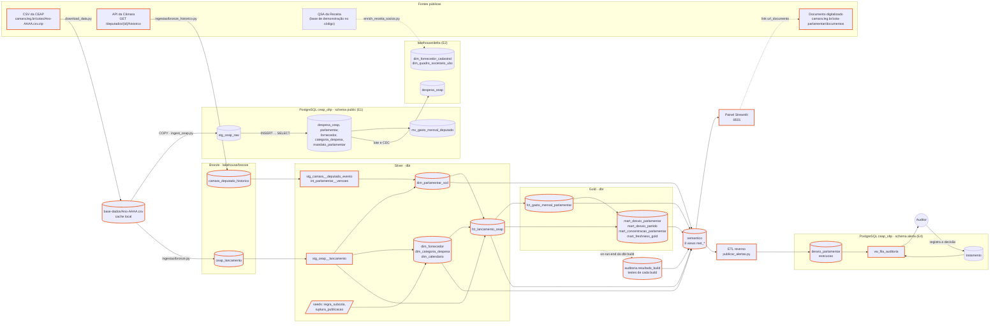

# Linhagem de dados

Esta página mostra o caminho do dado **da fonte pública até o consumo**: o CSV da Câmara, a API de
histórico dos deputados e o QSA da Receita, passando pelo PostgreSQL, pela Bronze, pela Silver, pela
Gold e pela camada semântica, até o painel e o ETL reverso. Quem olha o painel deve conseguir seguir
qualquer número até a coluna do arquivo público de onde ele veio.

- O que cada tabela é, quem é o dono e quais são as colunas principais: [Catálogo](catalogo.md).
- Tipo e descrição de cada coluna das camadas do dbt: [Dicionário de dados](dicionario-de-dados.md).
- A linhagem gerada pelo dbt (`dbt docs`) cobre só um trecho do caminho; ver
  [o que o dbt docs cobre](#dbt-docs-o-que-cobre-e-o-que-não-cobre).

## Visão de ponta a ponta

Em laranja, o caminho de cada número que aparece no painel e na fila do auditor. As demais caixas
são o ramo transacional e analítico da E1/E2, que lê o **mesmo arquivo** da Câmara, mas não alimenta o
painel.



!!! warning "Por que o OLTP não está entre a fonte e a Bronze"
    O fluxo pedido na issue era *fonte → OLTP → Bronze → Silver → Gold*. Ele valia até a E2. Na E3
    a Squad decidiu ([ADR-0004](adr/0004-avaliacao-etl-relacional-postgres-vs-lakehouse-direto.md))
    que a Bronze lê o CSV **direto do cache** `base-dados/`, sem passar pelo PostgreSQL. O código atual
    (`ingestao/bronze.py`) confirma isso. Hoje o PostgreSQL aparece em dois pontos do desenho:

    1. **Ramo paralelo da E1/E2**: o mesmo arquivo da Câmara é carregado no OLTP, que alimenta o
       lakehouse da E2 (`lakehouse/delta/despesa_ceap`) e a consulta otimizada com `EXPLAIN`.
       Nenhum número do painel vem desse ramo.
    2. **Destino do ETL reverso**: o schema `alerta` recebe o top 15 da camada semântica.

    A fonte comum aos dois ramos é o arquivo `base-dados/Ano-AAAA.csv`. Por isso a mesma coluna pública
    (por exemplo, `vlrLiquido`) pode ser seguida pelos dois caminhos; ver
    [linhagem por coluna](#linhagem-por-coluna-do-csv-às-camadas).

## Trecho a trecho

| # | De → Para | Mecanismo | Quando roda | O que muda no dado | Como se confere |
| :---: | :--- | :--- | :--- | :--- | :--- |
| 1 | Portal da Câmara → `base-dados/Ano-AAAA.csv` | `scripts/download_data.py` (serviço `ingestion`) | Na subida, **só se o arquivo não existir** no cache | Nada: o `.zip` é descompactado | Tamanho mínimo do arquivo (sem checksum) |
| 2 | Cache → OLTP (`stg_ceap_raw` → tabelas normalizadas) | `COPY` + `INSERT ... SELECT` em `scripts/ingest_ceap.py` | Na subida; pulada se `despesa_ceap` já tiver 785.754 linhas | Tipagem `NUMERIC(12,2)`; valor vazio vira 0; linhas sem `nuDeputadoId` descartadas; normalização em dimensões | Contagem impressa no fim da carga |
| 3 | OLTP → `delta/despesa_ceap` (E2) | Lote (`batch_ingest_lakehouse.py`) e CDC (`cdc_stream_consumer.py`) | Na subida (`scripts/main.py`) | Desnormalização; valores para `DOUBLE` | `scripts/test_e2_pipeline.py`, testes 1 a 4 |
| 4 | QSA (demonstração) → `delta/dim_*` (E2) | `scripts/enrich_receita_socios.py` | Na subida | Resolução recursiva do beneficiário final | `test_e2_pipeline.py`, teste 5 |
| 5 | Cache → `bronze/ceap_lancamento` | `ingestao/bronze.py`, asset Dagster `bronze/ceap_lancamento` | `e3-pipeline` na subida; job `ingestao_ceap` diário às 06:00 (ano corrente); backfill por ano | Texto fiel; `cpf` descartado; acréscimo de `_hash_lancamento`, `_arquivo_origem`, `_ingerido_em` | `dbt source freshness`; `unique` em `_hash_lancamento`; `assert_todos_os_anos_presentes` |
| 6 | API da Câmara → `bronze/camara_deputado_historico` | `ingestao/bronze_historico.py`, asset `bronze/camara_deputado_historico` | Job `transformacao` (disparado pelo sensor após cada ingestão bem-sucedida) | Um registro por evento, texto; nada é gravado se mais de 1% das chamadas falhar | `dbt source freshness` |
| 7 | Bronze → Silver | `dbt build` (staging, intermediate, core) | Job `transformacao` | Tipagem; SCD tipo 2 a partir da API; dimensões; fato atômico com flags de janela | `assert_fato_reconcilia_com_bronze` (mesma contagem e mesma soma); testes de SCD e de domínio ([lista](testes.md)) |
| 8 | Silver → Gold | `dbt build` (gestao) | Job `transformacao` | Agregação mensal, mediana da UF, rankings, concentração | `assert_gold_reconcilia_com_fato`, `assert_desvio_alocado_reconcilia`, contratos 🔒 |
| 9 | Gold e Silver → `semantico` | `dbt build` (semantic), views. A série mensal sai da Gold; os lançamentos com o link do documento saem do fato da Silver | Job `transformacao`; as views são lidas na hora | Regras de negócio (top 15, mínimo de 5 deputados), rótulos, idade dos dados; CPF de pessoa física mascarado (`mascara_cpf`) | `assert_semantico_gasto_consistente`, `assert_semantico_desvio_consistente`, `assert_semantico_sem_cpf_completo`, `grao_unico`, contratos 🔒 |
| 9a | Resultado dos testes → `auditoria.resultado_build` → `semantico.met_qualidade_build` | Hooks `on-run-start` e `on-run-end` do dbt (`macros/registra_build.sql`) | No fim de cada `dbt build` | Contagem dos testes por resultado | O selo do painel; `scripts/verificar_consumo_duplo.py` |
| 10 | `semantico` → Painel | Leitura `read_only` em `painel/app.py` (cache de 5 min); os lançamentos são lidos só para o parlamentar e a categoria escolhidos | Ao abrir o painel e a cada seleção | Nenhuma conta: só filtra, ordena, escolhe e formata | `scripts/verificar_consumo_duplo.py` |
| 10a | Painel → documento na Câmara | Link `url_documento` publicado no próprio CSV | Quando alguém clica | Nada: é o endereço publicado pela Câmara | [Exemplo 3](#exemplo-3-do-desvio-no-painel-até-o-documento-na-câmara) |
| 11 | `semantico` → `alerta.desvio_parlamentar` | `etl_reverso/publicar_alertas.py`, asset `alerta/desvio_parlamentar_postgres` | No fim do job `transformacao` (push diário), 3 tentativas | Só o top 15 (`em_alerta`); `desvio_acumulado` arredondado a 2 casas; um retrato por `referencia_dados` | Asset check `alerta_igual_a_camada_semantica` |
| 12 | `alerta` → Auditor | `alerta.vw_fila_auditoria` | Quando o auditor abre a fila | Junta o retrato mais recente com a última decisão | `etl_reverso/exemplo_auditor.sql` |

## Linhagem por coluna: do CSV às camadas

As colunas mais usadas, lado a lado nos dois ramos. A primeira coluna é o nome no arquivo público.

| CSV da Câmara | OLTP (`public`) | Delta E2 `despesa_ceap` | Bronze `ceap_lancamento` | Silver `fct_lancamento_ceap` (via `stg_ceap__lancamento`) |
| :--- | :--- | :--- | :--- | :--- |
| `vlrLiquido` | `despesa_ceap.valor_liquido` `NUMERIC(12,2)`, vazio → 0 | `valor_liquido` `DOUBLE` | `vlrLiquido` (texto) | `valor_liquido` `DECIMAL(14,2)` |
| `nuDeputadoId` | `parlamentar.id_deputado`, `despesa_ceap.id_deputado` | `id_deputado` | `nuDeputadoId` | `id_deputado` |
| `ideCadastro` | `parlamentar.ide_cadastro` | — | `ideCadastro` | `stg.id_cadastro_camara` → chave de junção com a API no SCD |
| `numAno`, `numMes` | `ano_competencia`, `mes_competencia` | `ano_competencia` (partição), `mes_competencia` | `numAno`, `numMes` | `competencia` = `make_date(numAno, numMes, 1)` |
| `sgPartido` ⚠️ | `mandato_parlamentar.sigla_partido`, `despesa_ceap.sigla_partido_emissao` | `sigla_partido_emissao` | `sgPartido` | `sigla_partido_publicada` (só auditoria; **não** é usado para agrupar) |
| `sgUF` | `mandato_parlamentar.sigla_uf`, `despesa_ceap.sigla_uf_emissao` | `sigla_uf_emissao` | `sgUF` | `sigla_uf_publicada` (`NA` → nulo) |
| `numSubCota`, `txtDescricao` | `categoria_despesa` | `num_subcota`, `subcota_descricao` | `numSubCota`, `txtDescricao` | `num_subcota` → `dim_categoria_despesa` |
| `txtCNPJCPF` 👤, `txtFornecedor` | `fornecedor.cnpj_cpf`, `fornecedor.razao_social` | `cnpj_cpf`, `razao_social` | `txtCNPJCPF`, `txtFornecedor` | `sk_fornecedor` = md5(dígitos do documento ou nome) → `dim_fornecedor` |
| `datEmissao` | `despesa_ceap.data_emissao` | `data_emissao` | `datEmissao` | `data_emissao`; `data_referencia_scd` = `coalesce(data_emissao, competencia)` |
| `ideDocumento` | `despesa_ceap.ide_documento` | `ide_documento` | `ideDocumento` | `id_documento_camara` (0 → nulo; **não** é chave) |
| `urlDocumento` | `despesa_ceap.url_documento` | — | `urlDocumento` | `url_documento` |
| todas as 32 | — | — | `_hash_lancamento` = md5 de todas | `id_lancamento` (chave do fato) |
| nome do arquivo | — | — | `_arquivo_origem` | `arquivo_origem` |
| `cpf` 👤 | `parlamentar.cpf` | — | **descartado** | — |
| `txtPassageiro` 👤 | `despesa_ceap.passageiro` | `passageiro` | `txtPassageiro` | **não selecionado** |

E da API de histórico (fonte do partido e da UF usados em toda a Gold):

| Campo da API | Bronze `camara_deputado_historico` | Silver |
| :--- | :--- | :--- |
| `id` | `id` | `stg_camara__deputado_evento.id_cadastro_camara` |
| `siglaPartido` | `siglaPartido` | `sigla_partido` → `int_parlamentar__versoes` → `dim_parlamentar_scd.sigla_partido` |
| `siglaUf` | `siglaUf` | `sigla_uf` → `int_parlamentar__versoes` → `dim_parlamentar_scd.sigla_uf` |
| `dataHora` | `dataHora` | `data_hora_evento` → `inicio_versao` → `valido_de` / `valido_ate` |

## Exemplo 1: o desvio acumulado do painel até o CSV

O bloco 1 do painel mostra, para cada parlamentar do top 15, a barra **"Desvio acumulado acima da
mediana da UF (R$)"**. Este é o caminho desse número:

```mermaid
flowchart RL
    p["Painel · bloco 1<br/>barra 'Desvio acumulado'"] --> s["semantico.met_parlamentar<br/>desvio_acumulado"]
    s --> g2["gold.mart_desvio_parlamentar<br/>desvio_acumulado"]
    g2 --> g1["gold.fct_gasto_mensal_parlamentar<br/>desvio_deputado_mes<br/>= gasto_deputado_mes − mediana_uf_mes"]
    g1 --> f["silver.fct_lancamento_ceap<br/>valor_liquido"]
    f --> st["silver.stg_ceap__lancamento<br/>valor_liquido"]
    st --> b["bronze/ceap_lancamento<br/>vlrLiquido"]
    b --> c["base-dados/Ano-AAAA.csv<br/>vlrLiquido"]
    c --> o["Câmara<br/>Ano-AAAA.csv.zip · vlrLiquido"]
```



| Passo | Tabela | Coluna | O que acontece | Onde está o código |
| :---: | :--- | :--- | :--- | :--- |
| 0 | Painel, bloco 1 | eixo do gráfico | Só formata em R$; ordena por `posicao_ranking`; filtra `em_alerta` | `painel/app.py` |
| 1 | `semantico.met_parlamentar` | `desvio_acumulado` | Repassa a coluna da Gold, sem conta | `dbt_ceap/models/semantic/met_parlamentar.sql` |
| 2 | `gold.mart_desvio_parlamentar` | `desvio_acumulado` | Soma, mês a mês, `desvio_deputado_mes` dos meses com `is_competencia_comparavel` (um valor por deputado × mês) | `dbt_ceap/models/gestao/mart_desvio_parlamentar.sql` |
| 3 | `gold.fct_gasto_mensal_parlamentar` | `desvio_deputado_mes` | `gasto_deputado_mes − mediana_uf_mes`. `gasto_deputado_mes` = soma de `valor_liquido` do deputado no mês; `mediana_uf_mes` = mediana desse total entre os deputados da mesma UF com gasto no mês. Só 57ª Legislatura e sem lideranças | `dbt_ceap/models/gestao/fct_gasto_mensal_parlamentar.sql` |
| 4 | `silver.fct_lancamento_ceap` | `valor_liquido` | Repassa o valor; liga o lançamento à versão do parlamentar vigente na data do gasto (`sk_parlamentar`) | `dbt_ceap/models/core/fct_lancamento_ceap.sql` |
| 5 | `silver.stg_ceap__lancamento` | `valor_liquido` | `vlrLiquido::decimal(14,2)` | `dbt_ceap/models/staging/stg_ceap__lancamento.sql` |
| 6 | `bronze/ceap_lancamento` | `vlrLiquido` | Cópia em texto; `_arquivo_origem` diz de qual arquivo veio a linha | `ingestao/bronze.py` |
| 7 | `base-dados/Ano-AAAA.csv` | `vlrLiquido` | Cópia local do arquivo da Câmara | `scripts/download_data.py` |
| 8 | Fonte pública | `vlrLiquido` | "Valor efetivamente debitado da cota", publicado pela Câmara | `http://www.camara.leg.br/cotas/Ano-AAAA.csv.zip` |

O número também depende de três entradas que não são o valor:

- **UF da mediana:** `fct_gasto_mensal_parlamentar.sigla_uf` vem de `dim_parlamentar_scd`, ou seja,
  do campo `siglaUf` da **API de histórico**, e não do `sgUF` do CSV.
- **Meses que entram:** `is_competencia_comparavel` vem de `dim_calendario`, que combina a maturação
  de 4 meses (`var meses_maturacao` em `dbt_project.yml`) com a primeira ruptura do seed
  `ruptura_publicacao`. Mudar o seed muda o número sem que a fonte tenha mudado.
- **Mês do gasto:** `competencia` vem de `numAno` e `numMes` do CSV.

O mesmo número segue para o **ETL reverso**: `alerta.desvio_parlamentar.desvio_acumulado` é
`met_parlamentar.desvio_acumulado` arredondado a 2 casas (`etl_reverso/publicar_alertas.py`), e o
auditor o vê em `alerta.vw_fila_auditoria`.

No ramo paralelo da E1/E2, a mesma coluna pública `vlrLiquido` vira `despesa_ceap.valor_liquido` no
OLTP e `valor_liquido` no Delta da E2. Esses valores **não** entram no cálculo acima.

### Como conferir com os dados

Com a plataforma no ar, na raiz do repositório, abra o banco analítico **só para leitura** (por
exemplo, `duckdb -readonly lakehouse/ceap.duckdb`). As consultas usam as tabelas da Gold e da
Silver e leem a Bronze direto do Delta.

```sql
INSTALL delta; LOAD delta;

-- 1. O número do painel: o primeiro do ranking
SET VARIABLE dep = (SELECT id_deputado FROM semantico.met_parlamentar WHERE posicao_ranking = 1 LIMIT 1);
SELECT rotulo, desvio_acumulado FROM semantico.met_parlamentar WHERE id_deputado = getvariable('dep');

-- 2. O mesmo número refeito a partir do desvio mensal da Gold
SELECT sum(desvio_deputado_mes) AS desvio_acumulado
FROM (SELECT DISTINCT id_deputado, competencia, desvio_deputado_mes
      FROM gold.fct_gasto_mensal_parlamentar
      WHERE id_deputado = getvariable('dep') AND is_competencia_comparavel);

-- 3. Gasto do mês na Gold = soma dos lançamentos no fato
SELECT g.competencia, g.gasto_deputado_mes, g.mediana_uf_mes, g.desvio_deputado_mes,
       (SELECT sum(f.valor_liquido) FROM silver.fct_lancamento_ceap f
         WHERE f.id_deputado = g.id_deputado AND f.competencia = g.competencia
           AND f.is_legislatura_alvo AND NOT f.is_lideranca) AS soma_do_fato
FROM (SELECT DISTINCT id_deputado, competencia, gasto_deputado_mes, mediana_uf_mes, desvio_deputado_mes
      FROM gold.fct_gasto_mensal_parlamentar
      WHERE id_deputado = getvariable('dep') AND is_competencia_comparavel) g
ORDER BY g.competencia
LIMIT 3;

-- 4. Do fato até a Bronze, pela chave do lançamento (id_lancamento = _hash_lancamento)
SELECT f.id_lancamento, f.valor_liquido, b.vlrLiquido, b._arquivo_origem,
       b.numAno, b.numMes, b.nuDeputadoId, b.ideDocumento, b.urlDocumento
FROM silver.fct_lancamento_ceap f
JOIN delta_scan('lakehouse/bronze/ceap_lancamento') b ON b._hash_lancamento = f.id_lancamento
WHERE f.id_deputado = getvariable('dep') AND f.is_competencia_comparavel AND NOT f.is_lideranca
ORDER BY f.valor_liquido DESC
LIMIT 5;
```

Para fechar no arquivo público, procure a mesma linha no CSV indicado em `_arquivo_origem`,
usando os valores do passo 4 (`ideDocumento` sozinho não basta: ele se repete em até 9 linhas):

```sql
SELECT nuDeputadoId, txNomeParlamentar, numAno, numMes, txtFornecedor, vlrLiquido, urlDocumento
FROM read_csv('base-dados/Ano-2024.csv', delim=';', header=true, all_varchar=true,
              quote='"', escape='"', strict_mode=false)
WHERE nuDeputadoId = '<nuDeputadoId do passo 4>'
  AND ideDocumento = '<ideDocumento do passo 4>'
  AND vlrLiquido   = '<vlrLiquido do passo 4>';
```

O `urlDocumento` abre a imagem da nota no portal da Câmara.

!!! tip "Não consulte as views `silver.stg_*` fora do container"
    As views de staging guardam o caminho da Bronze **dentro do container** (`/app/lakehouse/...`),
    então falham quando abertas no host. Por isso o passo 4 lê a Bronze com `delta_scan` direto.

Os testes do `dbt build` garantem as mesmas igualdades em todo o conjunto, não só para um
parlamentar: `assert_fato_reconcilia_com_bronze` (Bronze = fato, em linhas e em soma),
`assert_gold_reconcilia_com_fato` (fato = Gold mensal), `assert_semantico_gasto_consistente`
(fato = todas as views da camada semântica) e o asset check `alerta_igual_a_camada_semantica`
(camada semântica = fila do auditor).

## Exemplo 2: o partido do gráfico de partidos até a API

O bloco 2 do painel agrupa o desvio pelo partido **da data do gasto**. Esse partido não vem do CSV,
e sim da API de histórico, porque a Câmara regrava o `sgPartido` do CSV com o partido atual.

| Passo | Tabela | Coluna | O que acontece |
| :---: | :--- | :--- | :--- |
| 0 | Painel, bloco 2 | eixo das barras | Formata; mostra só `entra_no_ranking` |
| 1 | `semantico.met_partido` | `sigla_partido` | Repassa; aplica o corte de 5 deputados |
| 2 | `gold.mart_desvio_partido` | `sigla_partido` | Agrupa `desvio_alocado` por partido |
| 3 | `gold.fct_gasto_mensal_parlamentar` | `sigla_partido` | Partido da versão SCD do deputado naquele mês |
| 4 | `silver.fct_lancamento_ceap` | `sk_parlamentar` | Versão vigente em `coalesce(data_emissao, competencia)` |
| 5 | `silver.dim_parlamentar_scd` | `sigla_partido` | Partido da versão, com `valido_de` e `valido_ate` |
| 6 | `silver.int_parlamentar__versoes` | `sigla_partido` | Agrupa eventos seguidos com o mesmo partido e UF |
| 7 | `silver.stg_camara__deputado_evento` | `sigla_partido` | `trim(siglaPartido)`, só legislaturas 56 e 57 |
| 8 | `bronze/camara_deputado_historico` | `siglaPartido` | Cópia em texto, com `_extraido_em` e `_origem` (`api` ou `cache`) |
| 9 | Fonte pública | `siglaPartido` | `GET https://dadosabertos.camara.leg.br/api/v2/deputados/{id}/historico` |

O `sgPartido` do CSV continua disponível como `fct_lancamento_ceap.sigla_partido_publicada`, só para
auditoria. O teste `assert_divergencia_csv_vs_historico` mede a diferença entre as duas fontes, e
`mart_desvio_partido.erro_gasto_se_sobrescrito` mostra o erro que se cometeria usando o CSV.

## Exemplo 3: do desvio no painel até o documento na Câmara

O painel fecha a linhagem do exemplo 1 com o documento: no bloco 3, para o parlamentar e a categoria
escolhidos, ele lista os maiores lançamentos com o link do documento digitalizado no site da Câmara.

| Passo | Tabela | Coluna | O que acontece |
| :---: | :--- | :--- | :--- |
| 0 | Painel, bloco 3 | "abrir na Câmara" | Mostra o link; vazio quando a Câmara não publicou o documento ou quando o fornecedor é pessoa física |
| 1 | `semantico.met_lancamento_parlamentar` | `url_documento`, `valor_liquido`, `posicao_valor` | Mesmo recorte do ranking (57ª, sem lideranças, competências comparáveis); ordena por valor dentro de deputado × subcota; mascara o CPF e omite o link de pessoa física (o recibo traz o CPF completo) |
| 2 | `silver.fct_lancamento_ceap` | `url_documento`, `valor_liquido` | Repassa; um lançamento por linha |
| 3 | `silver.stg_ceap__lancamento` | `url_documento` | `nullif(urlDocumento, '')` |
| 4 | `bronze/ceap_lancamento` | `urlDocumento` | Cópia em texto do CSV |
| 5 | Fonte pública | `urlDocumento` | Endereço `camara.leg.br/cota-parlamentar/documentos/publ/...` publicado pela Câmara no CSV |

A soma dos `valor_liquido` de `met_lancamento_parlamentar` é o mesmo gasto de todas as outras views
(`assert_semantico_gasto_consistente`), e a série mensal (`met_parlamentar_mes`) soma o desvio
acumulado de cada parlamentar (`assert_semantico_desvio_consistente`). Assim, o caminho da barra do
ranking até o documento não perde nenhum real no meio.

**Cobertura do link:** com os CSVs baixados em 26/11/2026, a Câmara publicou o documento de 94% dos
lançamentos da janela comparável: 100% das notas eletrônicas e dos recibos e 87% das notas em papel
(tipo 0). Dos que têm link, 4.676 (cerca de 1%) são de pessoa física e ficam sem link no painel (LGPD).
Sem o link, o lançamento continua conferível pelo fornecedor, pela data e pelo valor.

## dbt docs: o que cobre e o que não cobre

O `dbt docs` desenha a linhagem dos modelos do dbt a partir das descrições dos arquivos `.yml`.

| Trecho | Coberto pelo dbt docs? | Onde está documentado |
| :--- | :---: | :--- |
| Fonte pública → `base-dados/` → Bronze (CSV) | **não** | esta página, [trecho a trecho](#trecho-a-trecho) (passos 1 e 5) |
| API da Câmara → Bronze (histórico) | **não** | esta página (passo 6) |
| Fonte → OLTP → Delta E2 (ramo E1/E2) e QSA | **não** | esta página (passos 2 a 4), [Modelo de dados](modelo-de-dados.md), [Lakehouse e CDC](lakehouse.md) |
| Bronze (`sources`) → Silver → Gold → `semantico` | **sim** | dbt docs e [Dicionário de dados](dicionario-de-dados.md) |
| `semantico` → painel e ETL reverso → `alerta` | **não** (o dbt não conhece os consumidores) | esta página (passos 10 a 12), [E4](e4.md) |

A interface do Dagster (`:3000`) mostra um grafo um pouco maior: inclui as duas assets da Bronze e a
asset do ETL reverso, mas também não mostra o download do CSV, o OLTP nem o painel.

**Como gerar.** Com a plataforma no ar (o `lakehouse/ceap.duckdb` precisa existir para o catálogo
trazer os tipos das colunas):

```bash
mkdir -p dbt_ceap/target
docker compose run --rm --no-deps -v ./dbt_ceap/target:/app/dbt_ceap/target e3-pipeline \
    bash -c "cd dbt_ceap && DBT_PROFILES_DIR=. dbt docs generate --static"
```

O resultado é um arquivo único, `dbt_ceap/target/static_index.html`, que abre direto no navegador,
sem servidor. A pasta `dbt_ceap/target/` não é versionada.

**Publicação no site:** ainda não é feita. O workflow `.github/workflows/docs.yml` só roda o
`mkdocs build`; para publicar o dbt docs junto com este site, ele precisa gerar o
`static_index.html` e copiá-lo para dentro de `site/` antes do upload. Até lá, use o arquivo gerado
localmente.

## Lacunas conhecidas na linhagem

| Lacuna | Efeito para quem segue um número | Referência |
| :--- | :--- | :--- |
| O cache `base-dados/` só é baixado quando o arquivo não existe | `_ingerido_em` diz quando a Bronze foi gravada, não quando o arquivo foi baixado da Câmara. A reingestão diária relê o arquivo do cache. | `scripts/download_data.py` |
| O QSA é uma base de demonstração e não chega à Silver, à Gold nem ao painel | Nenhum número do painel depende da Receita Federal | [Enriquecimento societário](enriquecimento.md#base-de-dados-usada) |
| Duas cópias analíticas convivem (Delta E2 e Bronze E3) | Totais calculados no Delta da E2 podem divergir dos do painel (tipos, linhas descartadas, exclusões não propagadas) | [Arquitetura, limitação 10](arquitetura.md#limitações-conhecidas) |
| O partido do OLTP e do Delta E2 vem do `sgPartido` do CSV | Agrupar por partido nesses ramos repete a sobrescrita da Câmara | [ADR-0005](adr/0005-modelagem-dimensional-granularidade-scd-ceap.md) |
| Seeds mudam a janela dos rankings | Um número do painel pode mudar sem mudança na fonte | `dbt_ceap/seeds/ruptura_publicacao.csv` |
| A Câmara não publica o documento de todo lançamento, e o painel omite o de pessoa física | Cerca de 7% dos lançamentos da janela ficam sem link para o documento digitalizado | [Exemplo 3](#exemplo-3-do-desvio-no-painel-até-o-documento-na-câmara) |
