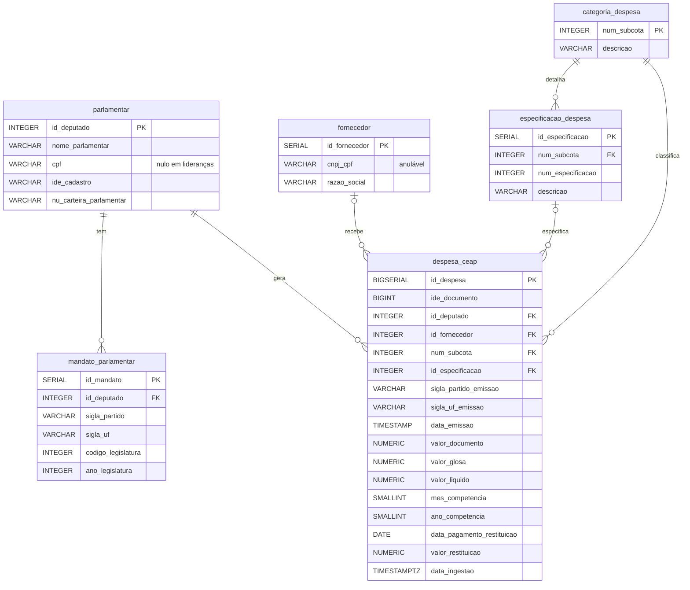

# Modelo de dados

O esquema é criado pelas migrações [`001_create_tables.sql`](https://github.com/taybalau/sbd2-g8-ceap/blob/main/migrations/001_create_tables.sql) e [`002_create_indexes.sql`](https://github.com/taybalau/sbd2-g8-ceap/blob/main/migrations/002_create_indexes.sql).

## Diagrama entidade-relacionamento



Todas as chaves estrangeiras usam `ON DELETE RESTRICT`.

## Tabelas

### `parlamentar`

Deputados federais e **contas de liderança partidária** (ex.: "Liderança do Governo").

| Coluna | Tipo | Observação |
| :--- | :--- | :--- |
| `id_deputado` | `INTEGER` PK | `nuDeputadoId` oficial da Câmara |
| `nome_parlamentar` | `VARCHAR(255)` NOT NULL | |
| `cpf` | `VARCHAR(14)` | Nulo para lideranças |
| `ide_cadastro` | `VARCHAR(30)` | |
| `nu_carteira_parlamentar` | `VARCHAR(30)` | Nulo para lideranças |

### `mandato_parlamentar`

Histórico de **partido, UF e legislatura**. Deputados trocam de legenda durante a legislatura, então o partido não pode ser atributo fixo de `parlamentar`.

Chave única: `(id_deputado, sigla_partido, sigla_uf, codigo_legislatura)`.

### `fornecedor`

Estabelecimentos e prestadores de serviço.

```sql
CONSTRAINT uk_fornecedor_doc_nome UNIQUE NULLS NOT DISTINCT (cnpj_cpf, razao_social)
```

!!! info "Por que `NULLS NOT DISTINCT`?"
    No SQL padrão, `NULL <> NULL` em constraints `UNIQUE`. Fornecedores sem CNPJ (bilhetes aéreos, por exemplo) não eram reconhecidos pelo `ON CONFLICT` e geravam duplicatas na carga ano a ano. A cláusula `NULLS NOT DISTINCT` (PostgreSQL 15+) trata os nulos como iguais e restabeleceu a contagem exata de **785.754** despesas.

### `categoria_despesa`

As **21 subcotas** orçamentárias da CEAP. PK `num_subcota`.

### `especificacao_despesa`

Detalhamento da subcota (ex.: combustível para *Veículos* vs. *Aeronaves*). Chave única `(num_subcota, num_especificacao, descricao)`.

### `despesa_ceap` — livro-razão *insert-only*

A tabela de fatos. Cada linha é um documento fiscal **imutável**: não há `UPDATE` destrutivo. Glosas e restituições têm campos próprios.

| Grupo | Colunas |
| :--- | :--- |
| Identificação | `id_despesa` (PK), `ide_documento` |
| Relacionamentos | `id_deputado`, `id_fornecedor`, `num_subcota`, `id_especificacao` |
| Contexto da emissão | `sigla_partido_emissao`, `sigla_uf_emissao`, `codigo_legislatura` |
| Documento | `numero_documento`, `tipo_documento` (0 = NF, 1 = Recibo, 2 = Exterior, 4 = NF-e), `data_emissao` |
| Valores | `valor_documento`, `valor_glosa`, `valor_liquido` — todos `NUMERIC(12, 2)` |
| Competência | `mes_competencia` (`CHECK 1–12`), `ano_competencia` (`CHECK ≥ 2000`), `parcela` |
| Detalhes | `passageiro`, `trecho`, `numero_lote`, `numero_ressarcimento`, `url_documento` |
| Restituição | `data_pagamento_restituicao`, `valor_restituicao` |
| Auditoria | `data_ingestao` (`DEFAULT CURRENT_TIMESTAMP`) |

### Tabelas de apoio

| Tabela | Finalidade |
| :--- | :--- |
| `schema_migrations` | Registra as migrações já aplicadas (`version`, `applied_at`) |
| `stg_ceap_raw` | Staging `UNLOGGED` com as **32 colunas originais** do CSV, todas `TEXT` |

## Os três carimbos de tempo

| # | Coluna | Significado |
| :---: | :--- | :--- |
| 1 | `data_emissao` | Quando o documento fiscal foi emitido pelo fornecedor (**evento no mundo real**) |
| 2 | `data_pagamento_restituicao` | Quando houve a compensação financeira aos cofres públicos |
| 3 | `data_ingestao` | Quando o banco registrou a linha (**evento no sistema**) |

Separar esses três momentos permite responder tanto "quando o gasto aconteceu" quanto "quando ficamos sabendo dele", que é a base para o CDC da E2.

## Índices (`002_create_indexes.sql`)

| Índice | Colunas | Pergunta que atende |
| :--- | :--- | :--- |
| `idx_despesa_deputado_periodo` | `(id_deputado, ano_competencia, mes_competencia)` | Gasto mensal por deputado e desvio da média |
| `idx_despesa_partido_ano` | `(sigla_partido_emissao, ano_competencia)` | Consumo por partido |
| `idx_despesa_subcota_ano` | `(num_subcota, ano_competencia)` | Categorias mais representativas |
| `idx_despesa_fornecedor_valor` | `(id_fornecedor, valor_liquido)` | Maiores fornecedores |
| `idx_despesa_data_emissao` | `(data_emissao)` | Fins de semana vs. dias úteis |
| `idx_despesa_ide_documento` | `(ide_documento) WHERE ide_documento IS NOT NULL` | Busca pontual de nota (índice parcial) |

## Inconsistências dos dados abertos e como foram tratadas

O modelo aceita a realidade do dataset da Câmara **sem descartar registros**:

| Inconsistência encontrada | Tratamento |
| :--- | :--- |
| Lideranças partidárias sem CPF nem carteira parlamentar | `cpf` e `nu_carteira_parlamentar` anuláveis |
| Telefonia com data de emissão vazia | `data_emissao` anulável |
| Passagens aéreas (SIGEPA) com valor líquido negativo (estornos) | Sem `CHECK` de positividade nos valores |
| Passagens e telefonia sem `ideDocumento` ou com valor 0 | `ide_documento` anulável; índice parcial |
| Fornecedor sem CNPJ/CPF | `cnpj_cpf` anulável + `NULLS NOT DISTINCT` |
