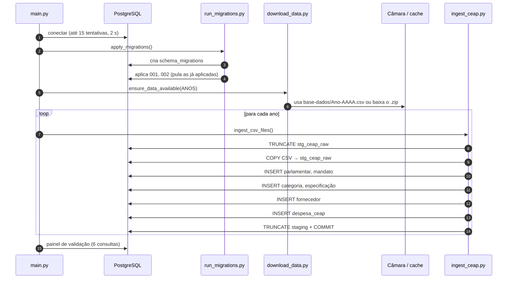

# Pipeline de ingestão

Os scripts ficam em [`scripts/`](https://github.com/taybalau/sbd2-g8-ceap/tree/main/scripts) e são executados pelo container `ceap_ingestion` a partir de `main.py`.

## Fluxo

## Scripts

### `main.py` — orquestrador

1. Lê `DB_HOST`, `DB_PORT`, `DB_NAME`, `DB_USER`, `DB_PASSWORD` e conecta com *retry*.
2. Chama `apply_migrations(conn, "migrations")`.
3. Lê `ANOS` (padrão `2023,2024,2025,2026`) e garante os CSVs com `ensure_data_available`.
4. Executa a carga com `ingest_csv_files`.
5. Roda o [painel de validação](consultas.md) com as seis perguntas.

### `run_migrations.py` — migrações versionadas

- Cria `schema_migrations` se não existir.
- Lista os `.sql` de `migrations/` em **ordem alfanumérica**.
- Executa só os que ainda não estão registrados, e registra cada um após o sucesso.
- Se uma migração falhar, faz `ROLLBACK` e interrompe a execução.

Resultado: **as migrações são idempotentes**. Rodar duas vezes não recria nada.

### `download_data.py` — download com cache

- URL oficial: `http://www.camara.leg.br/cotas/Ano-{ano}.csv.zip`.
- Se `base-dados/Ano-AAAA.csv` já existir (com mais de 1 KB), usa o cache.
- Caso contrário, baixa o `.zip`, **extrai em memória** e grava o CSV.
- Pode ser executado sozinho: `python scripts/download_data.py`.

### `ingest_ceap.py` — carga em dois estágios

**Estágio 1: staging bruto.** O CSV (separador `;`) é carregado com `COPY ... FROM STDIN` na tabela `stg_ceap_raw`, que é `UNLOGGED` (não escreve no WAL) e tem só colunas `TEXT`. Esse é o caminho mais rápido possível para trazer os dados ao banco.

**Estágio 2: normalização em SQL.** A partir do staging, comandos `INSERT ... SELECT` populam as tabelas na ordem das dependências:

| Ordem | Tabela | Estratégia de conflito |
| :---: | :--- | :--- |
| 1 | `parlamentar` | `ON CONFLICT DO UPDATE` (mantém CPF/carteira já conhecidos via `COALESCE`) |
| 2 | `mandato_parlamentar` | `ON CONFLICT DO NOTHING` |
| 3 | `categoria_despesa` | `ON CONFLICT DO UPDATE` da descrição |
| 4 | `especificacao_despesa` | `ON CONFLICT DO NOTHING` |
| 5 | `fornecedor` | `ON CONFLICT DO NOTHING` (com `NULLS NOT DISTINCT`) |
| 6 | `despesa_ceap` | Insert puro (*insert-only*) |

Durante a conversão:

- strings vazias viram `NULL` (`NULLIF(..., '')`) e textos são aparados com `TRIM`;
- datas só são convertidas se casarem com `^\d{4}-\d{2}-\d{2}`;
- valores ausentes recebem padrões explícitos (ex.: `'FORNECEDOR NÃO INFORMADO'`, `'SEM PARTIDO'`, legislatura `57`).

Cada ano é processado e confirmado em **uma transação** (`COMMIT` ao final do ano). No fim, o script imprime um resumo com as contagens de cada tabela e o volume total pago.

## Desempenho medido

| Etapa | Resultado |
| :--- | :--- |
| Carga completa dos 4 anos (785.754 linhas, ~265 MB) | **~97,4 s** |
| Consulta analítica principal (com índices) | **~112 ms** |

Para comparação com as alternativas (tabela flat e CRUD), veja a seção de medição do [ADR-0001](adr/0001-modelagem-transacional-insert-only-ceap.md#medicao).

## Correção relevante: duplicação de fornecedores

Na primeira versão, fornecedores sem CNPJ eram inseridos de novo a cada ano, porque `NULL <> NULL` impedia o `ON CONFLICT` de reconhecê-los. Como o `JOIN` da carga de despesas usa `razao_social` + `cnpj_cpf`, as duplicatas multiplicavam as despesas. A troca para `UNIQUE NULLS NOT DISTINCT` resolveu o problema e restabeleceu a contagem exata de **785.754** registros.
